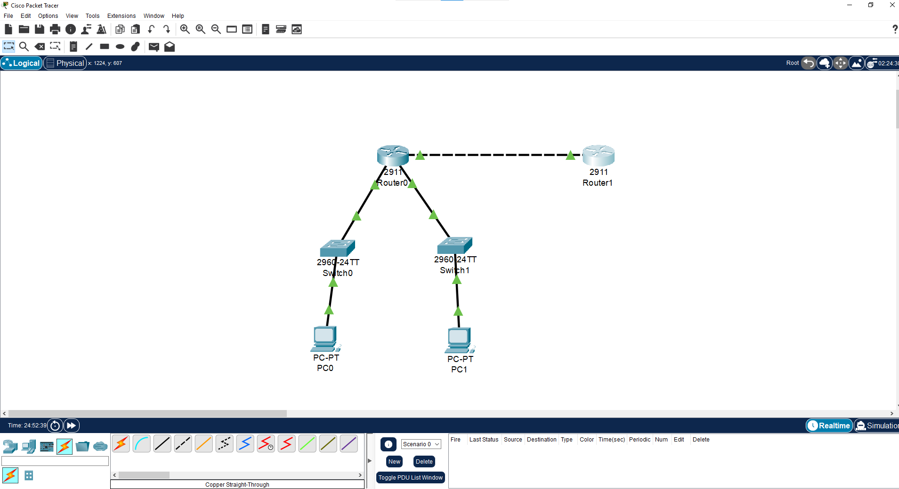
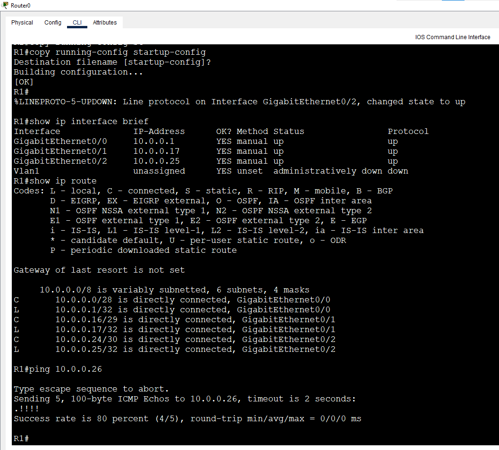
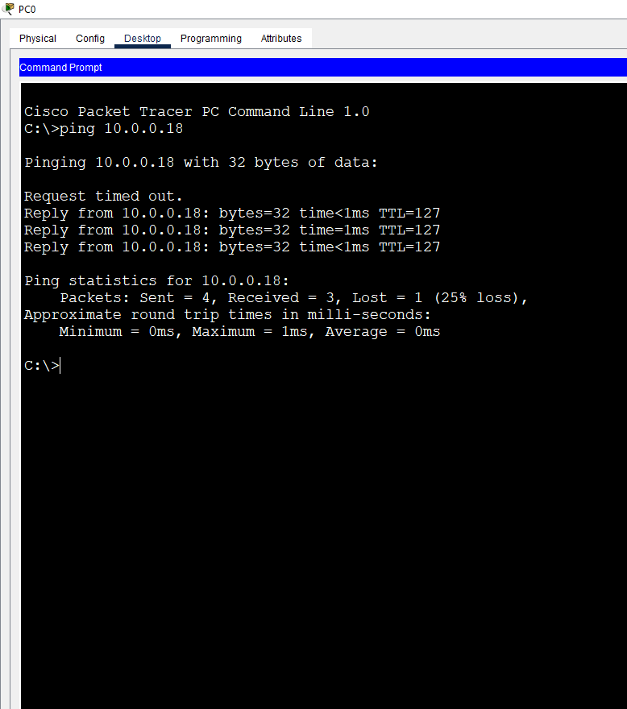

# Lab 4: IPv4 Subnetting (/28 to /30)

**Week 1 - Lab 4** | Topic: Network Fundamentals & Addressing

## Objective
Subnet with small prefixes (/28, /29, /30), understand why /30 is used for router-to-router links, and apply a simple VLSM design where each network gets a block sized to its needs.

## Subnetting Theory

| Prefix | Subnet Mask     | Block Size | Usable Hosts | Subnets from a /24 |
|--------|-----------------|------------|--------------|--------------------|
| /28    | 255.255.255.240 | 16         | 14           | 16                 |
| /29    | 255.255.255.248 | 8          | 6            | 32                 |
| /30    | 255.255.255.252 | 4          | 2            | 64                 |

- Block size = 256 - last mask octet.
- Broadcast = network + block size - 1.
- A /30 gives exactly two usable addresses, which is why it is used for point-to-point links between routers.
- **VLSM:** allocate subnets from the largest to the smallest so that they never overlap and little address space is wasted.

## Paper Exercises

| Address            | Network        | First Host | Last Host | Broadcast |
|--------------------|----------------|------------|-----------|-----------|
| 192.168.5.37/28    | 192.168.5.32   | .33        | .46       | .47       |
| 192.168.5.100/29   | 192.168.5.96   | .97        | .102      | .103      |
| 192.168.5.201/30   | 192.168.5.200  | .201       | .202      | .203      |
| 172.16.3.50/28     | 172.16.3.48    | .49        | .62       | .63       |
| 10.1.1.77/29       | 10.1.1.72      | .73        | .78       | .79       |
| 192.168.9.130/30   | 192.168.9.128  | .129       | .130      | .131      |

**Quick questions**
- Prefix for a router-to-router link: `/30`
- Prefix for 5 hosts: `/29` (6 usable). Prefix for 12 hosts: `/28` (14 usable).
- Usable hosts in a /29: 6

## VLSM Plan (from 10.0.0.0/24)

| Network      | Address     | Prefix | Usable Range  | Broadcast |
|--------------|-------------|--------|---------------|-----------|
| LAN-A        | 10.0.0.0    | /28    | .1 - .14      | .15       |
| LAN-B        | 10.0.0.16   | /29    | .17 - .22     | .23       |
| R1-R2 link   | 10.0.0.24   | /30    | .25 - .26     | .27       |

## Topology


- `PC1 --- SW1 --- R1 (G0/0)`
- `PC2 --- SW2 --- R1 (G0/1)`
- `R1 (G0/2) --- R2 (G0/0)` using a Copper Cross-Over cable (router to router)

## Addressing Table
| Device | Interface | IP Address | Subnet Mask     | Gateway   |
|--------|-----------|------------|-----------------|-----------|
| R1     | G0/0      | 10.0.0.1   | 255.255.255.240 | N/A       |
| R1     | G0/1      | 10.0.0.17  | 255.255.255.248 | N/A       |
| R1     | G0/2      | 10.0.0.25  | 255.255.255.252 | N/A       |
| R2     | G0/0      | 10.0.0.26  | 255.255.255.252 | N/A       |
| PC1    | NIC       | 10.0.0.2   | 255.255.255.240 | 10.0.0.1  |
| PC2    | NIC       | 10.0.0.18  | 255.255.255.248 | 10.0.0.17 |

## Steps

### 1. Configure R1
```
enable
configure terminal
hostname R1
interface g0/0
 description LAN-A-/28
 ip address 10.0.0.1 255.255.255.240
 no shutdown
 exit
interface g0/1
 description LAN-B-/29
 ip address 10.0.0.17 255.255.255.248
 no shutdown
 exit
interface g0/2
 description Link-to-R2-/30
 ip address 10.0.0.25 255.255.255.252
 no shutdown
 exit
end
copy running-config startup-config
```

### 2. Configure R2
```
enable
configure terminal
hostname R2
interface g0/0
 description Link-to-R1-/30
 ip address 10.0.0.26 255.255.255.252
 no shutdown
 exit
end
copy running-config startup-config
```

| Command | Purpose |
|---------|---------|
| `description` | Adds a label to the interface (documentation only) |
| `ip address <IP> <Mask>` | Assigns the address; the mask defines the subnet size |
| `no shutdown` | Enables the interface |
| `copy running-config startup-config` | Saves the configuration |

The switches need no configuration and only forward frames at Layer 2.

### 3. Configure the PCs
Set the IP address, mask and gateway from the addressing table.

## Verification
| Command | Run on | Expected result |
|---------|--------|-----------------|
| `show ip interface brief` | R1 | G0/0, G0/1, G0/2 are `up/up` with the correct IPs |
| `show ip route` | R1 | Three `C` routes: 10.0.0.0/28, 10.0.0.16/29, 10.0.0.24/30 |
| `ping 10.0.0.26` | R1 | Success (`!!!!!`) over the /30 link |
| `ping 10.0.0.18` | PC1 | Replies from PC2 through R1 |



## Observation: Missing Return Route
Pinging `10.0.0.26` (R2) from PC1 fails. R1 forwards the packet, but R2 has no route back to 10.0.0.0/28, so the reply is lost. This is resolved with static routing in Week 4.

## Common Issues & Fixes
| Problem | Likely cause | Fix |
|---------|--------------|-----|
| R1-R2 link is down | Wrong cable type | Use a Copper Cross-Over cable between the two routers |
| Overlapping subnet error on the router | Two interfaces in the same range | Give each interface its own non-overlapping subnet |
| PC cannot reach its gateway | Gateway is outside the PC's subnet | Use the router interface IP in the PC's own subnet |
| Wrong network/broadcast results | Used the wrong block size | Read the prefix first, then calculate the block size |

## Files
- [Download Packet Tracer Lab](./lab%204.pkt)

## Lessons Learned
- Choose the prefix from the number of hosts needed: /30 for links, /29 for up to 6 hosts, /28 for up to 14 hosts.
- Allocate subnets from largest to smallest (VLSM) to avoid overlap and waste.
- Directly connected networks appear as `C` routes automatically, but remote networks need routes in both directions.
