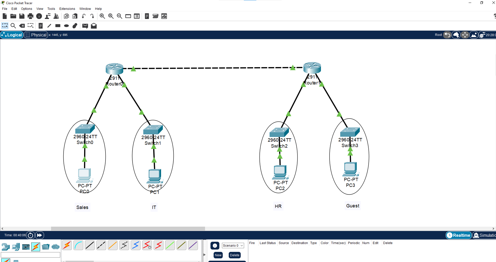
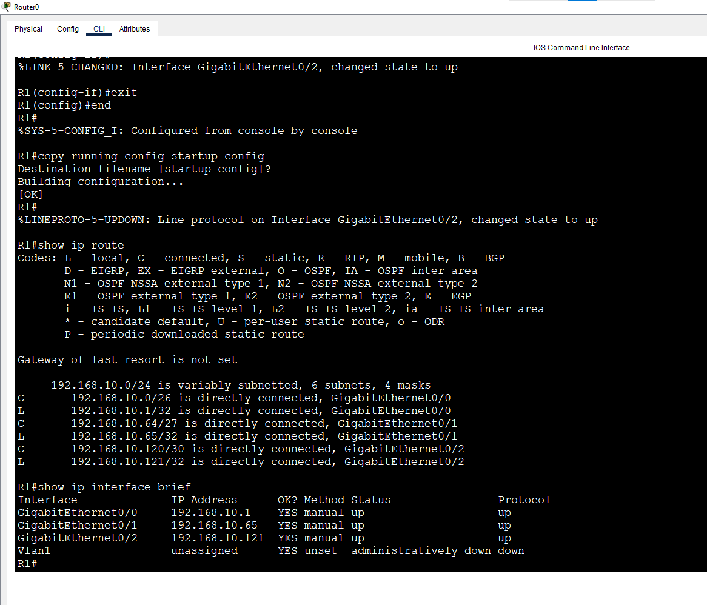
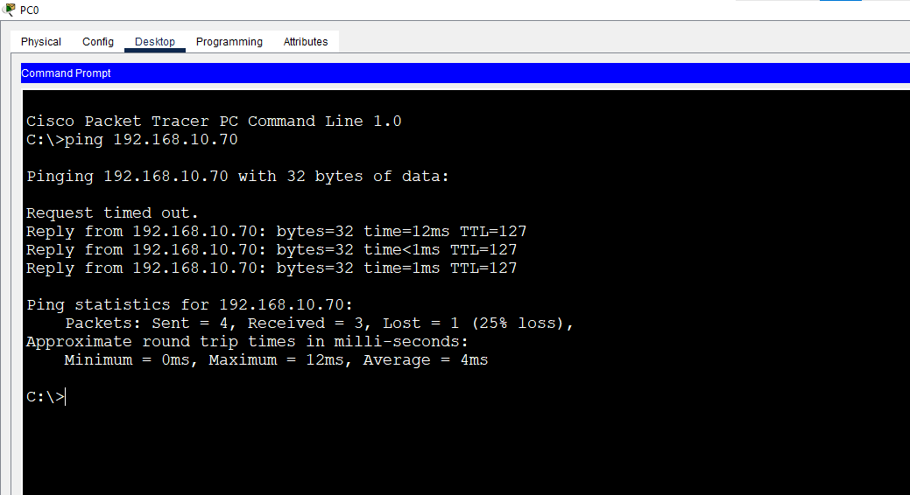

# Lab 5: VLSM Design

**Week 1 - Lab 5** | Topic: Network Fundamentals & Addressing

## Objective
Design the addressing for a company network from a single block (`192.168.10.0/24`) using Variable Length Subnet Masking (VLSM), so every network gets a subnet sized to its needs with no overlap and minimal waste.

## Requirements

| Network     | Hosts Needed |
|-------------|--------------|
| Sales       | 60           |
| IT          | 25           |
| HR          | 10           |
| Guest       | 5            |
| R1-R2 link  | 2            |

## VLSM Method
1. List the networks and sort them from largest to smallest.
2. For each network, choose the smallest prefix where `2^h - 2 >= hosts needed`.
3. Allocate sequentially: each network starts right after the previous broadcast address.
4. Check that every network address is a multiple of its block size and that nothing overlaps.

| Hosts Needed | Prefix | Usable Hosts |
|--------------|--------|--------------|
| up to 62     | /26    | 62           |
| up to 30     | /27    | 30           |
| up to 14     | /28    | 14           |
| up to 6      | /29    | 6            |
| 2 (link)     | /30    | 2            |

## Design Table

| Network    | Hosts | Prefix | Subnet Mask     | Network Address | First Host | Last Host | Broadcast |
|------------|-------|--------|-----------------|-----------------|------------|-----------|-----------|
| Sales      | 60    | /26    | 255.255.255.192 | 192.168.10.0    | .1         | .62       | .63       |
| IT         | 25    | /27    | 255.255.255.224 | 192.168.10.64   | .65        | .94       | .95       |
| HR         | 10    | /28    | 255.255.255.240 | 192.168.10.96   | .97        | .110      | .111      |
| Guest      | 5     | /29    | 255.255.255.248 | 192.168.10.112  | .113       | .118      | .119      |
| R1-R2 link | 2     | /30    | 255.255.255.252 | 192.168.10.120  | .121       | .122      | .123      |

**Unused space:** `192.168.10.124` to `192.168.10.255`, which is `192.168.10.124/30` plus a complete `192.168.10.128/25` available for future growth. In total 124 of the 256 addresses are used.

## Topology


- **R1:** G0/0 to Sales, G0/1 to IT, G0/2 to the R1-R2 link
- **R2:** G0/0 to the R1-R2 link, G0/1 to HR, G0/2 to Guest
- Each LAN has one switch and one PC. The routers are connected with a Copper Cross-Over cable.

## Addressing Table
| Device   | Interface    | IP Address     | Subnet Mask     | Gateway        |
|----------|--------------|----------------|-----------------|----------------|
| R1       | G0/0 (Sales) | 192.168.10.1   | 255.255.255.192 | N/A            |
| R1       | G0/1 (IT)    | 192.168.10.65  | 255.255.255.224 | N/A            |
| R1       | G0/2 (link)  | 192.168.10.121 | 255.255.255.252 | N/A            |
| R2       | G0/0 (link)  | 192.168.10.122 | 255.255.255.252 | N/A            |
| R2       | G0/1 (HR)    | 192.168.10.97  | 255.255.255.240 | N/A            |
| R2       | G0/2 (Guest) | 192.168.10.113 | 255.255.255.248 | N/A            |
| PC-Sales | NIC          | 192.168.10.10  | 255.255.255.192 | 192.168.10.1   |
| PC-IT    | NIC          | 192.168.10.70  | 255.255.255.224 | 192.168.10.65  |
| PC-HR    | NIC          | 192.168.10.100 | 255.255.255.240 | 192.168.10.97  |
| PC-Guest | NIC          | 192.168.10.115 | 255.255.255.248 | 192.168.10.113 |

## Steps

### 1. Configure R1
```
enable
configure terminal
hostname R1
interface g0/0
 description Sales-/26
 ip address 192.168.10.1 255.255.255.192
 no shutdown
 exit
interface g0/1
 description IT-/27
 ip address 192.168.10.65 255.255.255.224
 no shutdown
 exit
interface g0/2
 description Link-to-R2-/30
 ip address 192.168.10.121 255.255.255.252
 no shutdown
 exit
end
copy running-config startup-config
```

### 2. Configure R2
```
enable
configure terminal
hostname R2
interface g0/0
 description Link-to-R1-/30
 ip address 192.168.10.122 255.255.255.252
 no shutdown
 exit
interface g0/1
 description HR-/28
 ip address 192.168.10.97 255.255.255.240
 no shutdown
 exit
interface g0/2
 description Guest-/29
 ip address 192.168.10.113 255.255.255.248
 no shutdown
 exit
end
copy running-config startup-config
```

| Command | Purpose |
|---------|---------|
| `description` | Labels the interface (documentation only) |
| `ip address <IP> <Mask>` | Assigns the address; the mask defines the subnet size |
| `no shutdown` | Enables the interface |
| `copy running-config startup-config` | Saves the configuration |

The switches need no configuration. Each router interface uses the first usable address of its subnet, which is also the PCs' default gateway.

### 3. Configure the PCs
Set the IP address, mask and gateway from the addressing table.

## Verification
| Command | Run on | Expected result |
|---------|--------|-----------------|
| `show ip interface brief` | R1, R2 | All interfaces `up/up` with the correct IPs |
| `show ip route` | R1 | Three `C` routes: .0/26, .64/27, .120/30 |
| `show ip route` | R2 | Three `C` routes: .120/30, .96/28, .112/29 |
| `ping 192.168.10.122` | R1 | Success over the /30 link |
| PC-Sales to PC-IT | PC | Replies (through R1) |
| PC-HR to PC-Guest | PC | Replies (through R2) |




## Observation: Cross-Router Traffic
Before adding routes, a ping from PC-Sales to PC-HR fails, because each router only knows its directly connected networks. This is solved with static routing (covered in Week 4).

## Bonus: Static Routes (Week 4 Preview)
Routes added on each router so the whole network can communicate:

```
! R1
ip route 192.168.10.96 255.255.255.240 192.168.10.122
ip route 192.168.10.112 255.255.255.248 192.168.10.122

! R2
ip route 192.168.10.0 255.255.255.192 192.168.10.121
ip route 192.168.10.64 255.255.255.224 192.168.10.121
```
Format: `ip route <destination network> <mask> <next hop>`. After adding them, PC-Sales can reach PC-HR, and `show ip route` shows `S` (static) routes.

## Common Issues & Fixes
| Problem | Likely cause | Fix |
|---------|--------------|-----|
| Router rejects an address (overlap) | Two subnets overlap | Re-check that each network starts after the previous broadcast |
| R1-R2 link is down | Wrong cable type | Use a Copper Cross-Over cable between routers |
| PC cannot reach its gateway | Wrong mask or gateway | Use the mask of its own subnet and the router IP in that subnet |
| Cross-router ping fails | No route to the remote subnet | Add static routes on both routers |

## Files
[Download Packet Tracer Lab](./lab%205.pkt)

## Lessons Learned
- VLSM saves address space by sizing each subnet to its real need.
- Always allocate from the largest subnet to the smallest to keep blocks aligned and avoid overlap.
- Planning leaves a clean block (`192.168.10.128/25`) free for future networks.
- Routers only know directly connected networks until routes are added in both directions.
