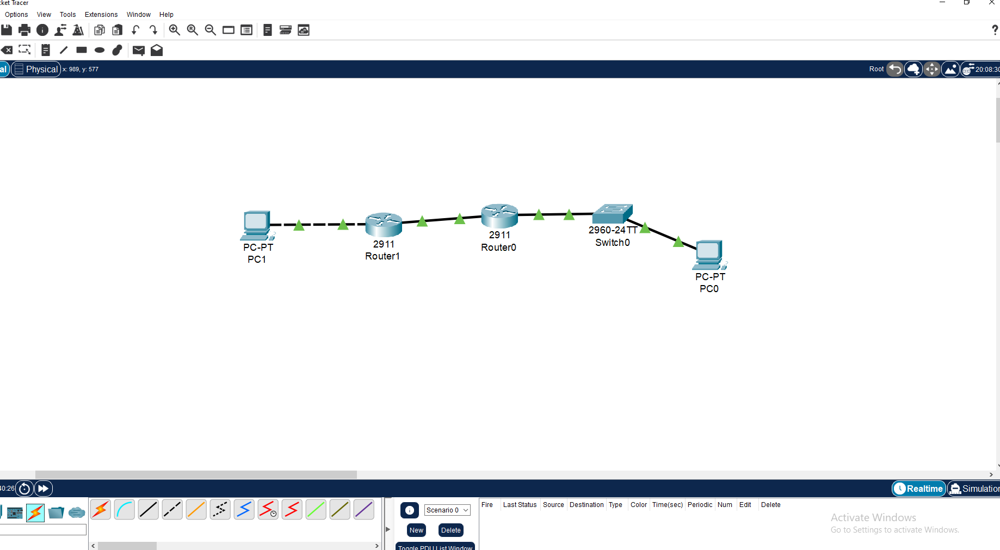
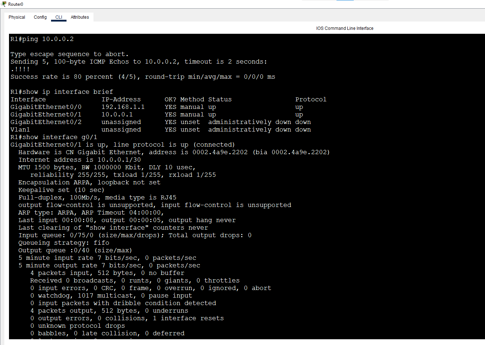
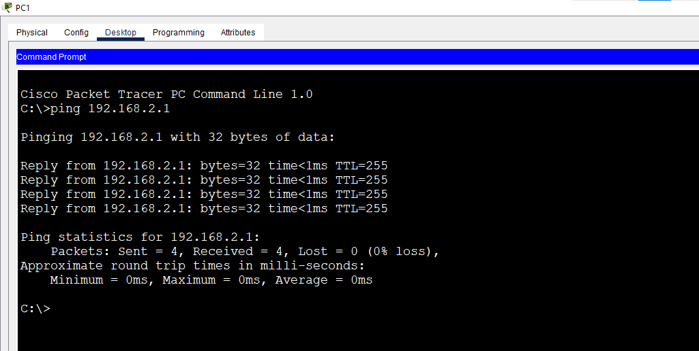
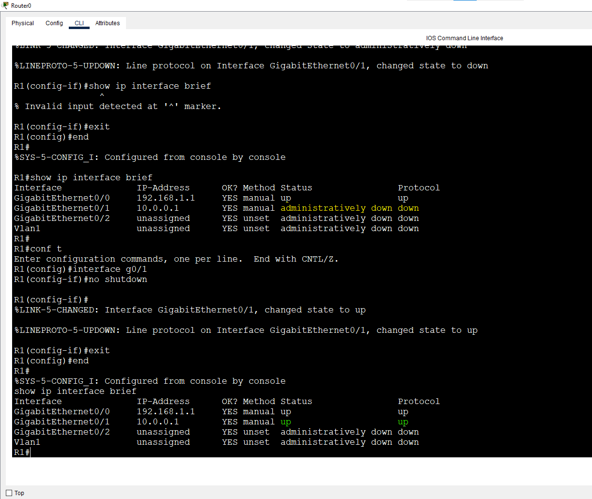

# Lab 6: Cabling & Interface Troubleshooting

**Week 1 - Lab 6** | Topic: Network Fundamentals & Addressing

## Objective
Choose the correct cable for each connection, read interface status, and diagnose common faults layer by layer (Layer 1 to Layer 3).

## Theory

### Cable Types
| Cable            | Used Between                                  | Examples                              |
|------------------|-----------------------------------------------|---------------------------------------|
| Straight-Through | Different device types                        | PC to Switch, Switch to Router        |
| Cross-Over       | Same device types (and PC to Router)         | Router to Router, Switch to Switch    |
| Console (Rollover) | Management PC to the console port          | PC to Router/Switch for configuration |

### Interface Status (`show ip interface brief`)
| Status / Protocol              | Meaning                | Typical Cause                                        |
|--------------------------------|------------------------|------------------------------------------------------|
| `up / up`                      | Working                | -                                                    |
| `administratively down / down` | Disabled by command    | `shutdown` was entered                               |
| `down / down`                  | Layer 1 problem        | Cable unplugged, wrong cable type, remote end off    |
| `up / down`                    | Layer 2 problem        | Encapsulation or clock rate mismatch                 |

### Troubleshooting Method (bottom-up)
1. **Layer 1:** cable, link lights (green = up, red = down).
2. **Layer 2:** interface protocol state, speed and duplex.
3. **Layer 3:** IP address, mask, gateway, then `ping`.

## Topology


| Link                | Cable            | Reason                      |
|---------------------|------------------|-----------------------------|
| PC1 - SW1           | Straight-Through | Different device types      |
| SW1 - R1 (G0/0)     | Straight-Through | Different device types      |
| R1 (G0/1) - R2 (G0/0) | Cross-Over     | Router to router            |
| R2 (G0/1) - PC2     | Cross-Over       | PC directly to router       |

## Addressing Table
| Device | Interface | IP Address   | Subnet Mask     | Gateway     |
|--------|-----------|--------------|-----------------|-------------|
| R1     | G0/0      | 192.168.1.1  | 255.255.255.0   | N/A         |
| R1     | G0/1      | 10.0.0.1     | 255.255.255.252 | N/A         |
| R2     | G0/0      | 10.0.0.2     | 255.255.255.252 | N/A         |
| R2     | G0/1      | 192.168.2.1  | 255.255.255.0   | N/A         |
| PC1    | NIC       | 192.168.1.10 | 255.255.255.0   | 192.168.1.1 |
| PC2    | NIC       | 192.168.2.10 | 255.255.255.0   | 192.168.2.1 |

## Steps

### 1. Configure R1
```
enable
configure terminal
hostname R1
interface g0/0
 ip address 192.168.1.1 255.255.255.0
 no shutdown
 exit
interface g0/1
 ip address 10.0.0.1 255.255.255.252
 no shutdown
 exit
end
copy running-config startup-config
```

### 2. Configure R2
```
enable
configure terminal
hostname R2
interface g0/0
 ip address 10.0.0.2 255.255.255.252
 no shutdown
 exit
interface g0/1
 ip address 192.168.2.1 255.255.255.0
 no shutdown
 exit
end
copy running-config startup-config
```

### 3. Configure the PCs
Set the IP address, mask and gateway from the addressing table. SW1 needs no configuration.

## Baseline Verification
| Command | Run on | Expected result |
|---------|--------|-----------------|
| `ping 192.168.1.1` | PC1 | Replies from R1 |
| `ping 10.0.0.2` | R1 | Replies from R2 |
| `ping 192.168.2.1` | PC2 | Replies from R2 |

A ping from PC1 to PC2 fails at this stage because the routers have no routes to each other's LANs (covered in Week 4).




## Inspection Commands
| Command | Run on | Purpose |
|---------|--------|---------|
| `show ip interface brief` | Router | One-line summary of every interface: IP, Status, Protocol |
| `show interfaces g0/1` | Router | Full detail: line protocol, MAC, speed/duplex, error counters (CRC, collisions) |
| `show running-config interface g0/1` | Router | Configuration of a single interface |
| `show interfaces status` | Switch | Port state (`connected`, `notconnect`, `disabled`), VLAN, duplex, speed |

## Fault Scenarios

Each fault was created, observed and then repaired.

| # | Fault | How it was created | Symptom | Fix |
|---|-------|--------------------|---------|-----|
| 1 | Interface disabled | R1: `interface g0/1`, then `shutdown` | `administratively down / down` | `no shutdown` |
| 2 | Wrong cable type | Replaced the Cross-Over between the routers with a Straight-Through | `down / down`, red link lights | Restore the Cross-Over cable |
| 3 | Cable unplugged | Removed the cable between R1 and R2 | `down / down` | Reconnect the cable |
| 4 | IP in the wrong subnet | R2 G0/0: `ip address 10.0.0.6 255.255.255.252` | Interfaces `up / up` but `ping 10.0.0.2` from R1 fails | Restore `10.0.0.2` |

| Command | Purpose |
|---------|---------|
| `shutdown` | Administratively disables an interface |
| `no shutdown` | Enables an interface |

Key point from fault 4: `up / up` does not guarantee connectivity. `10.0.0.1/30` and `10.0.0.6/30` belong to different subnets, so the problem is at Layer 3.



### Optional: Speed and Duplex Mismatch
```
interface f0/1
 speed 10
 duplex half
```
| Command | Purpose |
|---------|---------|
| `speed` | Sets the port speed manually |
| `duplex` | Sets the port duplex mode manually |

On real hardware a mismatch causes slow performance with CRC errors and late collisions while the port stays `up`. Packet Tracer may not simulate these errors. Restore with `speed auto` and `duplex auto`. Best practice: keep both ends on `auto`.

## Common Issues & Fixes
| Problem | Likely cause | Fix |
|---------|--------------|-----|
| Red link lights between routers | Wrong cable type | Use Cross-Over between routers |
| `administratively down` | Interface was shut down | `no shutdown` |
| `up / up` but ping fails | IP or mask mismatch | Verify both ends are in the same subnet |
| Port `notconnect` on the switch | Cable missing or remote end down | Check the cable and the remote interface |

## Files
- [Download Packet Tracer Lab](./lab%206.pkt)

## Lessons Learned
- Pick the cable by device type: different types use Straight-Through, same types use Cross-Over.
- Read the Status and Protocol columns together to tell Layer 1, 2 and 3 problems apart.
- Troubleshoot bottom-up: cable and lights first, then interface state, then IP addressing.
- An interface can be `up / up` and still fail to communicate if the addressing is wrong.
