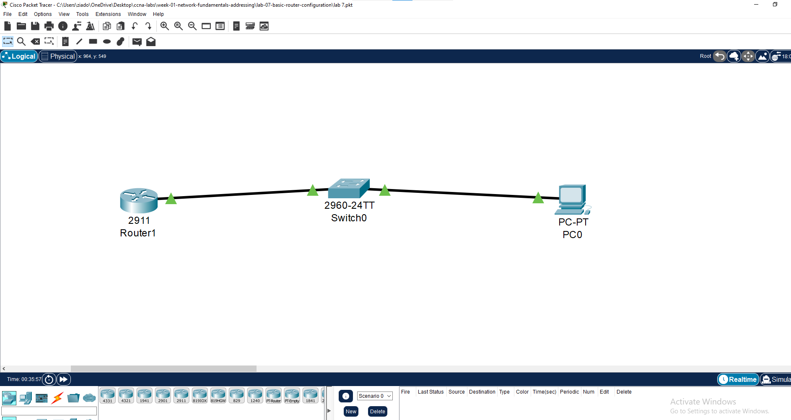
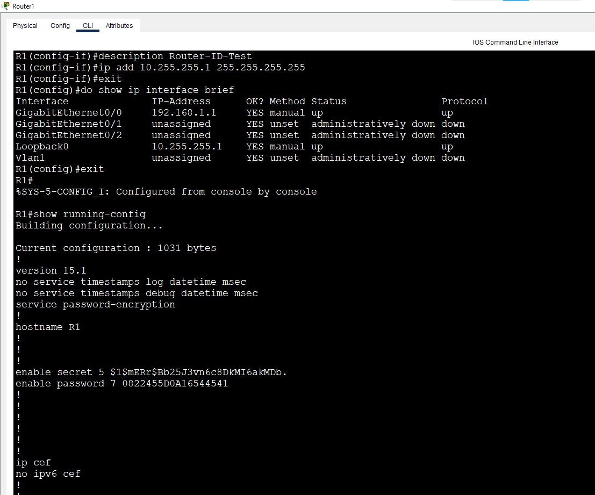
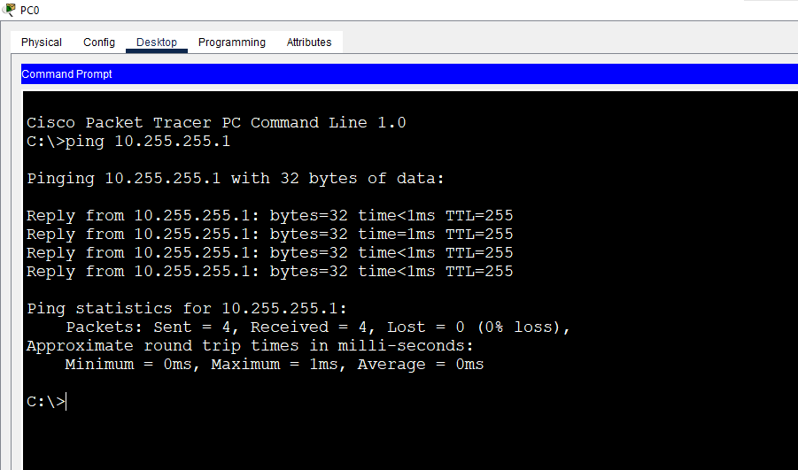

# Lab 7: Basic Router Configuration

**Week 1 - Lab 7** | Topic: Network Fundamentals & Addressing

## Objective
Become comfortable with the Cisco IOS command-line interface, understand the difference between `running-config` and `startup-config`, protect passwords, and use a Loopback interface.

## Topology


`PC1 --- SW1 --- R1 (G0/0)` using Straight-Through cables.

## Addressing Table
| Device | Interface | IP Address   | Subnet Mask     | Gateway     |
|--------|-----------|--------------|-----------------|-------------|
| R1     | G0/0      | 192.168.1.1  | 255.255.255.0   | N/A         |
| R1     | Loopback0 | 10.255.255.1 | 255.255.255.255 | N/A         |
| PC1    | NIC       | 192.168.1.10 | 255.255.255.0   | 192.168.1.1 |

## 1. CLI Modes and Navigation
| Mode             | Prompt           | How to enter                  |
|------------------|------------------|-------------------------------|
| User EXEC        | `R1>`            | Default after login           |
| Privileged EXEC  | `R1#`            | `enable`                      |
| Global Config    | `R1(config)#`    | `configure terminal`          |
| Interface Config | `R1(config-if)#` | `interface g0/0`              |
| Line Config      | `R1(config-line)#` | `line console 0`            |

- `exit` goes back one level.
- `end` or `Ctrl+Z` returns directly to Privileged EXEC.

## 2. CLI Help and Shortcuts
```
?
show ?
s?
sh ip int br
show history
do show ip interface brief
```
| Feature | Description |
|---------|-------------|
| `?` | Lists the commands available in the current mode |
| `show ?` | Lists the options of a command |
| `s?` | Lists all commands starting with "s" |
| Abbreviation | `sh ip int br` equals `show ip interface brief` |
| `Tab` | Completes a partially typed command |
| Up arrow / `show history` | Recalls previous commands |
| `do` | Runs an EXEC command from inside configuration mode |

## 3. Device Information
```
show version
show flash
show clock
clock set 10:30:00 14 October 2026
show clock
```
| Command | Shows |
|---------|-------|
| `show version` | IOS version, uptime, memory, interfaces, configuration register |
| `show flash` | Files stored in flash memory (the IOS image) |
| `clock set` | Sets the clock manually (run from Privileged EXEC) |

**Findings:** Router model: Cisco 2911. IOS version and uptime: `<fill in from show version>`.

## 4. Basic Configuration
```
enable
configure terminal
hostname R1
no ip domain-lookup
banner motd # Authorized Access Only #
line console 0
 logging synchronous
 password cisco
 login
 exit
line vty 0 4
 password cisco
 login
 exit
interface g0/0
 description LAN-to-SW1
 ip address 192.168.1.1 255.255.255.0
 no shutdown
 exit
end
```
`logging synchronous` stops system messages from interrupting the command being typed.

## 5. Passwords
```
configure terminal
enable password cisco123
enable secret MyPass123
end
show running-config
```
```
configure terminal
service password-encryption
end
show running-config
```
| Command | Effect |
|---------|--------|
| `enable password` | Stored in clear text |
| `enable secret` | Stored as a hash; takes priority over `enable password` when both exist |
| `service password-encryption` | Encrypts the remaining plain-text passwords (type 7) |

**Findings:**
- Before `service password-encryption`, the console/vty passwords and `enable password` appeared in clear text in `show running-config`.
- After it, they appeared as type 7 encrypted strings.
- Type 7 is weak and easily reversed, so `enable secret` should always be used for privileged access.

## 6. Loopback Interface
```
configure terminal
interface loopback 0
 description Router-ID-Test
 ip address 10.255.255.1 255.255.255.255
 exit
end
show ip interface brief
```
- A Loopback is a virtual interface: it needs no cable and no `no shutdown`, and stays `up/up` while the router runs.
- The `/32` mask (255.255.255.255) represents a single address.
- A ping from PC1 to `10.255.255.1` succeeds because R1 is PC1's gateway and owns that address.

## 7. Saving and the Reload Test
```
show running-config
show startup-config
```
| Config | Location | Persistence |
|--------|----------|-------------|
| `running-config` | RAM | Lost on reload |
| `startup-config` | NVRAM | Loaded at boot |

**Test:**
1. `copy running-config startup-config` to save everything.
2. Change the hostname without saving:
```
configure terminal
hostname R1-TEST
end
reload
```
3. Answer `no` to "Save?" and press Enter to confirm the reload.

**Result:** after the router booted, the hostname was back to `R1`, because the change existed only in `running-config` and was never saved to `startup-config`.

```
show interfaces description
```
Lists every interface with its status and description.

## Verification
| Command | Run on | Expected result |
|---------|--------|-----------------|
| `show ip interface brief` | R1 | G0/0 and Loopback0 are `up/up` with the correct IPs |
| `ping 192.168.1.1` | PC1 | Replies from R1 |
| `ping 10.255.255.1` | PC1 | Replies from the Loopback address |
| `show startup-config` | R1 | Contains the saved configuration |




## Optional: Telnet Test
From PC1 (Desktop > Telnet / SSH Client), connect to `192.168.1.1` with Telnet. After the vty password (`cisco`), enter `enable` and the secret to confirm the VTY configuration works.

## Common Issues & Fixes
| Problem | Likely cause | Fix |
|---------|--------------|-----|
| Configuration lost after reload | Not saved | Run `copy running-config startup-config` |
| `% Invalid input detected` | Wrong mode or typo | Check the prompt and use `?` for help |
| `clock set` rejected | Run in config mode | Run it from Privileged EXEC (`R1#`) |
| Passwords visible in `show running-config` | Encryption not enabled | Use `service password-encryption` and `enable secret` |

## Files
- [Download Packet Tracer Lab](./lab%207.pkt)
## Lessons Learned
- The prompt tells you which mode you are in, and `?`, Tab and abbreviations speed up work.
- Changes live in `running-config` (RAM) until saved to `startup-config` (NVRAM).
- Use `enable secret`, and add `service password-encryption` as a basic extra layer.
- A Loopback interface is always up and is useful for testing and for later routing protocols.
