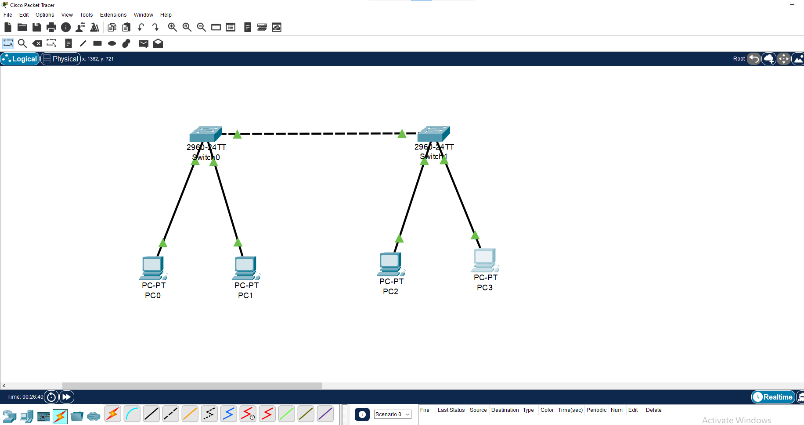
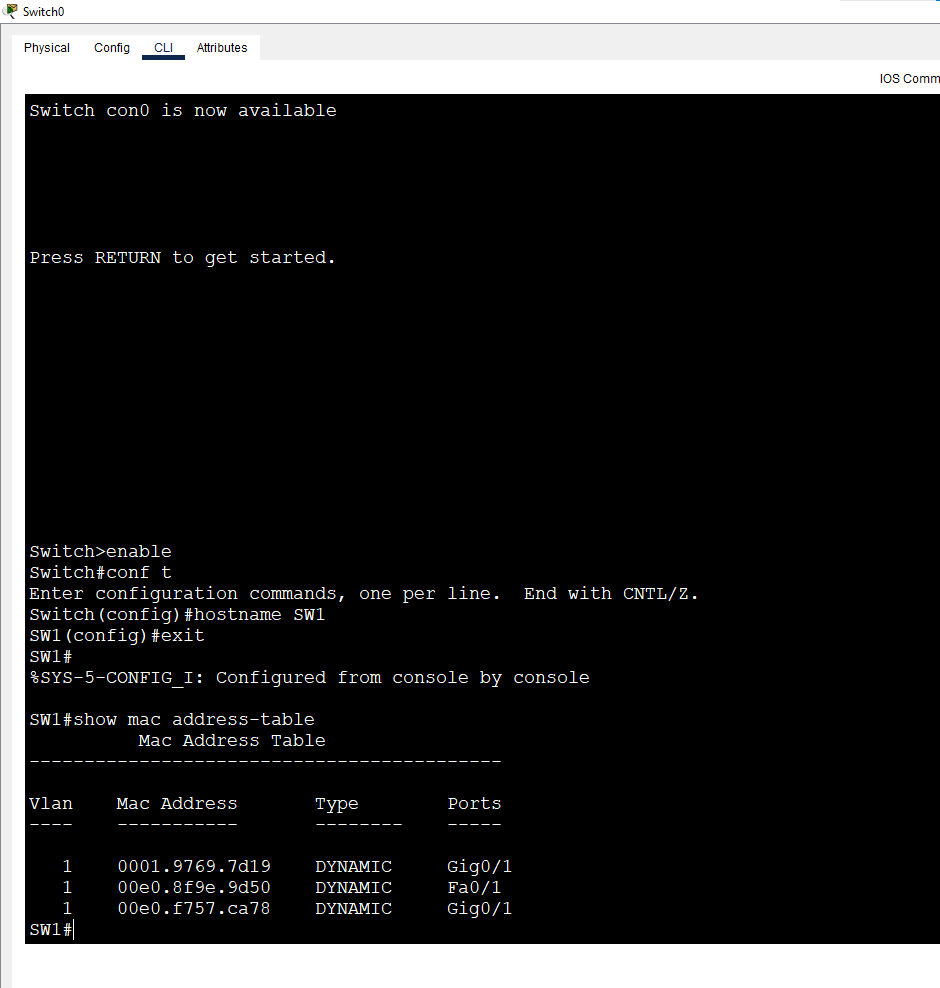
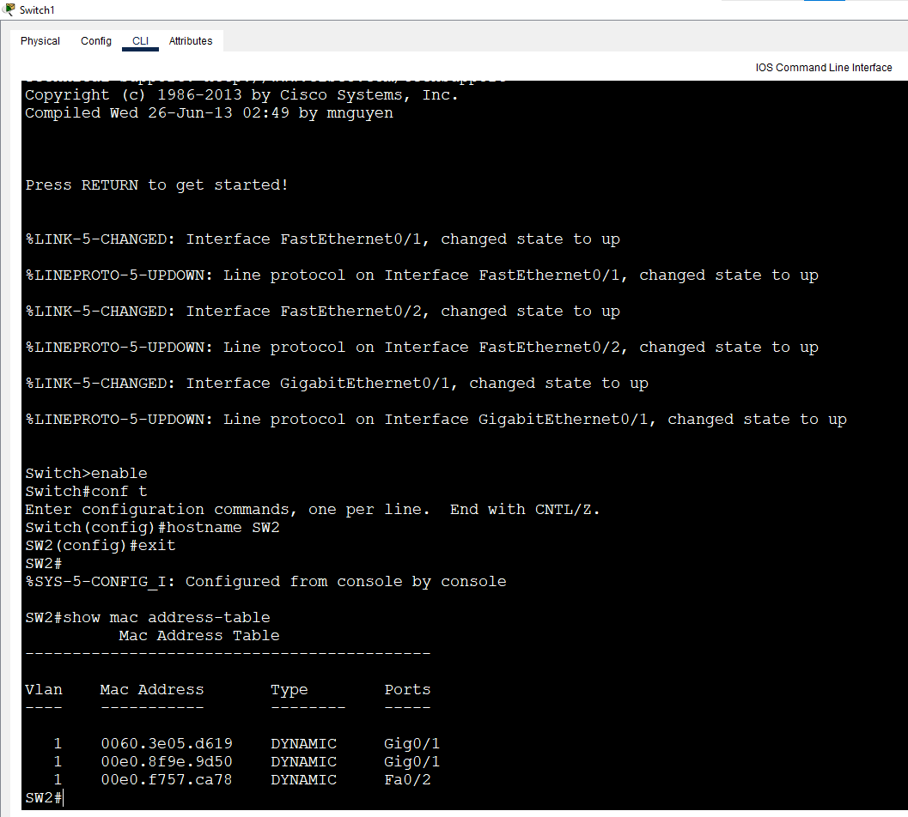
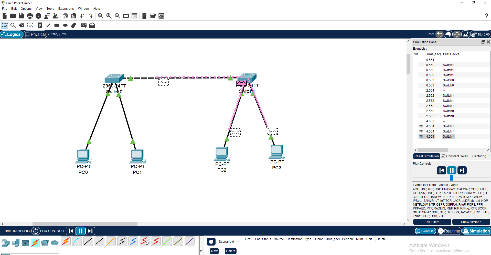

# Lab 8: Switch MAC Address Table

**Week 1 - Lab 8** | Topic: Network Fundamentals & Addressing

## Objective
Understand how a switch builds and uses its MAC address table: learning, flooding, forwarding, filtering and aging, and observe how the tables of two connected switches differ.

## Theory

A MAC address is 48 bits (12 hexadecimal digits), written like `0001.6444.1CE7`. The first half identifies the manufacturer and the second half identifies the network card.

| Function   | Behavior |
|------------|----------|
| Learning   | The switch reads the **source** MAC of every incoming frame and records it with the port (and VLAN) |
| Flooding   | If the **destination** MAC is unknown, or the frame is a broadcast (`FFFF.FFFF.FFFF`), the frame is sent out every port except the one it arrived on |
| Forwarding | If the destination MAC is known, the frame is sent out only that port |
| Filtering  | If the destination is on the same port the frame arrived on, the frame is not forwarded |
| Aging      | Entries not refreshed for 300 seconds (default) are removed |

**Rule of thumb:** a switch learns from the source address and decides using the destination address.

## Topology


| Device | Connected To     | IP Address     | Subnet Mask   |
|--------|------------------|----------------|---------------|
| PC1    | SW1 Fa0/1        | 192.168.10.1   | 255.255.255.0 |
| PC2    | SW1 Fa0/2        | 192.168.10.2   | 255.255.255.0 |
| PC3    | SW2 Fa0/1        | 192.168.10.3   | 255.255.255.0 |
| PC4    | SW2 Fa0/2        | 192.168.10.4   | 255.255.255.0 |
| SW1 - SW2 | Gi0/1 on both | -              | Copper Cross-Over cable |

All devices are in the same subnet, so no gateway is needed. The switches need no configuration.

## Steps

### 1. Start with empty tables
On both switches:
```
clear mac address-table dynamic
show mac address-table
```
| Command | Purpose |
|---------|---------|
| `clear mac address-table dynamic` | Removes all dynamically learned entries (run from Privileged EXEC) |
| `show mac address-table` | Displays the table: Vlan, Mac Address, Type (`DYNAMIC` or `STATIC`), Ports |

### 2. Record the PC MAC addresses
On each PC, run `ipconfig /all` in the Command Prompt and note the Physical Address.

| Device | MAC Address |
|--------|-------------|
| PC1    | 00E0.8F9E.9D50 |
| PC2    | 0001.42E2.3CD6 |
| PC3    | 000C.85E3.3D52 |
| PC4    | 00E0.F757.CA78 |

### 3. Experiment 1: ping within the same switch
From PC1: `ping 192.168.10.2`

**Result:**

| Switch | MAC | Port |
|--------|-----|------|
| SW1 | PC1 | Fa0/1 |
| SW1 | PC2 | Fa0/2 |
| SW2 | PC1 | Gi0/1 |

PC1's ARP Request is a broadcast, so SW1 flooded it out all ports, including the link to SW2. SW2 therefore learned PC1 on `Gi0/1`. The ARP Reply from PC2 is a unicast to PC1, which SW1 already knew, so it was forwarded only to Fa0/1 and never reached SW2.

### 4. Experiment 2: ping across the switches
From PC1: `ping 192.168.10.4`

**Result after both experiments:**

| Switch | MAC | Port |
|--------|-----|------|
| SW1 | PC1 | Fa0/1 |
| SW1 | PC2 | Fa0/2 |
| SW1 | PC4 | Gi0/1 |
| SW2 | PC1 | Gi0/1 |
| SW2 | PC4 | Fa0/2 |

SW1 learned PC4 on the uplink `Gi0/1` from the ARP Reply that arrived through SW2. SW2 learned PC4 on Fa0/2 when PC4 replied.




## Questions and Answers

**1. Why does SW2's table contain PC1's MAC even though PC1 only communicated with PC2?**
PC1's ARP Request is a broadcast. SW1 flooded it out every port, including the link to SW2, and SW2 learned the source MAC (PC1) on the port it arrived on.

**2. Why does PC3's MAC not appear in any table?**
PC3 has not sent any frame. It only received the ARP broadcast and did not reply, because the request was for another IP address. Switches only learn from frames they receive.

**3. How many MAC addresses appear on SW1's Gi0/1, and why can one port hold more than one?**
Three addresses appeared on SW1's Gi0/1 in this run. A port that leads to another switch can hold many MAC addresses, because every device behind that switch is reached through the same port, and SW1 maps each learned MAC to the port its frames arrive on.

## Simulation Mode: Watching Flooding
In Packet Tracer Simulation mode, after clearing both tables, a ping from PC1 to PC3 shows the ARP Request being copied out of every port (flooding), while the ARP Reply travels along a single path.



## Aging Time
```
show mac address-table aging-time
```
Shows how long an unused entry is kept (default 300 seconds). It can be changed:
```
configure terminal
mac address-table aging-time 600
end
```

## Optional: Static MAC Entry
On SW1, bind PC2's MAC address to Fa0/2 (replace the example with the real MAC):
```
configure terminal
mac address-table static 0001.6444.1CE7 vlan 1 interface fastethernet 0/2
end
show mac address-table static
```
| Command | Purpose |
|---------|---------|
| `mac address-table static` | Permanently binds a MAC address to a port; it never ages out |
| `show mac address-table static` | Lists static entries |

Moving PC2's cable to another port then breaks traffic toward PC2, because frames for that MAC keep going out Fa0/2. Remove the entry with the same command prefixed by `no`.

## Common Issues & Fixes
| Problem | Likely cause | Fix |
|---------|--------------|-----|
| MAC table is empty | No traffic generated yet | Ping between devices, then check again |
| A device is missing from the table | It has not sent any frame | Generate traffic from that device |
| Entries disappear | Aging time expired | Generate traffic again or increase the aging time |
| No link between the switches | Wrong cable or port | Use a Cross-Over cable on Gi0/1 of both switches |

## Files
- [Download Packet Tracer Lab](./lab%208.pkt)

## Lessons Learned
- A switch learns MAC addresses from the **source** of incoming frames and forwards based on the **destination**.
- Broadcasts and unknown unicasts are flooded; known unicasts go out a single port.
- A switch only learns devices that have actually sent traffic.
- A port connected to another switch can hold many MAC addresses.
