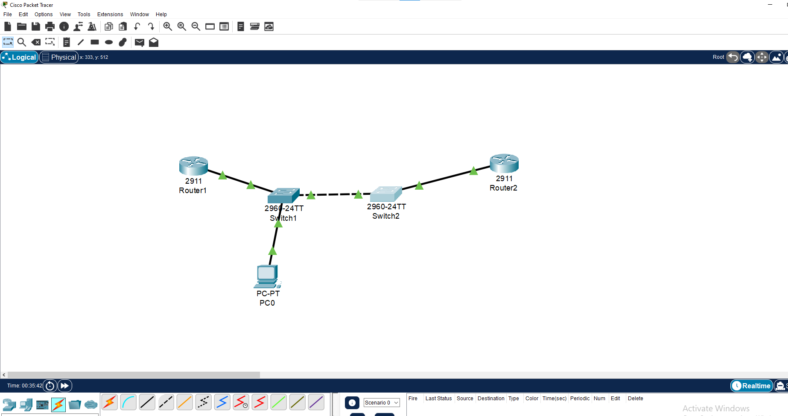
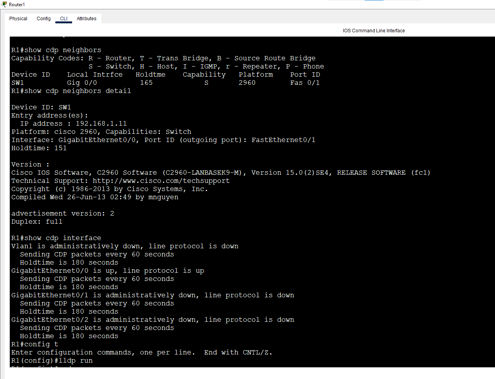
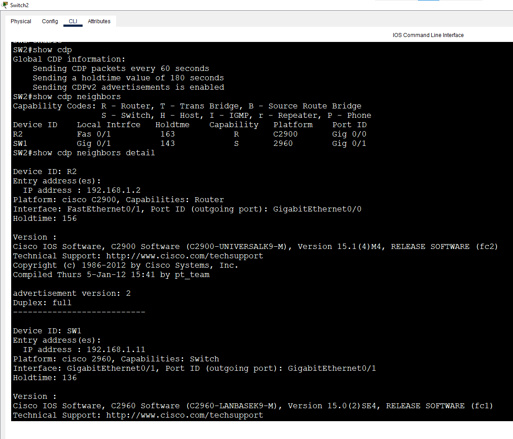
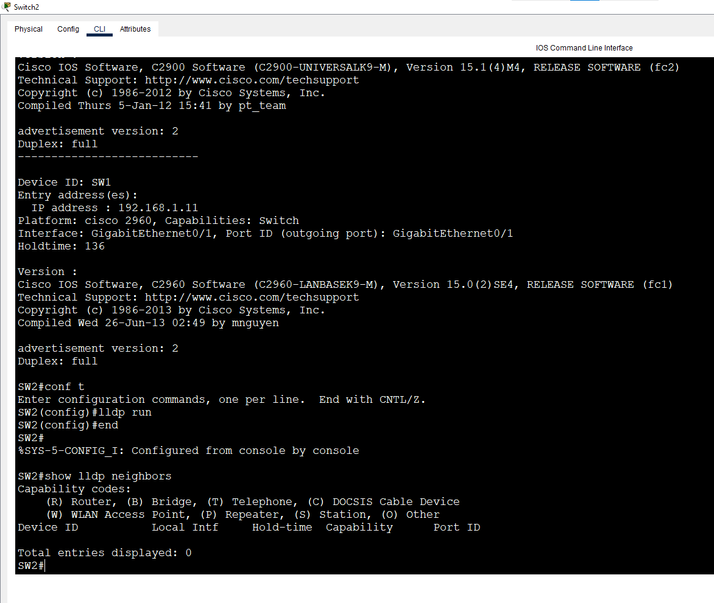

# Lab 9: CDP & LLDP Discovery

**Week 1 - Lab 9** | Topic: Network Fundamentals & Addressing

## Objective
Use neighbor discovery protocols to map a network without prior knowledge of its topology, understand the difference between CDP (Cisco proprietary) and LLDP (open standard), and learn how and why to disable them.

## Theory

| Feature | CDP | LLDP |
|---------|-----|------|
| Standard | Cisco proprietary | IEEE 802.1AB (open) |
| Default on Cisco devices | **Enabled** | **Disabled** |
| Advertisement timer / holdtime | 60 s / 180 s | 30 s / 120 s |
| OSI layer | Layer 2 | Layer 2 |
| Works with other vendors | No | Yes |

- Both protocols discover **directly connected** neighbors only.
- End devices such as PCs do not run CDP or LLDP, so they never appear in the tables.
- The information they reveal (model, IOS version, IP addresses) is valuable to administrators and attackers alike, so they should be disabled on ports facing users or untrusted networks.

## Topology


| Link                      | Cable            |
|---------------------------|------------------|
| R1 G0/0 - SW1 Fa0/1       | Straight-Through |
| SW1 Gi0/1 - SW2 Gi0/1     | Cross-Over       |
| SW2 Fa0/1 - R2 G0/0       | Straight-Through |
| PC1 - SW1 Fa0/2           | Straight-Through |

## Addressing Table
| Device       | Interface | IP Address   | Subnet Mask   |
|--------------|-----------|--------------|---------------|
| R1           | G0/0      | 192.168.1.1  | 255.255.255.0 |
| R2           | G0/0      | 192.168.1.2  | 255.255.255.0 |
| SW1          | VLAN 1    | 192.168.1.11 | 255.255.255.0 |
| SW2          | VLAN 1    | 192.168.1.12 | 255.255.255.0 |
| PC1          | NIC       | 192.168.1.10 | 255.255.255.0 |

## Steps

### 1. Basic configuration
Routers (R1 shown; R2 uses `hostname R2` and `192.168.1.2`):
```
enable
configure terminal
hostname R1
interface g0/0
 ip address 192.168.1.1 255.255.255.0
 no shutdown
 exit
end
```
Switches (SW1 shown; SW2 uses `hostname SW2` and `192.168.1.12`):
```
enable
configure terminal
hostname SW1
interface vlan 1
 ip address 192.168.1.11 255.255.255.0
 no shutdown
 exit
end
```
The hostname of each device is what appears as the Device ID in the neighbor tables.

### 2. CDP
```
show cdp
show cdp neighbors
show cdp neighbors detail
show cdp interface
```
| Command | Shows |
|---------|-------|
| `show cdp` | Global CDP status, timer and holdtime |
| `show cdp neighbors` | Summary: Device ID, Local Interface, Holdtime, Capability, Platform, Port ID (remote interface) |
| `show cdp neighbors detail` | Full detail per neighbor, including **IP address** and **IOS version** |
| `show cdp interface` | Interfaces where CDP is running and their settings |

Capability codes: `R` Router, `S` Switch, `I` IGMP, `H` Host.

### 3. Mapping the network
Running `show cdp neighbors` on each of the four devices was enough to reconstruct the topology: R1 sees only SW1, SW1 sees R1 and SW2, SW2 sees SW1 and R2, and R2 sees only SW2.





### 4. Tuning and disabling CDP
Timers (on any device):
```
configure terminal
cdp timer 30
cdp holdtime 90
end
show cdp
```
| Command | Purpose |
|---------|---------|
| `cdp timer` | How often CDP advertisements are sent |
| `cdp holdtime` | How long a neighbor keeps the information before discarding it |

Disable CDP on a single interface (SW1):
```
configure terminal
interface fa0/1
 no cdp enable
 exit
end
clear cdp table
show cdp neighbors
```
- `no cdp enable` stops both sending and receiving CDP on that interface.
- `clear cdp table` empties the table immediately instead of waiting for the holdtime to expire.
- After this, R1 and SW1 no longer appeared in each other's neighbor tables. CDP was re-enabled with `cdp enable`.

Disable CDP on the entire device (R2):
```
configure terminal
no cdp run
end
show cdp
```
`no cdp run` turns CDP off on every interface, and `show cdp` reports that CDP is not enabled. It was restored with `cdp run`.

### 5. LLDP
```
configure terminal
lldp run
end
show lldp neighbors
show lldp neighbors detail
```
| Command | Purpose |
|---------|---------|
| `lldp run` | Enables LLDP on the device |
| `show lldp neighbors` | Summary of LLDP neighbors |
| `show lldp neighbors detail` | Detailed neighbor information |

Per-interface control:
```
interface fa0/1
 no lldp transmit
 no lldp receive
```
LLDP showed the same neighbors as CDP. Support for LLDP depends on the Packet Tracer version.



## Questions and Answers

**1. Does R2 appear in R1's neighbor table? Why?**
No. CDP and LLDP only discover directly connected devices. Between R1 and R2 there are two switches, which process these frames themselves instead of relaying them.

**2. Does PC1 appear in any table? Why?**
No. End hosts do not run CDP or LLDP.

**3. Which command shows the neighbor's IP address and IOS version?**
`show cdp neighbors detail`.

**4. What happened after `no cdp enable` on an interface and `clear cdp table`?**
The devices on that link disappeared from each other's neighbor tables, because CDP stopped in both directions on that interface.

**5. Why disable CDP/LLDP on ports facing users or the Internet?**
They advertise the device model, IOS version and IP addresses to anyone who can capture the frames, which helps an attacker plan targeted attacks.

## Verification
| Command | Run on | Expected result |
|---------|--------|-----------------|
| `show cdp neighbors` | R1 | SW1 is the only neighbor |
| `show cdp neighbors` | SW1 | R1 (Fa0/1) and SW2 (Gi0/1) |
| `show cdp neighbors` | SW2 | SW1 (Gi0/1) and R2 (Fa0/1) |
| `show cdp neighbors detail` | any | IP address and IOS version of each neighbor |

## Common Issues & Fixes
| Problem | Likely cause | Fix |
|---------|--------------|-----|
| Neighbor table is empty | CDP disabled globally or on the interface | `cdp run` and `cdp enable` |
| A removed neighbor still appears | Holdtime has not expired yet | `clear cdp table` |
| `lldp run` is not recognized | Packet Tracer version without LLDP | Use CDP only |
| Device ID shows a default name | Hostname not configured | Set a `hostname` on the device |

## Files
- [Download Packet Tracer Lab](./lab%209.pkt)

## Lessons Learned
- CDP is enabled by default on Cisco devices, while LLDP must be enabled manually.
- Neighbor discovery only reaches directly connected devices, so mapping a network means checking device after device.
- `show cdp neighbors detail` reveals IP addresses and IOS versions, which is useful for administration but a security risk.
- Disable CDP/LLDP on ports that face users or untrusted networks.
