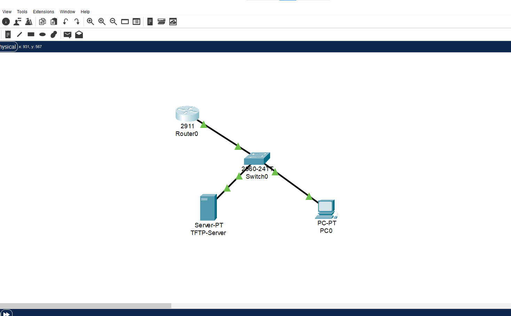
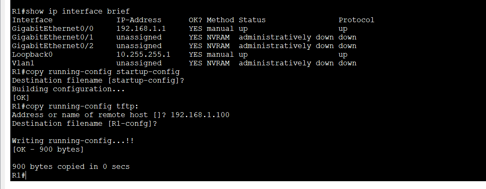
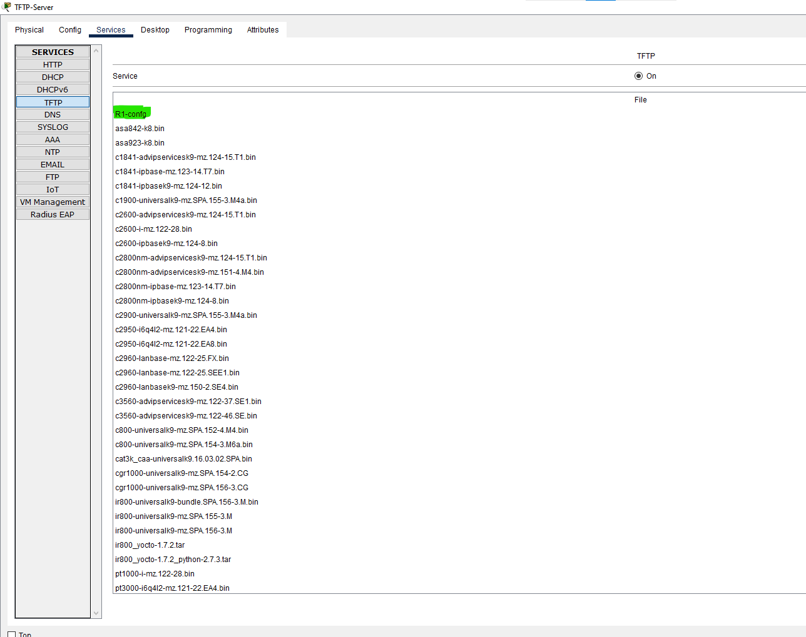
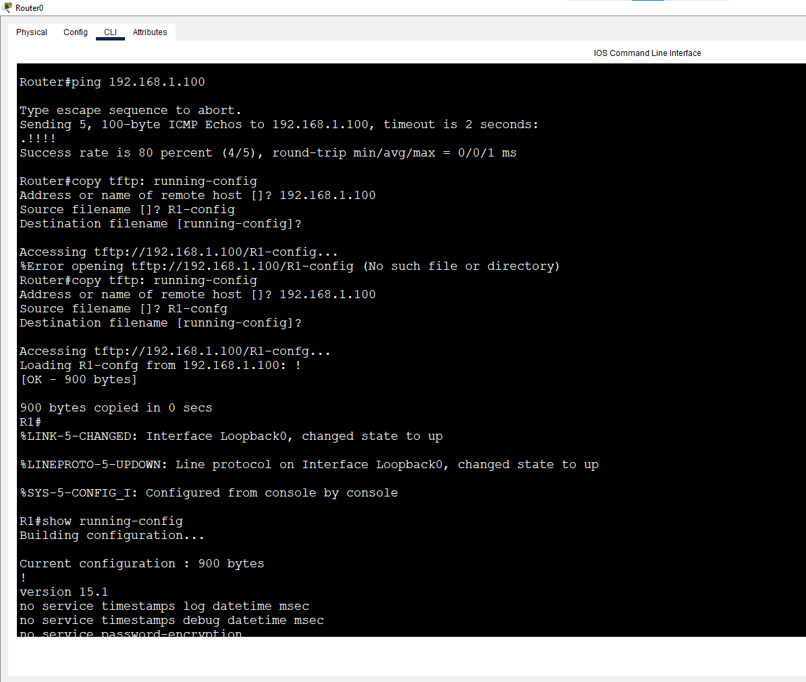

# Lab 10: Backup & Restore (TFTP)

**Week 1 - Lab 10** | Topic: Network Fundamentals & Addressing

## Objective
Back up a router's configuration to a TFTP server, simulate a complete failure by erasing the saved configuration, and restore the configuration from the backup.

## Theory

| Concept | Description |
|---------|-------------|
| TFTP | A simple file transfer protocol over UDP, with no encryption and no authentication |
| Backup | `copy running-config tftp:` sends the current configuration to the server |
| Restore | `copy tftp: running-config` or `copy tftp: startup-config` |
| Difference | Copying to `running-config` **merges** the lines into the current configuration; copying to `startup-config` **replaces** the saved configuration and takes effect after a `reload` |

**Security note:** configuration files contain passwords (only weakly encrypted) and travel over TFTP unprotected, so TFTP is for labs only. Production networks should use SCP or SFTP.

## Topology


`R1 (G0/0) --- SW1 --- TFTP Server`, and `PC1 --- SW1` using Straight-Through cables.

## Addressing Table
| Device               | IP Address    | Subnet Mask   | Gateway     |
|----------------------|---------------|---------------|-------------|
| R1 (G0/0)            | 192.168.1.1   | 255.255.255.0 | N/A         |
| TFTP Server (Server-PT) | 192.168.1.100 | 255.255.255.0 | 192.168.1.1 |
| PC1                  | 192.168.1.10  | 255.255.255.0 | 192.168.1.1 |

On the server, set the IP address under Desktop > IP Configuration, then open the Services tab, select TFTP and make sure it is `On`.

## Steps

### 1. Prepare a configuration worth backing up
```
enable
configure terminal
hostname R1
no ip domain-lookup
banner motd # Authorized Access Only #
enable secret MyPass123
line vty 0 4
 password cisco
 login
 exit
interface g0/0
 description LAN
 ip address 192.168.1.1 255.255.255.0
 no shutdown
 exit
interface loopback 0
 ip address 10.255.255.1 255.255.255.255
 exit
end
copy running-config startup-config
ping 192.168.1.100
```
The ping to the server succeeds before continuing.

### 2. Back up to the TFTP server
```
copy running-config tftp:
```
```
Address or name of remote host []? 192.168.1.100
Destination filename [R1-confg]?
```
The server address is entered and the default filename `R1-confg` is accepted. Successful output shows `!!` followed by `[OK - ... bytes]`.



The file `R1-confg` appears in the server's list under Services > TFTP.



### 3. Simulate the failure
```
erase startup-config
reload
```
| Command | Purpose |
|---------|---------|
| `erase startup-config` | Deletes the saved configuration from NVRAM |
| `reload` | Restarts the router (answer `no` if asked to save, then confirm) |

After booting, the router had the default name `Router` and an empty configuration, with its interfaces administratively down.

### 4. Restore the configuration
A blank router cannot reach the server, so basic connectivity is configured first:
```
enable
configure terminal
interface g0/0
 ip address 192.168.1.1 255.255.255.0
 no shutdown
 exit
end
ping 192.168.1.100
```

**Method A: restore into running-config (merge)**
```
copy tftp: running-config
```
```
Address or name of remote host []? 192.168.1.100
Source filename []? R1-confg
Destination filename [running-config]?
```
Then verify and save:
```
show running-config
show ip interface brief
copy running-config startup-config
```
**Note:** saved interface configuration does not include `no shutdown` for enabled interfaces, so some interfaces can remain `administratively down` after a merge and need `no shutdown`.



**Method B (optional): restore into startup-config (replace)**
```
copy tftp: startup-config
reload
```
After the reload, the router loads the complete configuration from storage.

### 5. Optional: back up the IOS image
```
show flash:
copy flash: tftp:
```
`show flash:` lists the IOS file (`.bin`), and `copy flash: tftp:` sends it to the server after you enter the source filename.

## Questions and Answers

**1. What is the default backup filename and where did it appear?**
`R1-confg` (hostname followed by `-confg`). It appeared in the TFTP server's file list under Services > TFTP.

**2. How did the router look after `erase startup-config` and `reload`?**
It booted with the default hostname `Router` and no configuration, so none of the original settings (banner, passwords, IP addresses) remained.

**3. Why must an IP address be configured before restoring?**
The router needs network connectivity to reach the TFTP server. A blank router has all interfaces shut down and no addresses, so the restore cannot start without a minimal configuration.

**4. What is the difference between `copy tftp: running-config` and `copy tftp: startup-config`?**
Copying to `running-config` merges the file's lines into the active configuration immediately, while copying to `startup-config` replaces the saved configuration and only takes effect after a reload.

**5. Why is TFTP unsuitable for production?**
It has no authentication and no encryption, so anyone on the path can read the transferred configuration, including password hashes and weakly encrypted passwords.

**6. What was the interface state after the restore?**
After restoring into `running-config`, the interface enabled manually before the restore stayed up. Interfaces that the file did not explicitly enable could show `administratively down`, and `no shutdown` was needed to bring them up.

## Verification
| Command | Run on | Expected result |
|---------|--------|-----------------|
| `ping 192.168.1.100` | R1 | Success before backup and before restore |
| `show running-config` | R1 | Hostname `R1`, banner, VTY and interface settings restored |
| `show ip interface brief` | R1 | G0/0 and Loopback0 with the correct IPs and `up/up` |
| `show startup-config` | R1 | Contains the restored configuration after saving |

## Common Issues & Fixes
| Problem | Likely cause | Fix |
|---------|--------------|-----|
| `copy` times out (`.....`) | No connectivity to the server | Check IP addresses, cables and the ping result |
| Backup file not listed on the server | TFTP service is off | Enable TFTP under Services |
| Source file not found during restore | Wrong filename | Match the name shown on the server exactly (`R1-confg`) |
| Interfaces `administratively down` after restore | No `no shutdown` in the saved file | Run `no shutdown` or restore via `startup-config` and reload |

## Files
- [Download Packet Tracer Lab](./lab%2010.pkt)

## Lessons Learned
- A configuration backup is the fastest way to recover from a failed or replaced device.
- Restoring needs basic IP connectivity first, because the router must reach the TFTP server.
- Copying to `running-config` merges while copying to `startup-config` replaces, and the choice depends on the situation.
- Verify interface states after a restore, because enabled interfaces may need `no shutdown`.
- TFTP is insecure and should be replaced by SCP or SFTP in real networks.
