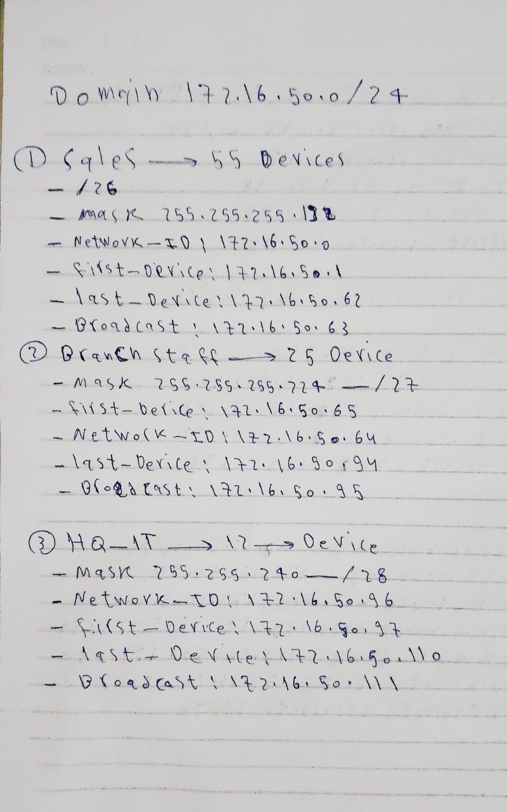
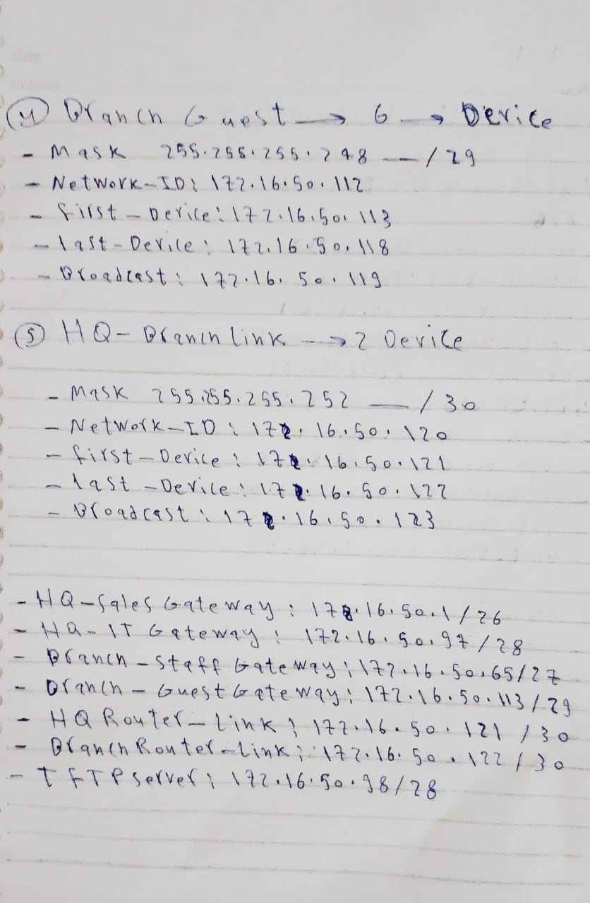
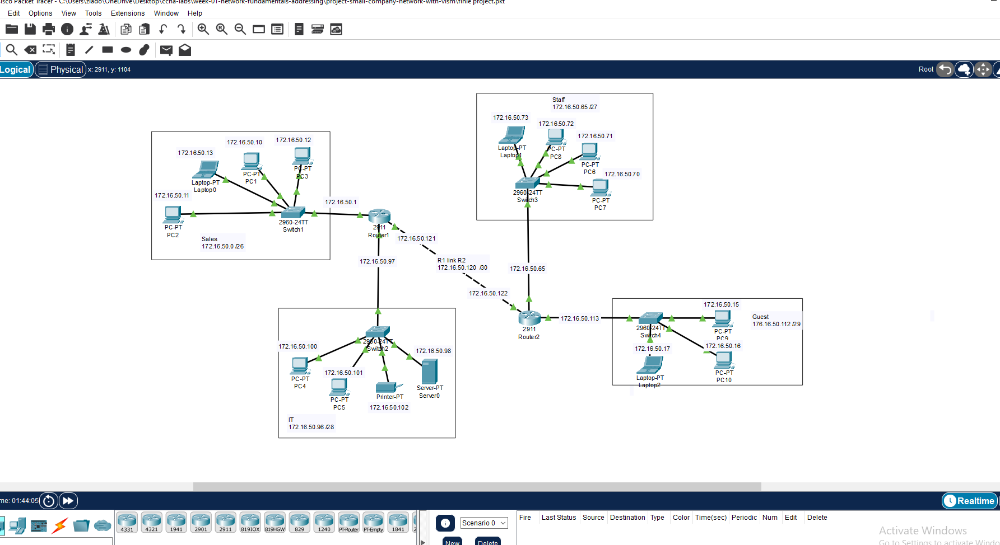
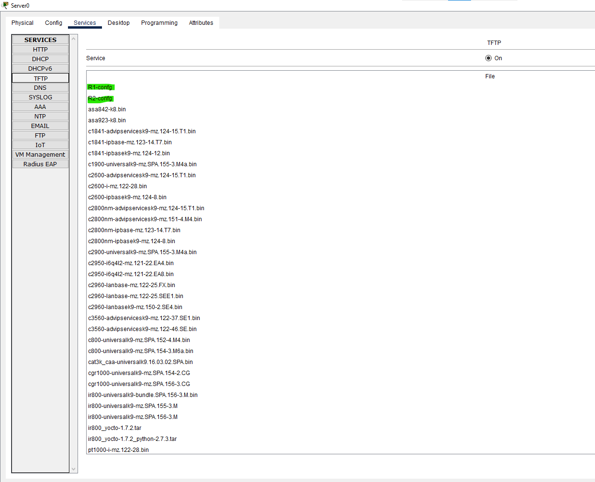
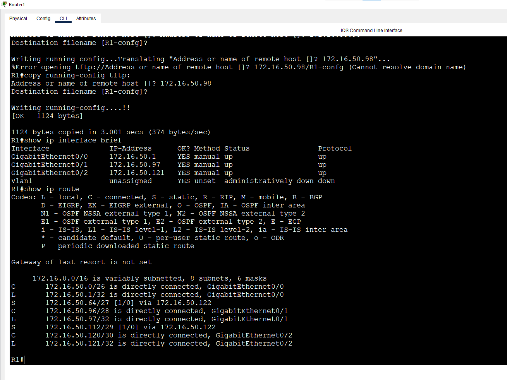
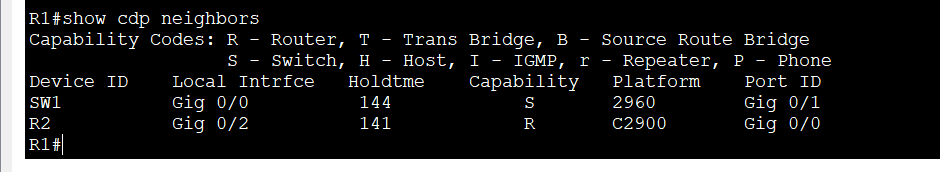

# Week 1 Project: Small Company Network with VLSM

**Week 1 - Final Project** | Topic: Network Fundamentals & Addressing

## Objective
Design and build a two-site company network (HQ and Branch) from a single address block, using VLSM for the addressing plan. The project combines everything from Labs 1-10: subnetting, device hardening, cabling, MAC and ARP behavior, CDP policy, static routing and a TFTP configuration backup.

## Scenario
A company has a headquarters and a branch connected by a point-to-point link. The available block is `172.16.50.0/24`.

| Site | Network | Required hosts |
|------|---------|----------------|
| HQ | Sales | 55 |
| HQ | IT (includes the TFTP server) | 12 |
| Branch | Staff | 25 |
| Branch | Guest | 6 |
| HQ - Branch | Router link | 2 |

## VLSM Design
Networks are allocated from largest to smallest so that every block starts on a multiple of its size and nothing overlaps.




| Network | Prefix | Mask | Network ID | Usable range | Broadcast | Gateway |
|---------|--------|------|------------|--------------|-----------|---------|
| Sales | /26 | 255.255.255.192 | 172.16.50.0 | .1 - .62 | 172.16.50.63 | 172.16.50.1 (R1) |
| Staff | /27 | 255.255.255.224 | 172.16.50.64 | .65 - .94 | 172.16.50.95 | 172.16.50.65 (R2) |
| IT | /28 | 255.255.255.240 | 172.16.50.96 | .97 - .110 | 172.16.50.111 | 172.16.50.97 (R1) |
| Guest | /29 | 255.255.255.248 | 172.16.50.112 | .113 - .118 | 172.16.50.119 | 172.16.50.113 (R2) |
| HQ-Branch link | /30 | 255.255.255.252 | 172.16.50.120 | .121 - .122 | 172.16.50.123 | R1 .121 / R2 .122 |

**Unused space:** `172.16.50.124/30` and `172.16.50.128/25` (`.124` to `.255`) remain available for growth.

**Design note:** the Guest `/29` has only 6 usable addresses. The gateway and the switch management address take two of them, leaving four for end devices. In a real design the router interface and management addresses must be counted with the hosts, so a requirement of 6 devices plus those two would call for a `/28`. In this lab the network is filled exactly with four end devices.

## Topology


| # | From | To | Cable |
|---|------|----|-------|
| 1 | SW1 Gi0/1 | R1 G0/0 | Straight-Through |
| 2 | SW2 Gi0/1 | R1 G0/1 | Straight-Through |
| 3 | R1 G0/2 | R2 G0/0 | **Cross-Over** |
| 4 | R2 G0/1 | SW3 Gi0/1 | Straight-Through |
| 5 | R2 G0/2 | SW4 Gi0/1 | Straight-Through |
| 6 | End devices | Fa0/1 - Fa0/4 on their switch | Straight-Through |

Devices: 2 x Router 2911, 4 x Switch 2960, 16 end devices (PCs, laptops, a printer, a smartphone and a server).

## Addressing Table
| Device | Interface | IP Address | Subnet Mask | Gateway |
|--------|-----------|------------|-------------|---------|
| R1 | G0/0 (Sales) | 172.16.50.1 | 255.255.255.192 | N/A |
| R1 | G0/1 (IT) | 172.16.50.97 | 255.255.255.240 | N/A |
| R1 | G0/2 (to R2) | 172.16.50.121 | 255.255.255.252 | N/A |
| R2 | G0/0 (to R1) | 172.16.50.122 | 255.255.255.252 | N/A |
| R2 | G0/1 (Staff) | 172.16.50.65 | 255.255.255.224 | N/A |
| R2 | G0/2 (Guest) | 172.16.50.113 | 255.255.255.248 | N/A |
| SW1 | VLAN 1 | 172.16.50.2 | 255.255.255.192 | 172.16.50.1 |
| SW2 | VLAN 1 | 172.16.50.99 | 255.255.255.240 | 172.16.50.97 |
| SW3 | VLAN 1 | 172.16.50.66 | 255.255.255.224 | 172.16.50.65 |
| SW4 | VLAN 1 | 172.16.50.114 | 255.255.255.248 | 172.16.50.113 |
| Sales hosts | PC1-PC3, Laptop | 172.16.50.10 - .13 | 255.255.255.192 | 172.16.50.1 |
| IT hosts | Server, 2 PCs, Printer | 172.16.50.98, .100 - .102 | 255.255.255.240 | 172.16.50.97 |
| Staff hosts | 3 PCs, Laptop | 172.16.50.70 - .73 | 255.255.255.224 | 172.16.50.65 |
| Guest hosts | PC, Laptop, PC, Smartphone | 172.16.50.115 - .118 | 255.255.255.248 | 172.16.50.113 |

**Packet Tracer note:** addresses in `172.16.0.0` are treated as Class B, so the PC fills in `255.255.0.0` automatically. The mask must be replaced by hand for every device.

## Steps

### 1. Base configuration (all routers and switches)
Only the hostname changes between devices. Switches use `line vty 0 15`.
```
enable
configure terminal
hostname R1
no ip domain-lookup
enable secret Cisco@123
service password-encryption
banner motd #Authorized Access Only#
line console 0
 password cisco
 login
 logging synchronous
 exit
line vty 0 4
 password cisco
 login
 logging synchronous
 exit
```
| Command | Purpose |
|---------|---------|
| `no ip domain-lookup` | Stops the delay after a mistyped command |
| `enable secret` | Protects privileged mode with a hashed password |
| `service password-encryption` | Encrypts the console and VTY passwords in the configuration |
| `banner motd` | Shows a warning message at login |
| `logging synchronous` | Keeps system messages from interrupting typing |

### 2. R1 interfaces and routes
```
interface g0/0
 description LAN-Sales
 ip address 172.16.50.1 255.255.255.192
 no shutdown
interface g0/1
 description LAN-IT
 ip address 172.16.50.97 255.255.255.240
 no cdp enable
 no shutdown
interface g0/2
 description Link-to-R2
 ip address 172.16.50.121 255.255.255.252
 no shutdown
 exit
ip route 172.16.50.64 255.255.255.224 172.16.50.122
ip route 172.16.50.112 255.255.255.248 172.16.50.122
end
copy running-config startup-config
```

### 3. R2 interfaces and routes
```
interface g0/0
 description Link-to-R1
 ip address 172.16.50.122 255.255.255.252
 no shutdown
interface g0/1
 description LAN-Staff
 ip address 172.16.50.65 255.255.255.224
 no cdp enable
 no shutdown
interface g0/2
 description LAN-Guest
 ip address 172.16.50.113 255.255.255.248
 no cdp enable
 no shutdown
 exit
ip route 172.16.50.0 255.255.255.192 172.16.50.121
ip route 172.16.50.96 255.255.255.240 172.16.50.121
end
copy running-config startup-config
```
| Command | Purpose |
|---------|---------|
| `ip route <network> <mask> <next-hop>` | Static route: to reach that network, send packets to the neighbor router |
| `no cdp enable` | Disables CDP on user-facing interfaces only |

### 4. Switch management (example: SW1)
```
interface vlan 1
 ip address 172.16.50.2 255.255.255.192
 no shutdown
 exit
ip default-gateway 172.16.50.1
interface fa0/1
 description To-PC1
interface range fa0/2 - 4
 description End-Devices
interface g0/1
 description Uplink-to-R1
end
copy running-config startup-config
```
A switch does not route, so `ip default-gateway` is needed for it to reach other networks. SW2, SW3 and SW4 use the management addresses from the table.

### 5. End devices
Each device is set to **Static** under Desktop > IP Configuration. Because of the automatic Class B mask, the subnet mask is cleared and retyped (`192`, `224`, `240` or `248` in the last octet) before the gateway is entered.

### 6. TFTP backup
On the server, Services > TFTP is set to `On`. On each router:
```
copy running-config tftp:
Address or name of remote host []? 172.16.50.98
Destination filename [R1-confg]?
```
R2 sends its file with the name `R2-confg`. R2 reaches the server through the HQ-Branch link, which also proves that the static routes work in both directions.



## Verification
| Command / test | Run on | Expected result |
|----------------|--------|-----------------|
| `show ip interface brief` | R1, R2 | All used interfaces `up/up` with the correct addresses |
| `show ip route` | R1, R2 | `C` entries for connected networks and `S` entries for the remote ones |
| Ping across sites | Any host | Sales, IT, Staff and Guest hosts reach each other |
| Ping to 172.16.50.98 | SW4 or any Branch device | Success (default gateway and routing work) |
| `show cdp neighbors` | R1 | Only R2 is listed |
| `show mac address-table` | SW1 | MAC addresses of the four end devices, and R1 on Gi0/1 |
| `show ip arp` | R1 | Entries for hosts that were pinged |
| `show running-config` | All devices | Passwords encrypted, banner and descriptions present |



## Troubleshooting Log
Two faults were introduced on purpose and then fixed.

### Fault 1: wrong subnet mask on R2 G0/2
| | |
|---|---|
| **Change** | `ip address 172.16.50.113 255.255.255.240` on G0/2 instead of `.248` |
| **Symptom** | Guest hosts lost connectivity to other networks, or behaved inconsistently |
| **Found with** | `show ip interface brief` and `show running-config interface g0/2` compared with the addressing table |
| **Fix** | `ip address 172.16.50.113 255.255.255.248` |

### Fault 2: missing static route on R1
| | |
|---|---|
| **Change** | `no ip route 172.16.50.64 255.255.255.224 172.16.50.122` |
| **Symptom** | Ping from HQ to the Staff network failed, while ping to the R2 link address still worked |
| **Found with** | `show ip route` on R1 showed no `S` entry for 172.16.50.64/27, and `traceroute` stopped at R1 |
| **Fix** | Re-entered the `ip route` command and tested again |

## Common Issues & Fixes
| Problem | Likely cause | Fix |
|---------|--------------|-----|
| `Invalid subnet address entered` on a PC | Last octet is not a valid mask value (for example 132) | Use 128, 192, 224, 240, 248, 252, 254 or 255 |
| Mask reverts to `255.255.0.0` | Packet Tracer fills the Class B mask automatically | Clear and retype the mask after entering the IP |
| Link between routers stays down | Straight-Through cable between two routers | Use a Cross-Over cable |
| First ping fails, the rest succeed | ARP resolution on the first packet | Ping again |
| Remote network unreachable | Missing or wrong static route | Compare `show ip route` with the design on both routers |
| Config copy to TFTP times out | No route to 172.16.50.98 from that router | Check static routes and the server gateway |

## Files
- [Download Packet Tracer Lab](./finle%20project.pkt)

## Lessons Learned
- Allocating from the largest network to the smallest keeps VLSM blocks aligned and free space contiguous.
- Router interface and management addresses must be counted when sizing a subnet.
- Static routes are needed in both directions, because a missing return route breaks a ping just like a missing forward route.
- Disabling CDP on user-facing interfaces limits what an attacker or an ordinary host can learn about the network.
- Comparing show output with the design table is the fastest way to find configuration mistakes.
