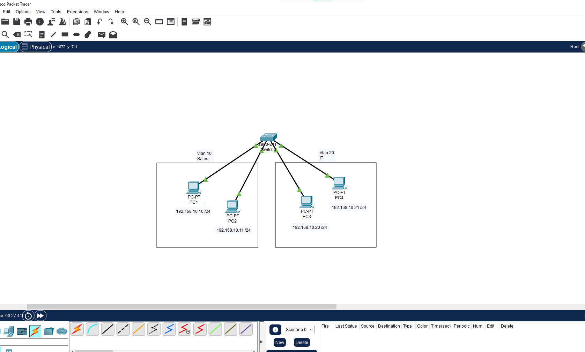
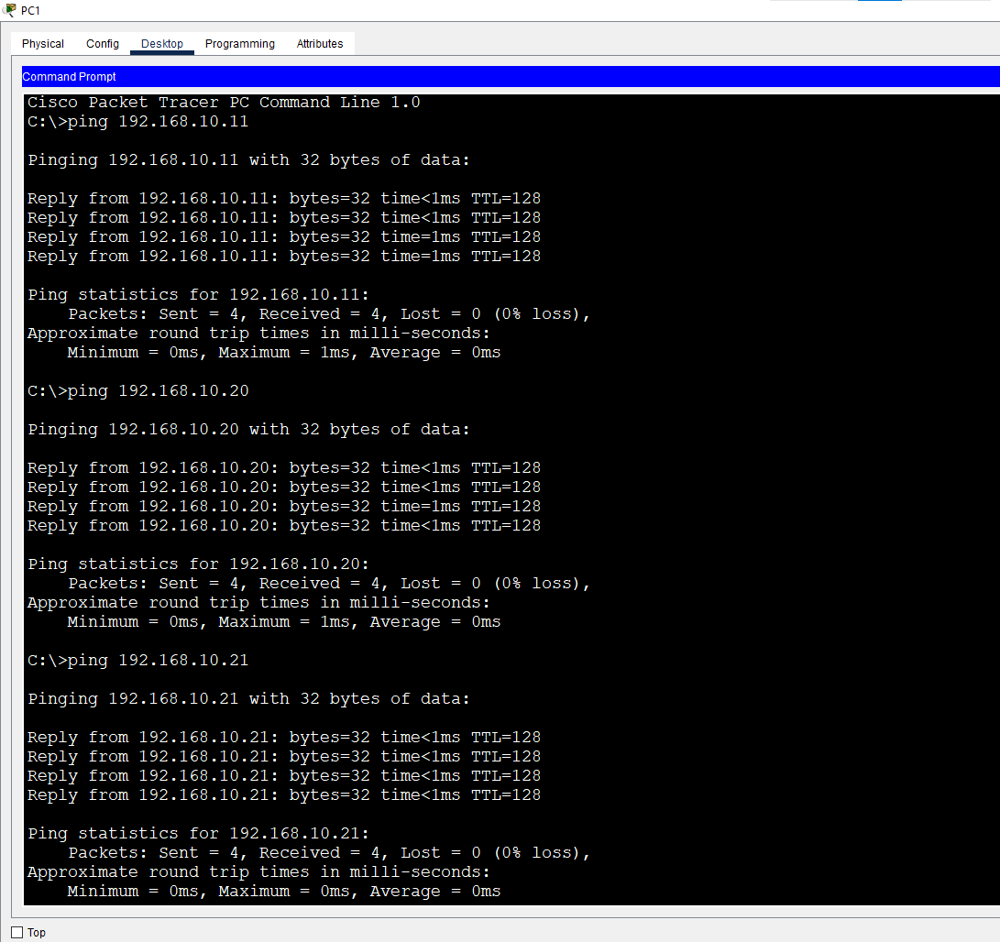
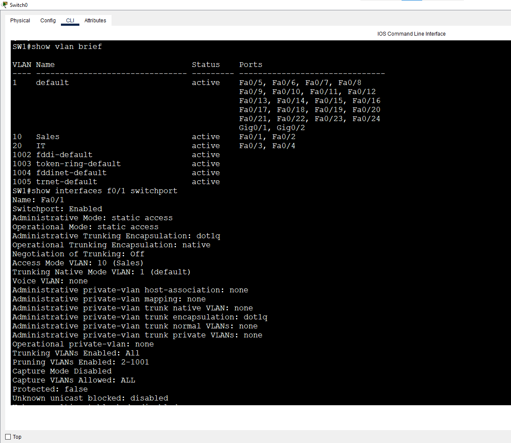
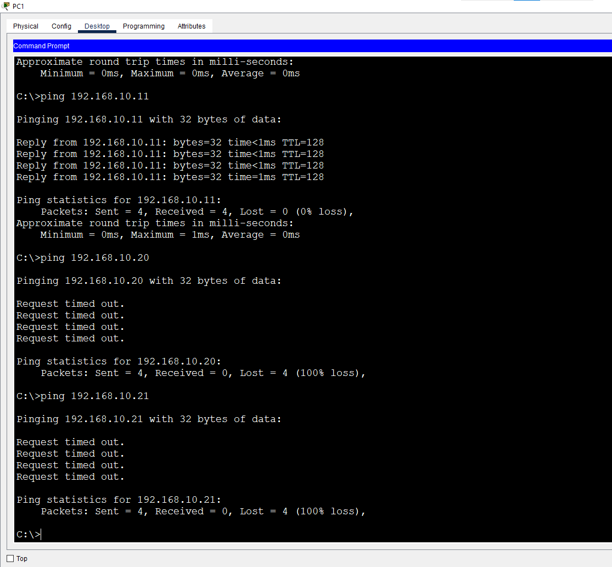

# Lab 1: Creating VLANs and Assigning Access Ports

**Week 2 - Lab 1** | Topic: Switching & VLANs

## Objective
Create two VLANs on a single switch, assign access ports to them, and prove that devices in different VLANs cannot communicate at Layer 2, even when their IP addresses are in the same subnet.

## Theory

| Concept | Description |
|---------|-------------|
| VLAN | A logical network inside a switch. Each VLAN is its own broadcast domain |
| Access port | A port that belongs to exactly one VLAN, used for end devices such as PCs and printers |
| VLAN 1 | The default VLAN. Every port starts in it, and it cannot be deleted |
| VLAN 2-1001 | The normal range used for user VLANs |
| VLAN 1002-1005 | Reserved for legacy Token Ring and FDDI |
| VLAN 1006-4094 | Extended range |
| Benefits | Isolation between departments, smaller broadcast domains, better security and organization |

## Topology


One Switch 2960 (`SW1`) connected to four PCs with Straight-Through cables.

| Device | SW1 port | VLAN |
|--------|----------|------|
| PC1 | Fa0/1 | 10 (Sales) |
| PC2 | Fa0/2 | 10 (Sales) |
| PC3 | Fa0/3 | 20 (IT) |
| PC4 | Fa0/4 | 20 (IT) |

## Addressing Table
All PCs are deliberately in the same subnet so that the VLANs are the only thing separating them. There is no router and no default gateway in this lab.

| Device | IP Address | Subnet Mask |
|--------|------------|-------------|
| PC1 | 192.168.1.10 | 255.255.255.0 |
| PC2 | 192.168.1.11 | 255.255.255.0 |
| PC3 | 192.168.1.20 | 255.255.255.0 |
| PC4 | 192.168.1.21 | 255.255.255.0 |

## Steps

### 1. Baseline test (before any VLAN configuration)
From PC1:
```
ping 192.168.1.11
ping 192.168.1.20
ping 192.168.1.21
```
All pings succeed because every port is still in the default VLAN 1. The first packet can time out while ARP resolves.



### 2. Create the VLANs on SW1
```
enable
configure terminal
hostname SW1
vlan 10
 name Sales
 exit
vlan 20
 name IT
 exit
```
| Command | Purpose |
|---------|---------|
| `vlan 10` | Creates VLAN 10 and enters its configuration mode |
| `name Sales` | Gives the VLAN a descriptive name (optional but useful for documentation) |
| `exit` | Leaves VLAN configuration mode |

### 3. Assign the access ports
```
interface range fa0/1 - 2
 switchport mode access
 switchport access vlan 10
 exit
interface range fa0/3 - 4
 switchport mode access
 switchport access vlan 20
 end
copy running-config startup-config
```
| Command | Purpose |
|---------|---------|
| `interface range fa0/1 - 2` | Configures several ports at once |
| `switchport mode access` | Makes the port an access port for one VLAN and an end device |
| `switchport access vlan 10` | Places the port in VLAN 10 |
| `copy running-config startup-config` | Saves the configuration |

### 4. Verify
```
show vlan brief
show interfaces fa0/1 switchport
show running-config interface fa0/3
```
`show vlan brief` lists VLAN 10 (Sales) with Fa0/1 and Fa0/2, VLAN 20 (IT) with Fa0/3 and Fa0/4, and the remaining ports in VLAN 1. In `show interfaces fa0/1 switchport`, the `Administrative Mode` is `static access` and the `Access Mode VLAN` is `10`.



From PC1:
```
ping 192.168.1.11
ping 192.168.1.20
```
The ping to PC2 (same VLAN) succeeds and the ping to PC3 (different VLAN) fails, even though both addresses are in 192.168.1.0/24.



### 5. Extra test: assigning a port to a VLAN that does not exist
```
interface fa0/5
 switchport mode access
 switchport access vlan 30
 end
show vlan brief
```
The switch created VLAN 30 automatically and placed Fa0/5 in it. Packet Tracer shows a message that the VLAN did not exist and is being created, and the new VLAN gets a default name such as `VLAN0030`. The behavior can vary between IOS versions.

## Questions and Answers

**1. What is the difference in the broadcast domain before and after VLANs?**
Before VLANs, all devices were in one broadcast domain, so a broadcast reached every device. After creating the VLANs, each VLAN became its own broadcast domain, so a broadcast sent by a PC reaches only the devices in the same VLAN.

**2. Why did the ping between PC1 and PC3 fail even though they are in the same subnet?**
They belong to different VLANs. The switch never forwards frames between VLANs at Layer 2, so the ARP request from PC1 never reaches PC3. Communication between VLANs needs a Layer 3 device (inter-VLAN routing), which is covered in a later lab.

**3. What does `switchport mode access` mean?**
It makes the port an access port that belongs to a single VLAN and connects to an end device.

**4. Which VLAN was Fa0/10 in before the configuration, and why?**
VLAN 1, the default VLAN. Every port belongs to VLAN 1 until it is assigned to another VLAN.

**5. What happened to VLAN 30 in the extra test, and what is your opinion about this behavior?**
Fa0/5 was placed in VLAN 30, and the switch created VLAN 30 automatically because it did not exist. This is convenient, but it is risky: a typo in the VLAN number silently creates an unwanted VLAN. Best practice is to create and name each VLAN explicitly before assigning ports.

## Verification
| Command / test | Run on | Expected result |
|----------------|--------|-----------------|
| `show vlan brief` | SW1 | VLAN 10 and 20 with the correct ports, others in VLAN 1 |
| `show interfaces fa0/1 switchport` | SW1 | Static access mode, access VLAN 10 |
| Ping PC1 to PC2 | PC1 | Success (same VLAN) |
| Ping PC1 to PC3 | PC1 | Fails (different VLANs) |

## Common Issues & Fixes
| Problem | Likely cause | Fix |
|---------|--------------|-----|
| Ping inside the same VLAN fails | Port in the wrong VLAN, or a wrong IP address | Check `show vlan brief` and the PC addresses |
| A port is missing from `show vlan brief` | The port is not an access port, or it is down | Check `show interfaces status` and the port mode |
| Unexpected extra VLAN appears | A port was assigned to a VLAN that did not exist | Remove it with `no vlan <id>` and fix the port assignment |
| First ping times out | ARP resolution on the first packet | Ping again |

## Files
- [Download Packet Tracer Lab](./lab%201.pkt)
## Lessons Learned
- A VLAN is a separate broadcast domain, so devices in different VLANs cannot communicate at Layer 2 even with matching IP subnets.
- All ports start in VLAN 1 until they are assigned elsewhere.
- Access ports belong to one VLAN and are used for end devices.
- Create and name VLANs explicitly, because the switch can create a VLAN silently when a port is assigned to a missing one.
- Communication between VLANs requires a Layer 3 device, which is the topic of a later lab.
