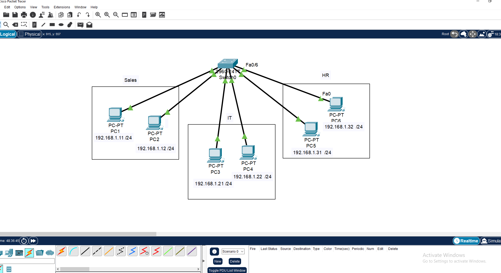
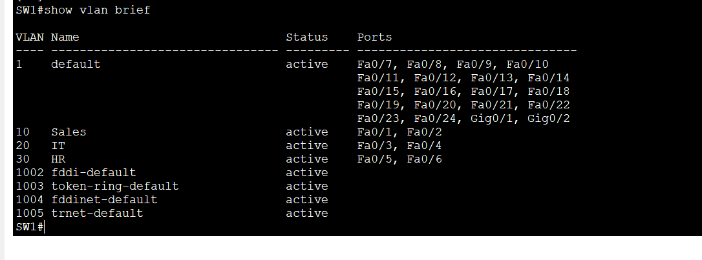
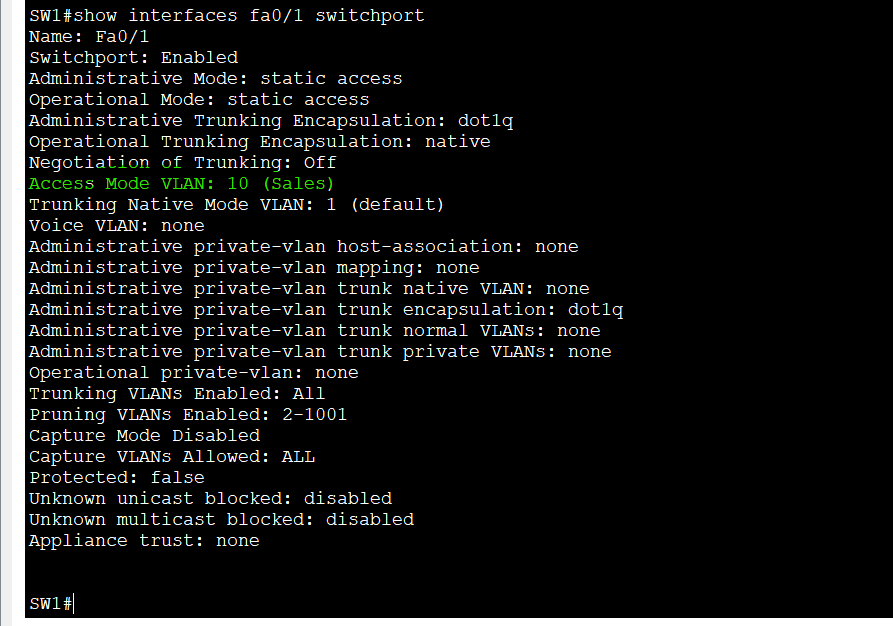
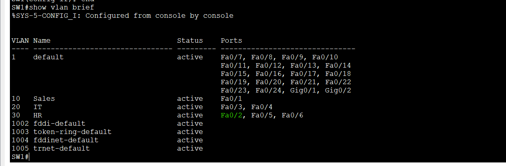
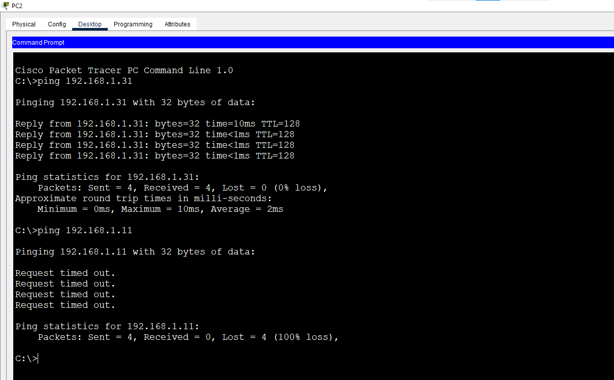
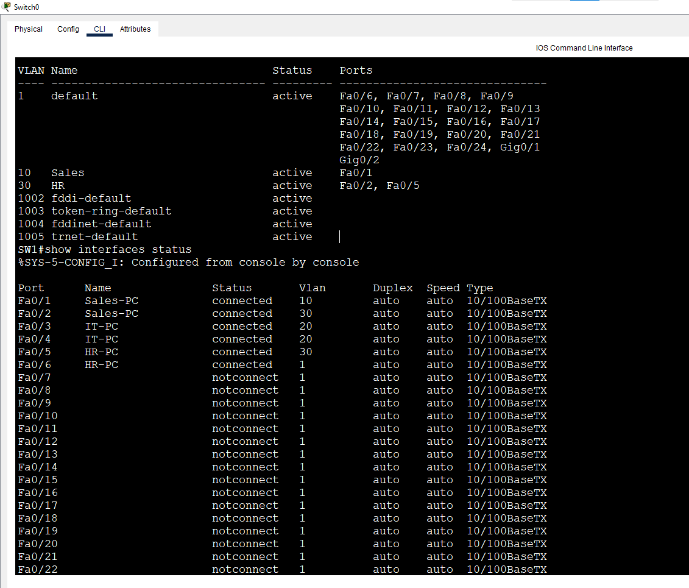

# Lab 2: Access Ports & VLAN Assignment

**Week 2 - Lab 2** | Topic: Switching & VLANs

## Objective
Assign access ports to VLANs, verify the assignment with several show commands, move a port from one VLAN to another, and observe what happens to the ports of a VLAN that is deleted.

## Theory

| Concept | Description |
|---------|-------------|
| Access port | Belongs to exactly one VLAN and carries untagged traffic for an end device |
| `switchport mode access` | Forces the port to be an access port instead of negotiating a mode |
| `switchport access vlan X` | Places the port in VLAN X |
| `no switchport access vlan` | Returns the port to the default VLAN 1 |
| `interface range` | Applies the same configuration to several ports at once |
| `description` | Documents what is connected to a port |
| Deleting a VLAN | The ports stay assigned to the deleted VLAN, but they become inactive and do not forward traffic until the VLAN is recreated or the ports are moved |

## Topology


One Switch 2960 (`SW1`) connected to six PCs with Straight-Through cables.

| Device | SW1 port | VLAN |
|--------|----------|------|
| PC1 | Fa0/1 | 10 |
| PC2 | Fa0/2 | 10 |
| PC3 | Fa0/3 | 20 |
| PC4 | Fa0/4 | 20 |
| PC5 | Fa0/5 | 30 |
| PC6 | Fa0/6 | 30 |

## Addressing Table
All PCs share one subnet, so VLANs are the only thing separating them. There is no router and no default gateway in this lab.

| Device | IP Address | Subnet Mask |
|--------|------------|-------------|
| PC1 | 192.168.1.1 | 255.255.255.0 |
| PC2 | 192.168.1.2 | 255.255.255.0 |
| PC3 | 192.168.1.3 | 255.255.255.0 |
| PC4 | 192.168.1.4 | 255.255.255.0 |
| PC5 | 192.168.1.5 | 255.255.255.0 |
| PC6 | 192.168.1.6 | 255.255.255.0 |

## Steps

### 1. Create the VLANs and assign the ports
```
enable
configure terminal
hostname SW1
vlan 10
 name Sales
vlan 20
 name IT
vlan 30
 name HR
 exit
interface range fa0/1 - 2
 description Sales-PCs
 switchport mode access
 switchport access vlan 10
interface range fa0/3 - 4
 description IT-PCs
 switchport mode access
 switchport access vlan 20
interface range fa0/5 - 6
 description HR-PCs
 switchport mode access
 switchport access vlan 30
 end
copy running-config startup-config
```
| Command | Purpose |
|---------|---------|
| `vlan 10` / `name Sales` | Creates the VLAN and names it |
| `interface range fa0/1 - 2` | Configures two ports with one set of commands |
| `description` | Labels the port for documentation |
| `switchport mode access` | Makes the ports access ports |
| `switchport access vlan 10` | Assigns the ports to VLAN 10 |

### 2. Verify the assignment
```
show vlan brief
show interfaces fa0/1 switchport
```
`show vlan brief` lists VLAN 10 with Fa0/1-2, VLAN 20 with Fa0/3-4 and VLAN 30 with Fa0/5-6. In `show interfaces fa0/1 switchport`, the `Administrative Mode` is `static access` and the `Access Mode VLAN` is `10`.




### 3. Move a port to another VLAN
Fa0/2 is moved from VLAN 10 to VLAN 30:
```
interface fa0/2
 switchport access vlan 30
 end
show vlan brief
```
From PC2, the ping to PC5 (now the same VLAN) succeeds and the ping to PC1 (VLAN 10) fails.




Fa0/2 is then returned to VLAN 10 before the next step:
```
interface fa0/2
 switchport access vlan 10
```

### 4. Delete a VLAN that still has ports
```
configure terminal
no vlan 20
end
show vlan brief
show interfaces status
```
VLAN 20 disappears from `show vlan brief`, and Fa0/3 and Fa0/4 are no longer listed under any active VLAN. `show interfaces status` still shows them assigned to VLAN 20, and the ping between PC3 and PC4 fails because the switch does not forward traffic for a VLAN that does not exist. The exact port status text can differ between Packet Tracer and real IOS versions.



### 5. Recreate the VLAN
```
configure terminal
vlan 20
 name IT
 end
copy running-config startup-config
```
Fa0/3 and Fa0/4 return to VLAN 20 without being reconfigured, and the ping between PC3 and PC4 works again.

## Questions and Answers

**1. What does `switchport mode access` do?**
It makes the port an access port that belongs to one VLAN and connects to an end device, instead of negotiating a trunk.

**2. What happens to a port when you move it to another VLAN?**
It immediately becomes part of the new VLAN's broadcast domain. It can reach only devices in that VLAN and loses contact with its previous VLAN.

**3. What happens to the ports when their VLAN is deleted?**
The ports keep their VLAN assignment but stop forwarding traffic, because the VLAN no longer exists. They are not moved to VLAN 1 automatically.

**4. How do you restore those ports?**
Recreate the VLAN with the same number, or reassign the ports to another VLAN.

**5. Why use `interface range` and `description`?**
`interface range` saves time and avoids inconsistent configuration across ports, and descriptions make the switch easier to read and troubleshoot.

## Verification
| Command / test | Run on | Expected result |
|----------------|--------|-----------------|
| `show vlan brief` | SW1 | VLAN 10, 20 and 30 with their ports |
| `show interfaces fa0/1 switchport` | SW1 | Static access, access VLAN 10 |
| Ping PC2 to PC5 after the move | PC2 | Success |
| Ping PC2 to PC1 after the move | PC2 | Fails |
| Ping PC3 to PC4 after `no vlan 20` | PC3 | Fails |
| Ping PC3 to PC4 after recreating VLAN 20 | PC3 | Success |

## Common Issues & Fixes
| Problem | Likely cause | Fix |
|---------|--------------|-----|
| A PC cannot reach its neighbor in the same VLAN | Wrong VLAN on one port | Check `show vlan brief` and reassign the port |
| Ports vanish from `show vlan brief` | The VLAN was deleted | Recreate the VLAN with the same number |
| Port is in an unexpected VLAN | A typo in the VLAN number | Correct it with `switchport access vlan X` |
| First ping times out | ARP resolution on the first packet | Ping again |

## Files
- [Download Packet Tracer Lab](./lab%202.pkt)
## Lessons Learned
- Access ports place an end device in one VLAN, and moving a port changes its broadcast domain immediately.
- Verify with both `show vlan brief` and `show interfaces <port> switchport`.
- Deleting a VLAN does not move its ports, so they become inactive until the VLAN is recreated.
- Naming VLANs and describing ports keeps the configuration readable.
