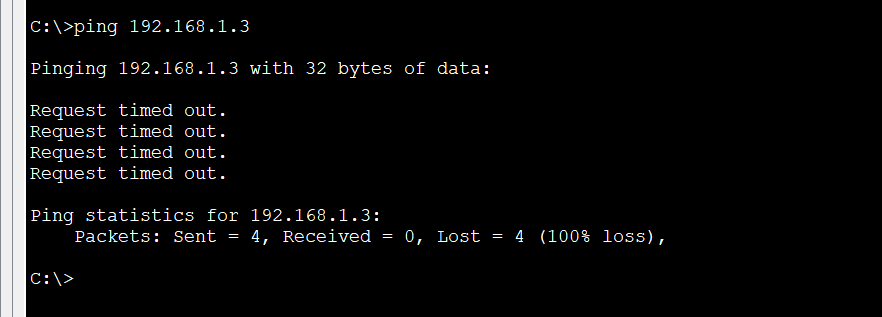
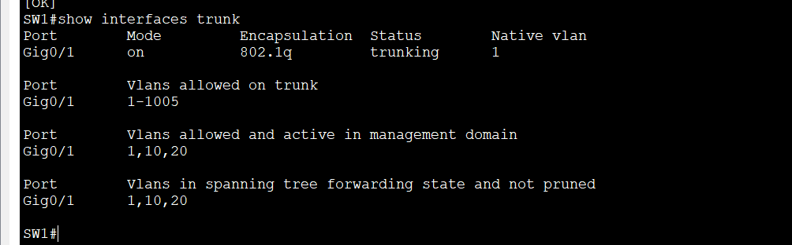
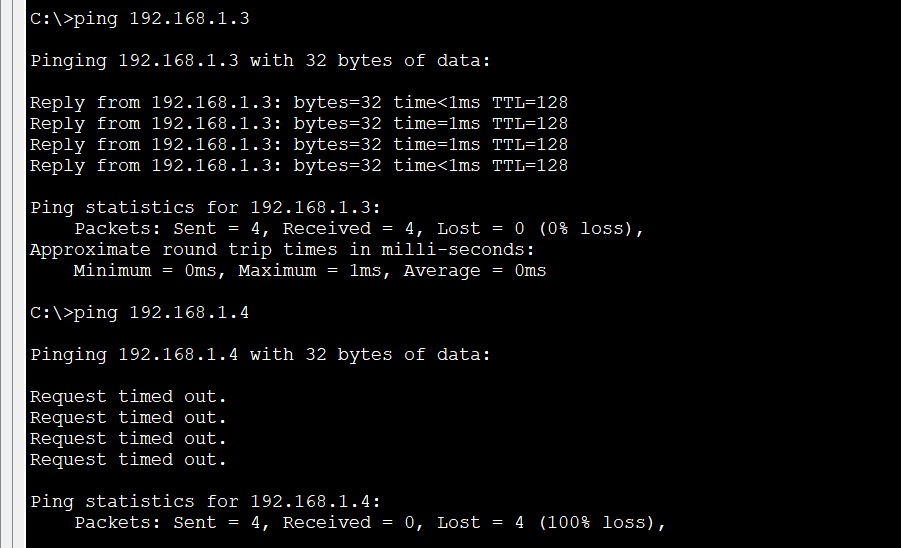

# Lab 3: 802.1Q Trunking

**Week 2 - Lab 3** | Topic: Switching & VLANs

## Objective
Connect two switches with a single trunk link that carries multiple VLANs, and prove that devices in the same VLAN can communicate across switches while devices in different VLANs still cannot.

## Theory

| Concept | Description |
|---------|-------------|
| Access port | Belongs to one VLAN and connects an end device |
| Trunk port | Carries traffic for multiple VLANs over one link, usually between switches or to a router |
| 802.1Q | The standard tagging protocol. It inserts a 4-byte tag containing the VLAN ID into the Ethernet frame |
| Native VLAN | The one VLAN sent without a tag. It is VLAN 1 by default and is covered in the next lab |
| Catalyst 2960 | Supports only 802.1Q, so the `switchport trunk encapsulation` command does not exist on it |

Without a trunk, each VLAN would need its own cable between the switches. A trunk replaces them with one link.

## Topology


Two Switch 2960 devices (`SW1`, `SW2`) and four PCs. The switch-to-switch link (Gi0/1 to Gi0/1) uses a **Cross-Over** cable, and the PCs use Straight-Through cables.

| Device | Switch | Port | VLAN |
|--------|--------|------|------|
| PC1 | SW1 | Fa0/1 | 10 (Sales) |
| PC2 | SW1 | Fa0/2 | 20 (IT) |
| PC3 | SW2 | Fa0/1 | 10 (Sales) |
| PC4 | SW2 | Fa0/2 | 20 (IT) |

## Addressing Table
All PCs are in one subnet, so VLANs are the only separation. There is no router and no default gateway.

| Device | IP Address | Subnet Mask |
|--------|------------|-------------|
| PC1 | 192.168.1.1 | 255.255.255.0 |
| PC2 | 192.168.1.2 | 255.255.255.0 |
| PC3 | 192.168.1.3 | 255.255.255.0 |
| PC4 | 192.168.1.4 | 255.255.255.0 |

## Steps

### 1. Create the VLANs and access ports (both switches)
```
enable
configure terminal
hostname SW1
vlan 10
 name Sales
vlan 20
 name IT
 exit
interface fa0/1
 switchport mode access
 switchport access vlan 10
interface fa0/2
 switchport mode access
 switchport access vlan 20
 end
```
SW2 uses the same commands with `hostname SW2`. The VLANs must exist on both switches, because a trunk only carries VLANs and does not create them.

### 2. Test before the trunk
From PC1:
```
ping 192.168.1.3
```
The ping fails even though PC1 and PC3 are both in VLAN 10. The inter-switch port is still an access port in VLAN 1, so VLAN 10 traffic cannot cross it.



### 3. Configure the trunk (both switches)
```
interface gi0/1
 description Trunk-to-SW2
 switchport mode trunk
 end
copy running-config startup-config
```
On SW2 the description is `Trunk-to-SW1`.

| Command | Purpose |
|---------|---------|
| `switchport mode trunk` | Sets the port to trunk mode permanently |
| `description` | Documents the link |

Entering `switchport trunk encapsulation dot1q` on a 2960 produces an error, because 802.1Q is the only supported encapsulation.

### 4. Verify
```
show interfaces trunk
show interfaces gi0/1 switchport
show vlan brief
```
`show interfaces trunk` lists Gi0/1 with Mode `on`, Encapsulation `802.1q`, Native vlan `1` and the allowed VLANs. `show vlan brief` does not list Gi0/1 under any VLAN, because a trunk port does not belong to a single VLAN.



### 5. Test after the trunk
From PC1:
```
ping 192.168.1.3
ping 192.168.1.4
```
The ping to PC3 (same VLAN, other switch) succeeds. The ping to PC4 (different VLAN) fails. The first packet can time out while ARP resolves.



## Questions and Answers

**1. Why did the ping between PC1 and PC3 fail before the trunk?**
The link between the switches was an access port in VLAN 1, so frames of VLAN 10 could not cross it. PC1's ARP request never reached SW2.

**2. What is the difference between an access port and a trunk port?**
An access port carries one VLAN, untagged, and connects an end device. A trunk port carries many VLANs over one link by tagging frames, and connects switches or routers.

**3. What does 802.1Q add to the frame?**
A 4-byte tag that includes the 12-bit VLAN ID, so the receiving switch knows which VLAN the frame belongs to.

**4. Why does `show vlan brief` not list the trunk port?**
A trunk port is not a member of one VLAN. It carries several, so it appears in `show interfaces trunk` instead.

**5. Why did PC1 fail to ping PC4 although the trunk works?**
They are in different VLANs (10 and 20), which are separate broadcast domains. The trunk preserves that separation. Reaching another VLAN needs a Layer 3 device, covered in a later lab.

**6. What happens if VLAN 20 is missing on SW2?**
SW2 has no VLAN 20 to forward the tagged frames into, so PC2 and PC4 cannot communicate even though the trunk is up. Assigning a port to a missing VLAN may create it automatically on some versions, so the exact behavior can vary. Best practice is to create the same VLANs explicitly on every switch.

## Verification
| Command / test | Run on | Expected result |
|----------------|--------|-----------------|
| `show interfaces trunk` | SW1, SW2 | Gi0/1 trunking, 802.1q, native VLAN 1 |
| `show vlan brief` | SW1, SW2 | VLAN 10 and 20 with the PC ports, no trunk port listed |
| Ping PC1 to PC3 before the trunk | PC1 | Fails |
| Ping PC1 to PC3 after the trunk | PC1 | Success |
| Ping PC1 to PC4 after the trunk | PC1 | Fails |

## Common Issues & Fixes
| Problem | Likely cause | Fix |
|---------|--------------|-----|
| Same-VLAN ping across switches fails | The link is not a trunk, or only one side is configured | Set `switchport mode trunk` on both ends |
| One VLAN does not cross the trunk | The VLAN is missing on one switch | Create it on both switches |
| Trunk link is down | Wrong cable type between switches | Use a Cross-Over cable |
| `switchport trunk encapsulation` rejected | The 2960 supports only 802.1Q | Skip the command |
| First ping times out | ARP resolution | Ping again |

## Files
- [Download Packet Tracer Lab](./lab%203.pkt)

## Lessons Learned
- A trunk carries many VLANs over one link by tagging frames with 802.1Q.
- Create the same VLANs on every switch, because trunks do not create them.
- Trunk ports belong to no single VLAN and do not appear in `show vlan brief`.
- A trunk extends VLANs across switches without breaking the separation between them.
