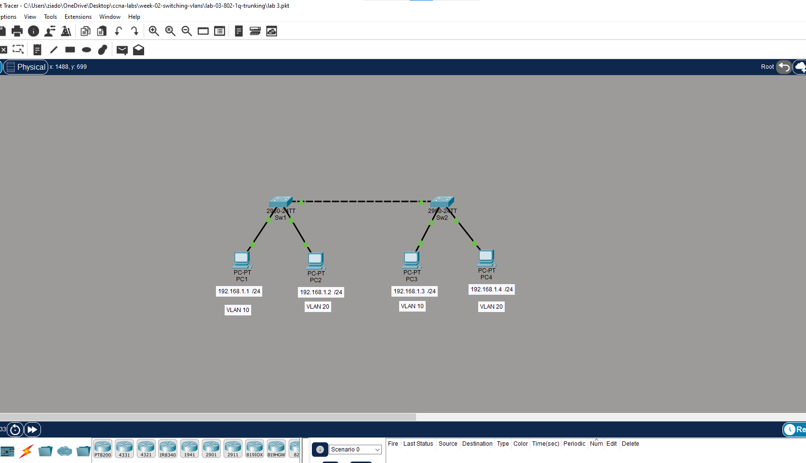
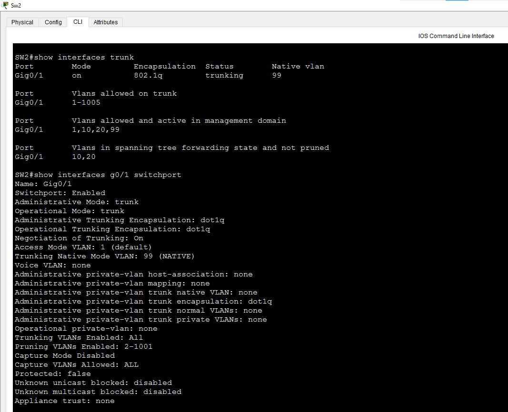
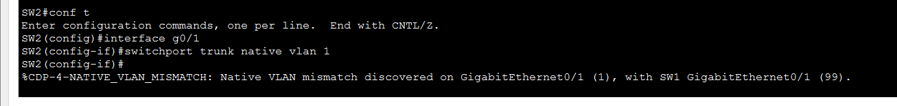
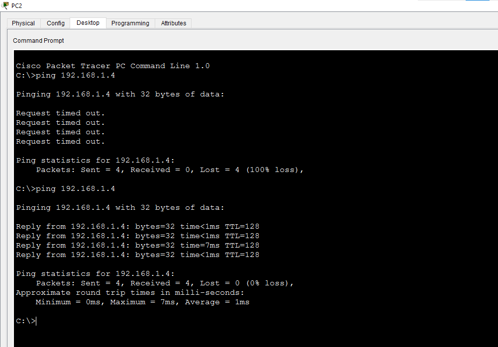

# Lab 4: Native VLAN & Allowed VLANs

**Week 2 - Lab 4** | Topic: Switching & VLANs

## Objective
Move the native VLAN of the trunk from VLAN 1 to a dedicated unused VLAN (99), observe what happens when the two ends disagree, and control which VLANs are allowed to cross the trunk.

## Theory

| Concept | Description |
|---------|-------------|
| Native VLAN | The one VLAN whose frames cross an 802.1Q trunk without a tag. It is VLAN 1 by default |
| Native VLAN mismatch | The two ends of a trunk use different native VLANs. Untagged frames end up in the wrong VLAN, and CDP reports the problem |
| Allowed VLAN list | The VLANs a trunk is permitted to carry. By default it is all VLANs (1-4094) |
| `add` / `remove` | Keywords that edit the allowed list without replacing it |

Using VLAN 1 as the native VLAN is a security risk, because VLAN 1 also carries control traffic by default. Best practice is a dedicated, unused VLAN for native traffic, and a trunk that carries only the VLANs it needs.

## Topology


Same topology as Lab 3: two Switch 2960 devices (`SW1`, `SW2`) and four PCs. The switch-to-switch link (Gi0/1 to Gi0/1) uses a **Cross-Over** cable, and the PCs use Straight-Through cables.

| Device | Switch | Port | VLAN |
|--------|--------|------|------|
| PC1 | SW1 | Fa0/1 | 10 (Sales) |
| PC2 | SW1 | Fa0/2 | 20 (IT) |
| PC3 | SW2 | Fa0/1 | 10 (Sales) |
| PC4 | SW2 | Fa0/2 | 20 (IT) |

## Addressing Table
All PCs are in one subnet, so VLANs are the only separation. There is no router and no default gateway.

| Device | IP Address | Subnet Mask |
|--------|------------|-------------|
| PC1 | 192.168.1.1 | 255.255.255.0 |
| PC2 | 192.168.1.2 | 255.255.255.0 |
| PC3 | 192.168.1.3 | 255.255.255.0 |
| PC4 | 192.168.1.4 | 255.255.255.0 |

## Steps

### 1. Start from the Lab 3 setup
VLANs 10 and 20, the access ports, and the Gi0/1 trunk are already configured. Confirm that the trunk currently uses the default native VLAN:
```
show interfaces trunk
```
Gi0/1 shows Native vlan `1`.



### 2. Create the native VLAN (both switches)
```
enable
configure terminal
vlan 99
 name NATIVE
 end
```
The VLAN must exist on both switches before it is used as the native VLAN.

### 3. Change the native VLAN (both switches)
```
configure terminal
interface gi0/1
 switchport trunk native vlan 99
 end
copy running-config startup-config
```

### 4. Verify
```
show interfaces trunk
show interfaces gi0/1 switchport
```
`show interfaces trunk` now shows Native vlan `99` on both switches. `show interfaces gi0/1 switchport` shows `Trunking Native Mode VLAN: 99 (NATIVE)`.


Test from PC1:
```
ping 192.168.1.3
```
The ping to PC3 still succeeds, because VLAN 10 is tagged on the trunk and is not affected by the native VLAN.

### 5. Create a native VLAN mismatch (SW2 only)
```
configure terminal
interface gi0/1
 switchport trunk native vlan 1
 end
```
After a short time a log message appears on the switches:
```
%CDP-4-NATIVE_VLAN_MISMATCH: Native VLAN mismatch discovered on GigabitEthernet0/1 (1), with SW1 GigabitEthernet0/1 (99).
```
On real hardware, spanning tree may also report the port as inconsistent. Restore the correct value on SW2:
```
configure terminal
interface gi0/1
 switchport trunk native vlan 99
 end
```



### 6. Restrict the allowed VLANs (both switches)
```
configure terminal
interface gi0/1
 switchport trunk allowed vlan 10,20,99
 end
```

| Command | Purpose |
|---------|---------|
| `allowed vlan 10,20,99` | Replaces the whole list with exactly these VLANs |
| `allowed vlan add 20` | Adds VLAN 20 to the existing list |
| `allowed vlan remove 20` | Removes VLAN 20 from the existing list |


### 7. Block VLAN 20 on the trunk (both switches)
```
configure terminal
interface gi0/1
 switchport trunk allowed vlan remove 20
 end
```
From PC1:
```
ping 192.168.1.3
```
From PC2:
```
ping 192.168.1.4
```
The ping between PC1 and PC3 (VLAN 10) succeeds. The ping between PC2 and PC4 (VLAN 20) fails, even though both ports are in VLAN 20 and the trunk is up.



### 8. Restore VLAN 20
```
configure terminal
interface gi0/1
 switchport trunk allowed vlan add 20
 end
copy running-config startup-config
```
The ping between PC2 and PC4 works again.

## Questions and Answers

**1. What is the native VLAN?**
The only VLAN whose frames cross an 802.1Q trunk untagged. All other VLANs are tagged with their VLAN ID.

**2. Why change the native VLAN from VLAN 1?**
VLAN 1 is the default for every port and carries control traffic. Moving native traffic to a dedicated unused VLAN reduces the risk of VLAN hopping and of mixing user traffic with management traffic.

**3. What happens when the native VLAN does not match on both ends?**
Untagged frames sent from one side are placed into a different VLAN on the other side, so traffic leaks between VLANs. CDP logs a native VLAN mismatch message, and spanning tree may flag the port.

**4. Did the mismatch stop the VLAN 10 ping?**
Not necessarily. VLAN 10 frames are tagged, so they cross the trunk normally. The mismatch affects only untagged traffic, which is why it can go unnoticed without the log message.

**5. What is the difference between `allowed vlan 10` and `allowed vlan add 10`?**
`allowed vlan 10` replaces the whole list with VLAN 10 only, which can cut off every other VLAN. `allowed vlan add 10` keeps the current list and adds VLAN 10 to it.

**6. Why did PC2 and PC4 fail to ping after removing VLAN 20 from the trunk?**
The trunk no longer carries VLAN 20 frames between the switches. Both PCs are still in VLAN 20 and the link is up, but the VLAN cannot cross it.

**7. Why restrict the allowed VLANs at all?**
It limits broadcast traffic and the exposure of each trunk to only the VLANs that actually need to cross it.

## Verification
| Command / test | Run on | Expected result |
|----------------|--------|-----------------|
| `show interfaces trunk` | SW1, SW2 | Native vlan 99 |
| `show interfaces gi0/1 switchport` | SW1, SW2 | Trunking Native Mode VLAN: 99 (NATIVE) |
| Native VLAN set to 1 on SW2 | SW1, SW2 | `%CDP-4-NATIVE_VLAN_MISMATCH` log message |
| `show interfaces trunk` after `allowed vlan 10,20,99` | SW1, SW2 | Allowed list shows 10,20,99 |
| Ping PC1 to PC3 with VLAN 20 removed | PC1 | Success |
| Ping PC2 to PC4 with VLAN 20 removed | PC2 | Fails |
| Ping PC2 to PC4 after `allowed vlan add 20` | PC2 | Success |

## Common Issues & Fixes
| Problem | Likely cause | Fix |
|---------|--------------|-----|
| `%CDP-4-NATIVE_VLAN_MISMATCH` message | Different native VLANs on the two ends | Set the same native VLAN on both ends |
| Every VLAN stops crossing the trunk | `allowed vlan` was typed without `add` or `remove` and replaced the list | Rebuild the list, or use `allowed vlan add` |
| One VLAN does not cross the trunk | The VLAN is missing from the allowed list or from one switch | Add it to the list and create it on both switches |
| Native VLAN does not change | The command was entered on one side only | Configure both ends |
| Native VLAN not shown by name | VLAN 99 does not exist on that switch | Create VLAN 99 on both switches |

## Files
- [Download Packet Tracer Lab](./lab%204.pkt)

## Lessons Learned
- The native VLAN is the only VLAN sent untagged on a trunk, and it must match on both ends.
- Use a dedicated, unused VLAN as native instead of VLAN 1.
- A native VLAN mismatch does not necessarily break tagged VLANs, so the CDP log message is the main warning.
- Use `add` and `remove` to edit the allowed VLAN list, because the plain command replaces it.
- Limit each trunk to the VLANs it really needs.
