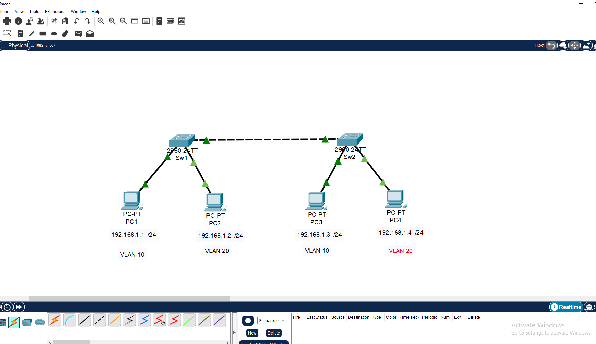
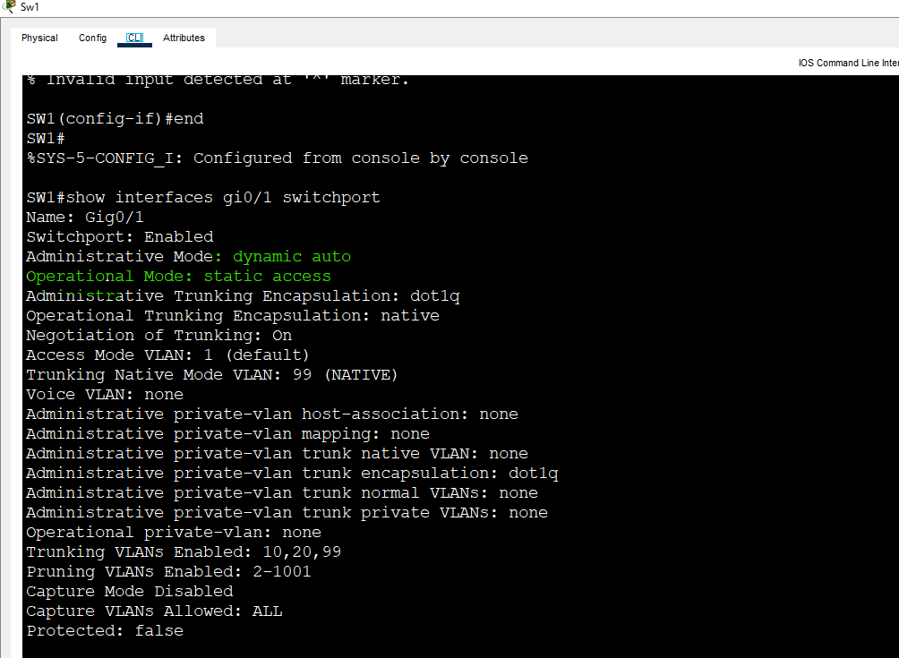
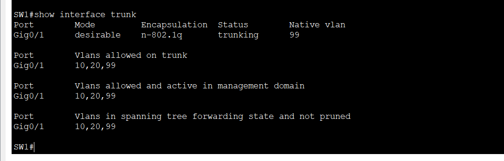
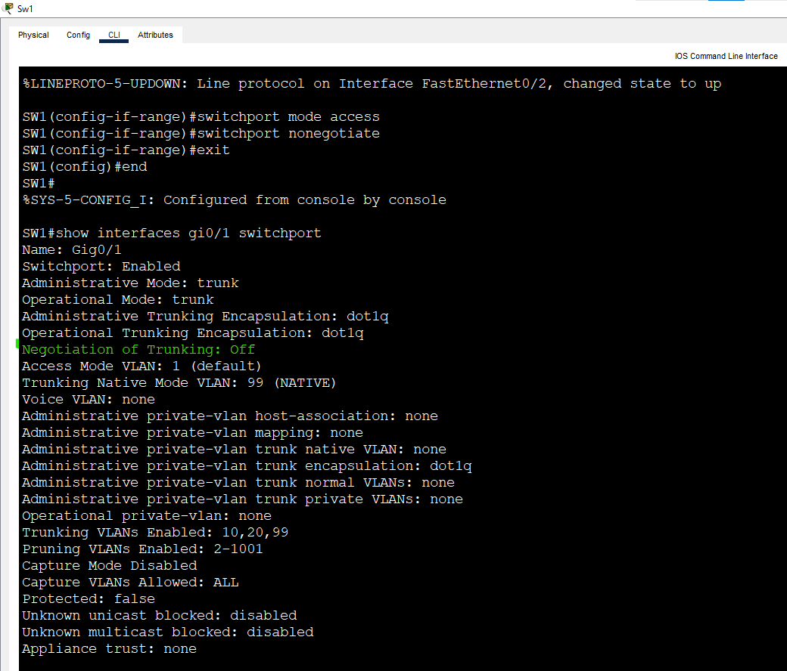
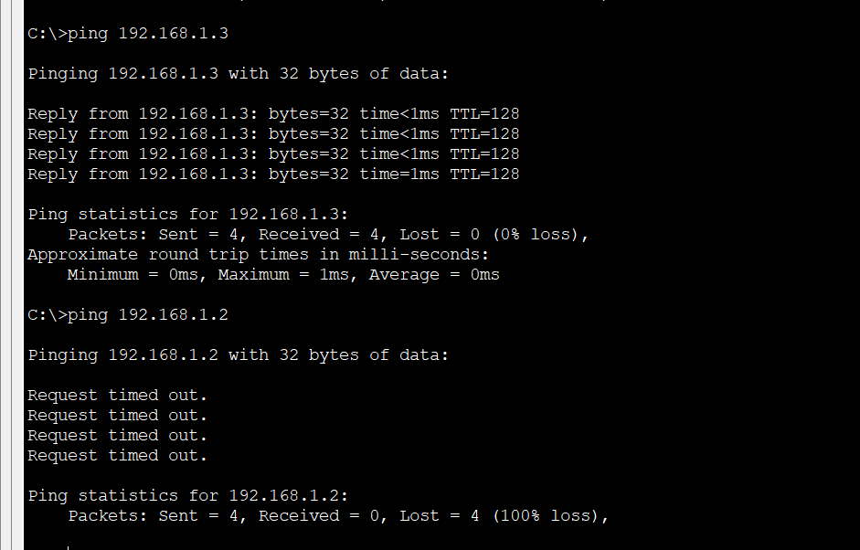

# Lab 5: DTP (Dynamic Trunking Protocol)

**Week 2 - Lab 5** | Topic: Switching & VLANs

## Objective
Understand how two switches negotiate a trunk automatically with DTP, test the different switchport modes and their results, and finish with a manual trunk and DTP turned off, which is the recommended practice.

## Theory

| Mode | Description |
|------|-------------|
| `dynamic auto` | Waits passively and becomes a trunk only if the other side asks. Default on the Catalyst 2960 |
| `dynamic desirable` | Actively asks the other side to form a trunk |
| `trunk` | Always a trunk, and still sends DTP frames |
| `access` | Always an access port |
| `switchport nonegotiate` | Stops the port from sending DTP frames. Allowed only on `trunk` or `access` ports |

### Expected results

| SW1 | SW2 | Result |
|-----|-----|--------|
| auto | auto | Access (nobody asks for a trunk) |
| auto | desirable | Trunk |
| desirable | desirable | Trunk |
| trunk | auto | Trunk |
| trunk | desirable | Trunk |
| trunk | access | Mismatch, not recommended |

DTP is convenient but it lets a connected device negotiate a trunk on its own, which is a security risk. Production links are set manually.

## Topology


Same topology as the previous labs: two Switch 2960 devices (`SW1`, `SW2`) and four PCs. The switch-to-switch link (Gi0/1 to Gi0/1) uses a **Cross-Over** cable, and the PCs use Straight-Through cables.

| Device | Switch | Port | VLAN |
|--------|--------|------|------|
| PC1 | SW1 | Fa0/1 | 10 (Sales) |
| PC2 | SW1 | Fa0/2 | 20 (IT) |
| PC3 | SW2 | Fa0/1 | 10 (Sales) |
| PC4 | SW2 | Fa0/2 | 20 (IT) |

## Addressing Table
All PCs are in one subnet, so VLANs are the only separation. There is no router and no default gateway.

| Device | IP Address | Subnet Mask |
|--------|------------|-------------|
| PC1 | 192.168.1.1 | 255.255.255.0 |
| PC2 | 192.168.1.2 | 255.255.255.0 |
| PC3 | 192.168.1.3 | 255.255.255.0 |
| PC4 | 192.168.1.4 | 255.255.255.0 |

## Steps

### 1. Prepare the link (both switches)
VLANs 10 and 20 and the access ports are already configured from the previous labs. Put the inter-switch port back in dynamic mode:
```
enable
configure terminal
interface gi0/1
 switchport mode dynamic auto
 end
```

### 2. Test auto / auto
```
show interfaces gi0/1 switchport
show interfaces trunk
```
Gi0/1 shows `Operational Mode: static access` and does not appear in `show interfaces trunk`. Both sides are waiting for the other to ask, so no trunk forms. A ping from PC1 to PC3 fails.



### 3. Test auto / desirable
On SW1 only:
```
configure terminal
interface gi0/1
 switchport mode dynamic desirable
 end
```
Wait a few seconds, then run:
```
show interfaces trunk
```
Gi0/1 is now a trunk on both switches, although SW2 was never changed. A ping from PC1 to PC3 succeeds.



### 4. Test the other combinations
| Test | SW1 | SW2 |
|------|-----|-----|
| desirable / desirable | `switchport mode dynamic desirable` | `switchport mode dynamic desirable` |
| trunk / auto | `switchport mode trunk` | `switchport mode dynamic auto` |

Both combinations form a trunk. In the trunk / auto test, `show interfaces gi0/1 switchport` on SW2 shows `Administrative Mode: dynamic auto` but `Operational Mode: trunk`, so the configured mode and the actual mode are not always the same.

### 5. Final configuration: manual trunk, DTP off (both switches)
```
configure terminal
interface gi0/1
 switchport mode trunk
 switchport nonegotiate
interface range fa0/1 - 2
 switchport mode access
 switchport nonegotiate
 end
copy running-config startup-config
```
| Command | Purpose |
|---------|---------|
| `switchport mode trunk` | Fixes the link as a trunk |
| `switchport nonegotiate` | Stops DTP frames on the port |
| `switchport mode access` | Fixes the PC ports as access ports |

### 6. Verify
```
show interfaces gi0/1 switchport
show interfaces trunk
```
Gi0/1 shows `Negotiation of Trunking: Off` and remains a trunk.



Test from PC1:
```
ping 192.168.1.3
ping 192.168.1.2
```
The ping to PC3 (same VLAN, other switch) succeeds. The ping to PC2 (different VLAN) fails. The first packet can time out while ARP resolves.



## Questions and Answers

**1. What is the difference between `dynamic auto` and `dynamic desirable`?**
`dynamic auto` only responds when the other side asks for a trunk. `dynamic desirable` actively asks.

**2. Why does auto / auto not form a trunk?**
Both sides wait passively and neither sends a request, so the port stays an access port.

**3. Why is `switchport nonegotiate` recommended?**
It stops the port from sending or accepting DTP negotiation, so a device plugged into the port cannot talk the switch into a trunk. That reduces the risk of VLAN hopping.

**4. Why set the PC ports to `access`?**
A port left in dynamic mode could be negotiated into a trunk by whatever is connected to it. A fixed access port only carries its own VLAN.

**5. Why can the administrative mode differ from the operational mode?**
The administrative mode is what was configured. The operational mode is the result of negotiation. A `dynamic auto` port connected to a `trunk` port is administratively `dynamic auto` and operationally `trunk`.

**6. Why did the ping to PC2 fail although the trunk works?**
PC1 and PC2 are in different VLANs (10 and 20), which are separate broadcast domains. A trunk keeps them separate, and reaching another VLAN needs a Layer 3 device.

## Verification
| Command / test | Run on | Expected result |
|----------------|--------|-----------------|
| `show interfaces gi0/1 switchport` with auto / auto | SW1 | Operational Mode: static access |
| Ping PC1 to PC3 with auto / auto | PC1 | Fails |
| `show interfaces trunk` with auto / desirable | SW1, SW2 | Gi0/1 trunking |
| Ping PC1 to PC3 after the trunk forms | PC1 | Success |
| `show interfaces gi0/1 switchport` after Step 5 | SW1, SW2 | Negotiation of Trunking: Off |
| Ping PC1 to PC2 at the end | PC1 | Fails |

## Common Issues & Fixes
| Problem | Likely cause | Fix |
|---------|--------------|-----|
| The link stays access | Both sides are `dynamic auto` | Set one side to `dynamic desirable` or `trunk` |
| `switchport nonegotiate` is rejected | The port is in a dynamic mode | Set `trunk` or `access` first |
| The trunk does not form right away | Negotiation takes a few seconds | Wait, then check `show interfaces trunk` again |
| One side trunk, other side access | Mismatched modes | Set the same mode on both ends |
| Trunk link is down | Wrong cable type between switches | Use a Cross-Over cable |

## Files
- [Download Packet Tracer Lab](./lab%205.pkt)

## Lessons Learned
- DTP lets switches negotiate a trunk, and only `desirable` or `trunk` on one side makes it form.
- The operational mode can differ from the configured mode.
- Two `dynamic auto` ports never form a trunk.
- For security, set trunks and access ports manually and turn DTP off with `switchport nonegotiate`.
