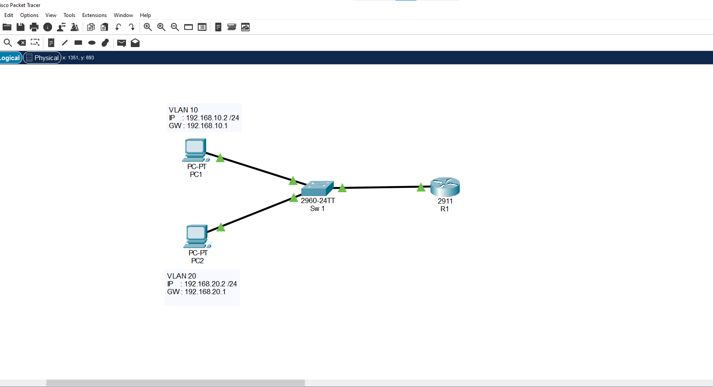
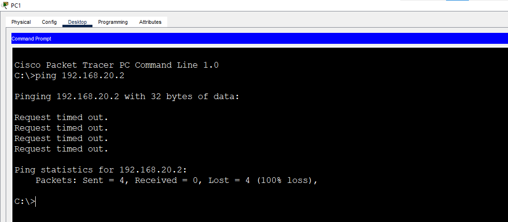
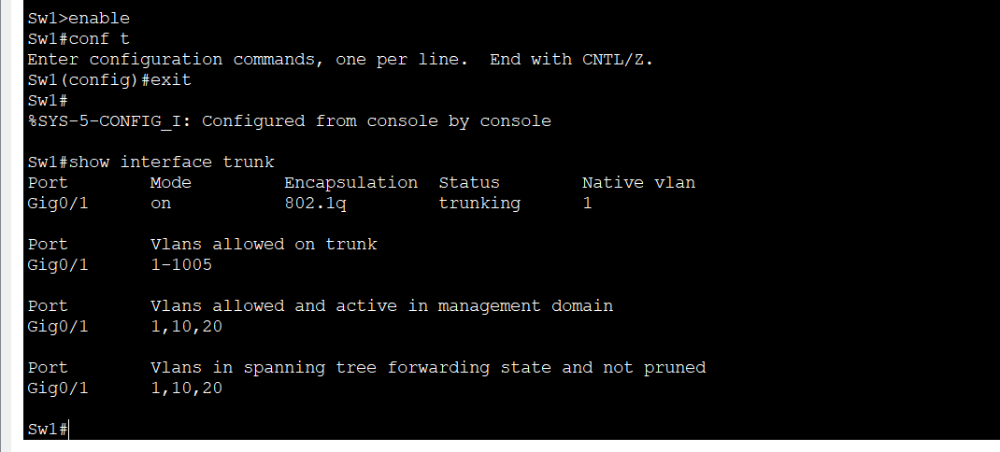
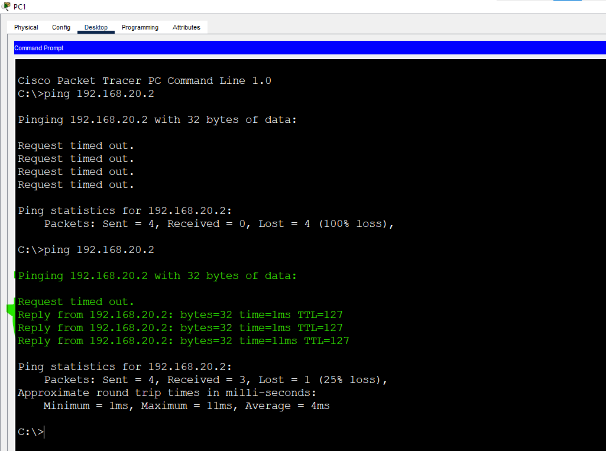

# Lab 6: Router-on-a-Stick

**Week 2 - Lab 6** | Topic: Switching & VLANs

## Objective
Enable communication between two VLANs using a single router connected to a switch through one trunk link. Create one subinterface per VLAN on the router, and prove that devices in different VLANs can reach each other only through the router.

## Theory

| Concept | Description |
|---------|-------------|
| Router-on-a-Stick | One router connected to a switch with a single physical link, and that link is a trunk |
| Subinterface | A logical interface created on one physical router port, one per VLAN |
| `encapsulation dot1Q <id>` | Binds the subinterface to a VLAN and tells the router to expect 802.1Q tags |
| Default gateway | The IP address of the subinterface is the gateway for the hosts in that VLAN |

Each VLAN is a separate broadcast domain and needs its own subnet. Traffic between two subnets must pass through a Layer 3 device, so the router receives the tagged frame on one subinterface, routes the packet, and sends it back out through the other subinterface with the new VLAN tag.

## Topology


One Switch 2960 (`SW1`), one router (`R1`) and two PCs. All links use **Straight-Through** cables.

| Device | Port | Connected to | VLAN / Mode |
|--------|------|--------------|-------------|
| PC1 | NIC | SW1 Fa0/1 | 10 (Sales) |
| PC2 | NIC | SW1 Fa0/2 | 20 (IT) |
| SW1 | Gi0/1 | R1 Gi0/0 | Trunk |

## Addressing Table
Each VLAN has its own subnet, and the router subinterface is the default gateway.

| Device | Interface | VLAN | IP Address | Subnet Mask | Default Gateway |
|--------|-----------|------|------------|-------------|-----------------|
| PC1 | NIC | 10 | 192.168.10.2 | 255.255.255.0 | 192.168.10.1 |
| PC2 | NIC | 20 | 192.168.20.2 | 255.255.255.0 | 192.168.20.1 |
| R1 | Gi0/0.10 | 10 | 192.168.10.1 | 255.255.255.0 | - |
| R1 | Gi0/0.20 | 20 | 192.168.20.1 | 255.255.255.0 | - |

## Steps

### 1. Configure the switch (SW1)
```
enable
configure terminal
hostname SW1
vlan 10
 name Sales
vlan 20
 name IT
 exit
interface fa0/1
 switchport mode access
 switchport access vlan 10
interface fa0/2
 switchport mode access
 switchport access vlan 20
interface gi0/1
 description Trunk-to-R1
 switchport mode trunk
 end
copy running-config startup-config
```

### 2. Test before the router
Set the IP addresses and gateways on the PCs, then from PC1:
```
ping 192.168.20.2
```
The ping fails. PC1 and PC2 are in different VLANs and different subnets, and nothing connects them yet.



### 3. Configure the router (R1)
```
enable
configure terminal
hostname R1
interface gi0/0
 no shutdown
interface gi0/0.10
 description Gateway-VLAN10
 encapsulation dot1Q 10
 ip address 192.168.10.1 255.255.255.0
interface gi0/0.20
 description Gateway-VLAN20
 encapsulation dot1Q 20
 ip address 192.168.20.1 255.255.255.0
 end
copy running-config startup-config
```

| Command | Purpose |
|---------|---------|
| `interface gi0/0` + `no shutdown` | Brings up the physical port. It has no IP address of its own |
| `interface gi0/0.10` | Creates the subinterface for VLAN 10 |
| `encapsulation dot1Q 10` | Associates the subinterface with VLAN 10 |
| `ip address ...` | Gives the subinterface the gateway address of its VLAN |

### 4. Verify
On R1:
```
show ip interface brief
show ip route
```
On SW1:
```
show interfaces trunk
```
`show ip route` lists two connected networks, `192.168.10.0/24` on `Gi0/0.10` and `192.168.20.0/24` on `Gi0/0.20`. `show interfaces trunk` on SW1 lists Gi0/1 as a trunk carrying VLANs 10 and 20.




### 5. Test after the router
From PC1:
```
ping 192.168.20.2
tracert 192.168.20.2
```
The ping to PC2 succeeds. The first hop in the traceroute is `192.168.10.1`, which is the router. The first packet can time out while ARP resolves.



## Questions and Answers

**1. Why is a router needed for communication between VLANs?**
Each VLAN is a separate broadcast domain with its own subnet. A Layer 2 switch only forwards frames inside a VLAN, so traffic between two VLANs must be routed by a Layer 3 device.

**2. Why does each subinterface need `encapsulation dot1Q`?**
The router receives tagged frames on a single physical port. The command tells the router which VLAN ID belongs to which subinterface, so it can match incoming frames and tag outgoing frames correctly.

**3. Why does the physical interface have no IP address?**
The physical port only carries the trunk. The IP addresses live on the subinterfaces, one for each VLAN. The physical port only needs `no shutdown`, because if it stays down every subinterface stays down.

**4. What is the main disadvantage of Router-on-a-Stick?**
All traffic between VLANs goes through one physical link, in and out, so that link can become a bottleneck. The router also becomes a single point of failure.

**5. What is the difference between Router-on-a-Stick and a Layer 3 switch?**
Router-on-a-Stick routes through an external router over one trunk link. A Layer 3 switch routes inside the switch itself using SVIs, which is faster and needs no extra link. This is the topic of the next lab.

## Verification
| Command / test | Run on | Expected result |
|----------------|--------|-----------------|
| Ping PC1 to PC2 before the router | PC1 | Fails |
| `show interfaces trunk` | SW1 | Gi0/1 trunking, VLANs 10 and 20 allowed |
| `show ip interface brief` | R1 | Gi0/0, Gi0/0.10 and Gi0/0.20 up/up |
| `show ip route` | R1 | Two connected routes, 192.168.10.0/24 and 192.168.20.0/24 |
| Ping PC1 to PC2 after the router | PC1 | Success |
| `tracert 192.168.20.2` | PC1 | First hop 192.168.10.1 |

## Common Issues & Fixes
| Problem | Likely cause | Fix |
|---------|--------------|-----|
| Ping between VLANs fails | Wrong default gateway on the PC | Set the gateway to the subinterface address |
| No reply from the gateway | `gi0/0` is shut down | Run `no shutdown` on the physical interface |
| A subinterface does not work | Wrong VLAN ID in `encapsulation dot1Q` | Match the ID to the VLAN |
| The router does not see the VLANs | The switch port to the router is not a trunk | Set `switchport mode trunk` on Gi0/1 |
| First ping times out | ARP resolution | Ping again |

## Files
- [Download Packet Tracer Lab](./lab%206.pkt)

## Lessons Learned
- Devices in different VLANs need a Layer 3 device to communicate.
- Router-on-a-Stick uses one trunk link and one subinterface per VLAN.
- Each subinterface needs `encapsulation dot1Q` and an IP address that serves as the VLAN gateway.
- The physical interface carries no IP address but must be enabled.
- All inter-VLAN traffic shares one link, which limits performance.
