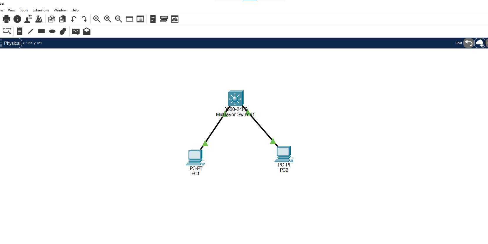
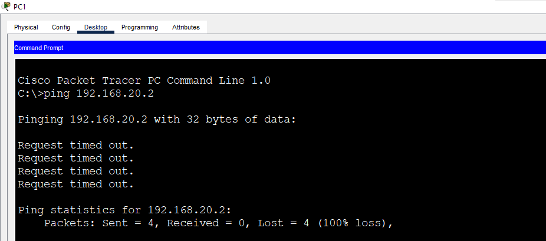
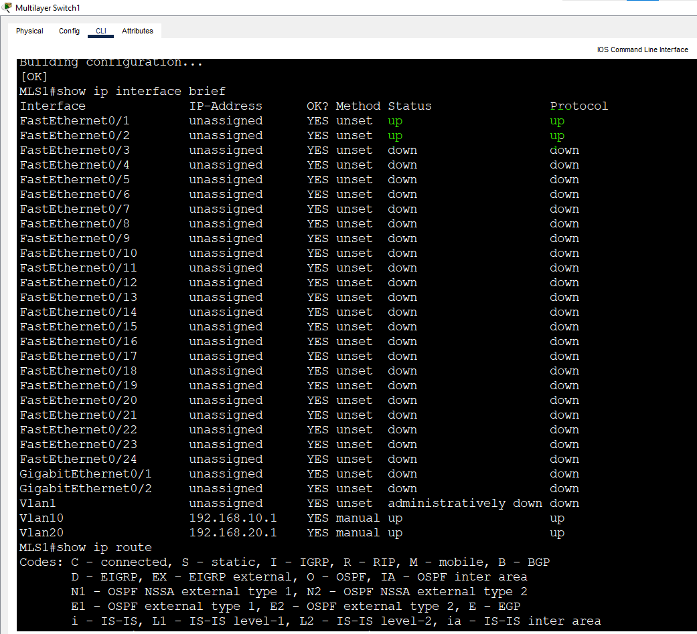
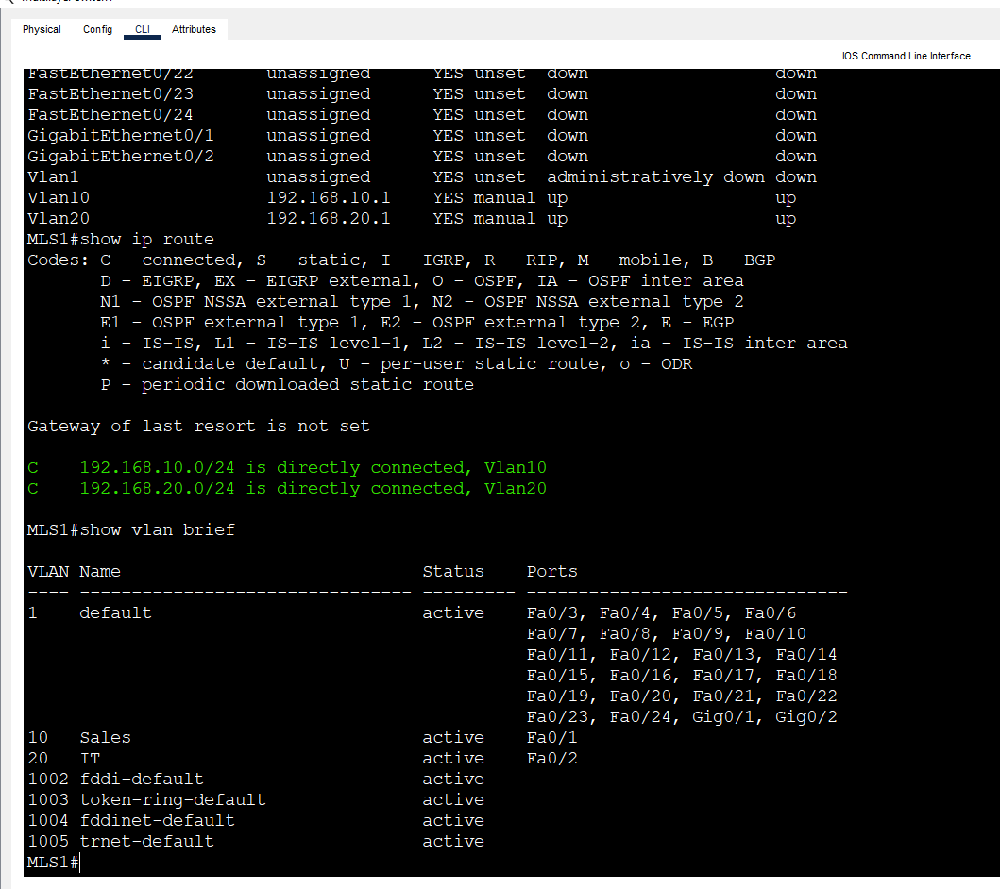
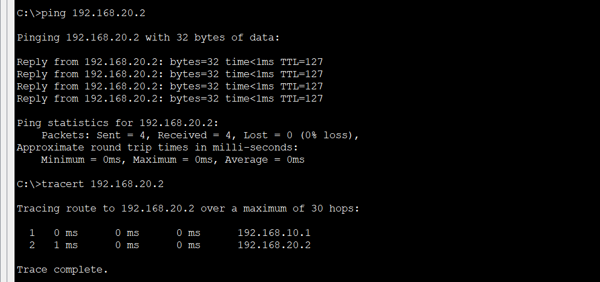

# Lab 7: Inter-VLAN Routing with a Layer 3 Switch (SVI)

**Week 2 - Lab 7** | Topic: Switching & VLANs

## Objective
Route between two VLANs inside a single Layer 3 switch using SVIs, without an external router, and compare the result with Router-on-a-Stick from Lab 6.

## Theory

| Concept | Description |
|---------|-------------|
| Layer 3 switch | A switch that performs both switching and routing in one device |
| SVI | Switch Virtual Interface (`interface vlan X`). It acts as the default gateway of that VLAN |
| `ip routing` | Enables Layer 3 forwarding on the switch. Without it the SVIs do not route between VLANs |
| SVI state | An SVI is up/up only when its VLAN exists and at least one port in that VLAN is active |

The Packet Tracer Catalyst 2960 is a Layer 2 switch and does not support `ip routing`. This lab uses a **Catalyst 3560-24PS** multilayer switch.

## Topology


One multilayer switch (`MLS1`) and two PCs. There is no router. All links use **Straight-Through** cables.

| Device | Switch | Port | VLAN |
|--------|--------|------|------|
| PC1 | MLS1 | Fa0/1 | 10 (Sales) |
| PC2 | MLS1 | Fa0/2 | 20 (IT) |

## Addressing Table
The addressing is the same as Lab 6, so the two methods are easy to compare. The SVI is the default gateway.

| Device | Interface | VLAN | IP Address | Subnet Mask | Default Gateway |
|--------|-----------|------|------------|-------------|-----------------|
| PC1 | NIC | 10 | 192.168.10.2 | 255.255.255.0 | 192.168.10.1 |
| PC2 | NIC | 20 | 192.168.20.2 | 255.255.255.0 | 192.168.20.1 |
| MLS1 | VLAN 10 (SVI) | 10 | 192.168.10.1 | 255.255.255.0 | - |
| MLS1 | VLAN 20 (SVI) | 20 | 192.168.20.1 | 255.255.255.0 | - |

## Steps

### 1. Create the VLANs and access ports
```
enable
configure terminal
hostname MLS1
vlan 10
 name Sales
vlan 20
 name IT
 exit
interface fa0/1
 switchport mode access
 switchport access vlan 10
interface fa0/2
 switchport mode access
 switchport access vlan 20
 end
```

### 2. Test before the SVIs
Set the IP addresses and gateways on the PCs, then from PC1:
```
ping 192.168.20.2
```
The ping fails. PC1 and PC2 are in different VLANs and different subnets, and nothing routes between them yet.



### 3. Enable routing and create the SVIs
```
configure terminal
ip routing
interface vlan 10
 description Gateway-VLAN10
 ip address 192.168.10.1 255.255.255.0
 no shutdown
interface vlan 20
 description Gateway-VLAN20
 ip address 192.168.20.1 255.255.255.0
 no shutdown
 end
copy running-config startup-config
```

| Command | Purpose |
|---------|---------|
| `ip routing` | Turns the switch into a router for IP traffic |
| `interface vlan 10` | Creates the SVI for VLAN 10 |
| `ip address ...` | Gives the SVI the gateway address of its VLAN |
| `no shutdown` | Enables the SVI |

### 4. Verify
```
show ip interface brief
show ip route
show vlan brief
```
`show ip interface brief` lists `Vlan10` and `Vlan20` as up/up. `show ip route` lists two connected networks, `192.168.10.0/24` on `Vlan10` and `192.168.20.0/24` on `Vlan20`.





### 5. Test after the SVIs
From PC1:
```
ping 192.168.20.2
tracert 192.168.20.2
```
The ping to PC2 succeeds. The first hop in the traceroute is `192.168.10.1`, which is the switch itself, followed by the destination. The first packet can time out while ARP resolves.



### 6. Optional: see the SVI state change
```
configure terminal
interface fa0/2
 shutdown
 end
show ip interface brief
```
`Vlan20` goes down because no active port is left in VLAN 20. Restore it:
```
configure terminal
interface fa0/2
 no shutdown
 end
```

## Questions and Answers

**1. What is an SVI and what is it used for?**
An SVI is a virtual Layer 3 interface that represents a VLAN on a switch. Its IP address is the default gateway for the hosts in that VLAN, and it routes traffic between VLANs.

**2. Why is `ip routing` needed?**
Without it the switch only forwards frames at Layer 2, and the SVIs act as management interfaces. The command enables Layer 3 forwarding between the connected networks.

**3. Why can an SVI be down even after `no shutdown`?**
An SVI comes up only when its VLAN exists and at least one port in that VLAN is up. If the VLAN is missing or all of its ports are down, the SVI stays down.

**4. What is the difference between a Layer 3 switch and Router-on-a-Stick?**
Router-on-a-Stick sends every inter-VLAN packet over one trunk link to an external router and back, so the link can become a bottleneck. A Layer 3 switch routes internally in hardware, needs no extra link and no external router, and is faster.

**5. Why can the 2960 not be used in this lab?**
The Packet Tracer 2960 is a Layer 2 switch and rejects `ip routing`. A multilayer switch such as the 3560 is required.

## Verification
| Command / test | Run on | Expected result |
|----------------|--------|-----------------|
| Ping PC1 to PC2 before the SVIs | PC1 | Fails |
| `show ip interface brief` | MLS1 | Vlan10 and Vlan20 up/up |
| `show ip route` | MLS1 | Two connected routes, 192.168.10.0/24 and 192.168.20.0/24 |
| Ping PC1 to PC2 after the SVIs | PC1 | Success |
| `tracert 192.168.20.2` | PC1 | First hop 192.168.10.1 |

## Common Issues & Fixes
| Problem | Likely cause | Fix |
|---------|--------------|-----|
| Ping between VLANs fails | `ip routing` is not enabled | Run `ip routing` |
| An SVI is down | No active port in the VLAN, or the VLAN does not exist | Connect a device or create the VLAN |
| An SVI is administratively down | `no shutdown` was forgotten | Run `no shutdown` on the SVI |
| No reply from the gateway | Wrong default gateway on the PC | Set the gateway to the SVI address |
| `ip routing` is rejected | The switch is a 2960 | Use a 3560 multilayer switch |
| First ping times out | ARP resolution | Ping again |

## Files
- [Download Packet Tracer Lab](./lab%207.pkt)

## Lessons Learned
- A Layer 3 switch routes between VLANs internally using SVIs.
- `ip routing` must be enabled, otherwise the SVIs do not route.
- An SVI is up only when its VLAN has at least one active port.
- Compared with Router-on-a-Stick, there is no external router and no shared trunk bottleneck.
