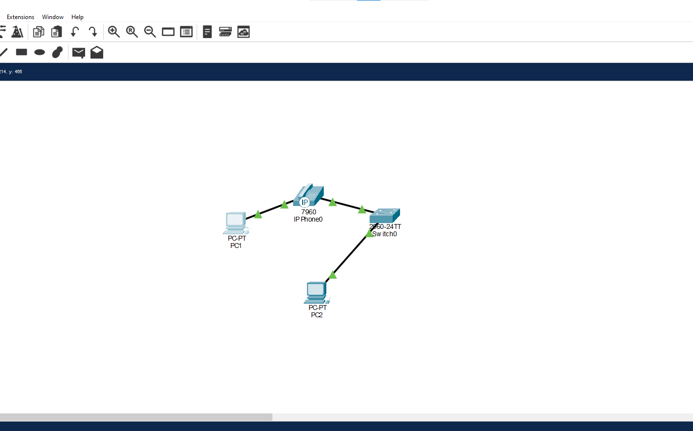
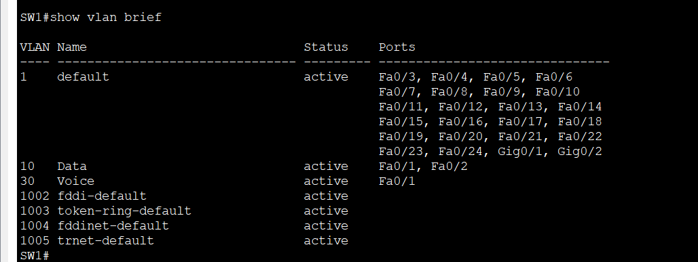
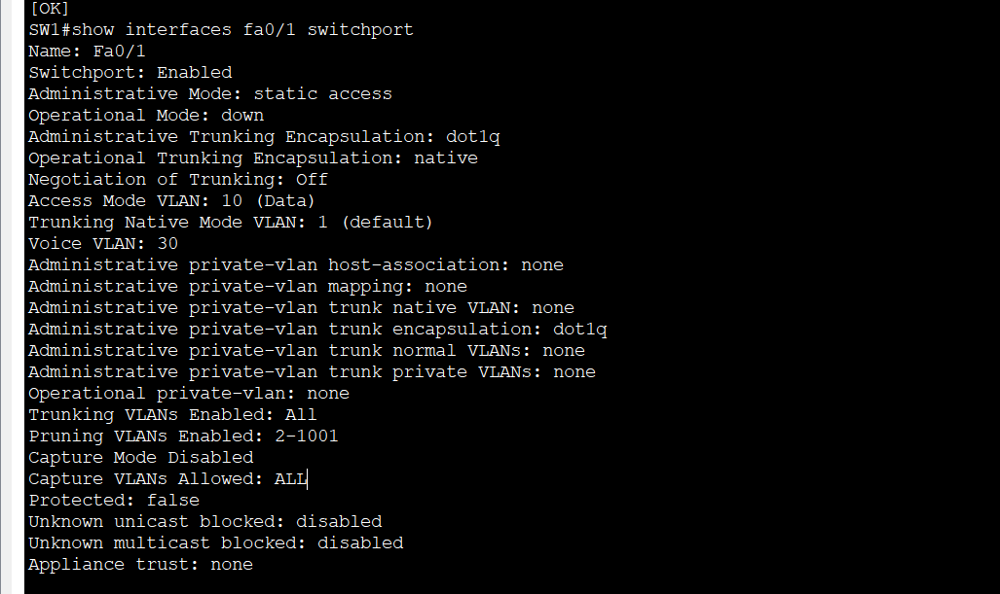
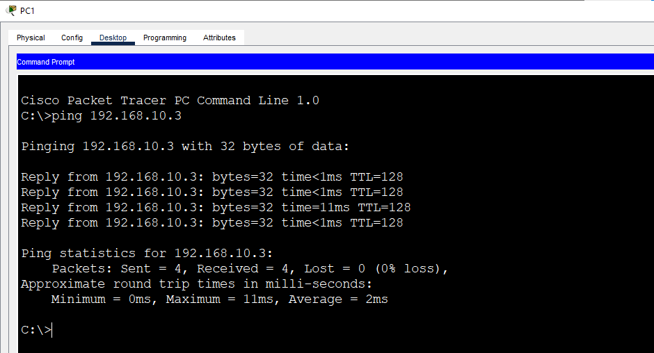

# Lab 8: Voice VLAN

**Week 2 - Lab 8** | Topic: Switching & VLANs

## Objective
Separate IP phone traffic from PC traffic on the same switch port by configuring a data VLAN and a voice VLAN together, and understand how the phone learns its voice VLAN.

## Theory

| Concept | Description |
|---------|-------------|
| Voice VLAN | A VLAN dedicated to IP phone traffic, kept apart from data traffic |
| `switchport voice vlan <id>` | Defines the voice VLAN on an access port |
| IP phone | Contains a small switch with a port for the network and a port for a PC, so a PC can connect through the phone |
| CDP | The switch tells the phone which voice VLAN to use, so the phone tags its own traffic |

On a port with a voice VLAN, the PC traffic crosses the phone **untagged** in the data VLAN, and the phone traffic is **tagged** in the voice VLAN. The port still counts as an access port.

## Topology


One Switch 2960 (`SW1`), one IP phone, and two PCs. PC1 is connected to the PC port of the phone, and the phone is connected to `Fa0/1`. PC2 is connected directly to `Fa0/2`. All links use **Straight-Through** cables.

| Device | Connected to | Port | VLAN |
|--------|--------------|------|------|
| IP Phone | SW1 | Fa0/1 | 30 (Voice) |
| PC1 | IP Phone (PC port) | - | 10 (Data) |
| PC2 | SW1 | Fa0/2 | 10 (Data) |

## Addressing Table
There is no router and no default gateway. The phone does not need an IP address for this lab, which focuses on the VLAN configuration.

| Device | IP Address | Subnet Mask |
|--------|------------|-------------|
| PC1 | 192.168.10.2 | 255.255.255.0 |
| PC2 | 192.168.10.3 | 255.255.255.0 |

## Steps

### 1. Create the VLANs
```
enable
configure terminal
hostname SW1
vlan 10
 name Data
vlan 30
 name Voice
 exit
```

### 2. Configure the phone port (Fa0/1)
```
interface fa0/1
 description IP-Phone-and-PC1
 switchport mode access
 switchport access vlan 10
 switchport voice vlan 30
 spanning-tree portfast
 exit
```

| Command | Purpose |
|---------|---------|
| `switchport access vlan 10` | Sets the data VLAN used by the PC behind the phone |
| `switchport voice vlan 30` | Sets the voice VLAN used by the phone |
| `spanning-tree portfast` | Brings the end-device port up without delay |

### 3. Configure the PC port (Fa0/2)
```
interface fa0/2
 description PC2
 switchport mode access
 switchport access vlan 10
 spanning-tree portfast
 end
copy running-config startup-config
```

### 4. Verify
```
show vlan brief
show interfaces fa0/1 switchport
show running-config interface fa0/1
```
`show interfaces fa0/1 switchport` shows `Access Mode VLAN: 10 (Data)` and `Voice VLAN: 30 (Voice)`. `show vlan brief` lists Fa0/1 under VLAN 10 and VLAN 30 in the VLAN list.





### 5. Test the data traffic
From PC1:
```
ping 192.168.10.3
```
The ping to PC2 succeeds, because PC1's traffic crosses the phone untagged in VLAN 10. The first packet can time out while ARP resolves.



### 6. Optional: remove the voice VLAN
```
configure terminal
interface fa0/1
 no switchport voice vlan
 end
show interfaces fa0/1 switchport
```
The output shows `Voice VLAN: none`, so the phone would send its traffic in the data VLAN. Restore it:
```
configure terminal
interface fa0/1
 switchport voice vlan 30
 end
```

## Packet Tracer Notes
- The IP phone (7960) needs power. Add a power adapter from the Physical tab, or use a switch with PoE.
- Registering the phone and making calls needs a router with `telephony-service`, which is outside the scope of this lab.

## Questions and Answers

**1. What is the benefit of a voice VLAN?**
It keeps voice traffic in its own VLAN, separate from data. That allows different policies and priority for voice, and it avoids mixing phone traffic with PC traffic.

**2. Why separate voice traffic from data traffic?**
Voice is sensitive to delay and loss, so it should not compete with bulk data. A separate VLAN makes it possible to apply quality of service and security rules to voice only.

**3. How does the phone learn the voice VLAN?**
The switch advertises the voice VLAN to the phone through CDP. The phone then sends its own traffic tagged with that VLAN ID.

**4. What is the difference between `switchport access vlan` and `switchport voice vlan`?**
`switchport access vlan` sets the VLAN for untagged data traffic from the PC. `switchport voice vlan` sets the VLAN for the tagged traffic from the phone.

**5. Which device sends tagged traffic and which sends untagged traffic on this port?**
The phone sends tagged traffic in the voice VLAN (30). The PC behind the phone sends untagged traffic that the switch places in the data VLAN (10).

## Verification
| Command / test | Run on | Expected result |
|----------------|--------|-----------------|
| `show interfaces fa0/1 switchport` | SW1 | Access Mode VLAN 10, Voice VLAN 30 |
| `show vlan brief` | SW1 | VLAN 10 with Fa0/1 and Fa0/2, VLAN 30 listed |
| `show running-config interface fa0/1` | SW1 | `switchport access vlan 10` and `switchport voice vlan 30` |
| Ping PC1 to PC2 | PC1 | Success |
| Voice VLAN removed | SW1 | `Voice VLAN: none` |

## Common Issues & Fixes
| Problem | Likely cause | Fix |
|---------|--------------|-----|
| `Voice VLAN: none` | The command is missing on the port | Run `switchport voice vlan 30` |
| The phone does not power on | No power source | Add a power adapter or use PoE |
| The PC behind the phone has no connectivity | The port is not an access port in VLAN 10 | Fix `switchport access vlan` |
| VLAN 30 is not listed | The voice VLAN was not created | Create VLAN 30 |
| `switchport voice vlan` is rejected | The port is a trunk | Set the port to access mode |

## Files
- [Download Packet Tracer Lab](./lab%208.pkt)

## Lessons Learned
- One access port can carry a data VLAN and a voice VLAN at the same time.
- The phone learns its voice VLAN from the switch through CDP.
- PC traffic through the phone is untagged, and phone traffic is tagged.
- Separating voice from data allows priority and security rules for voice.
