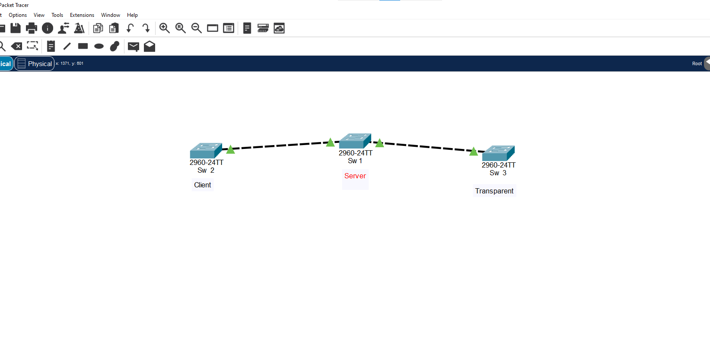
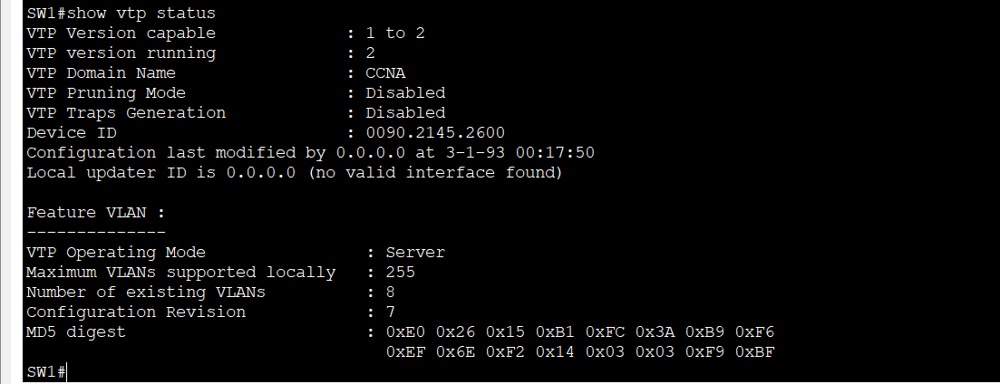
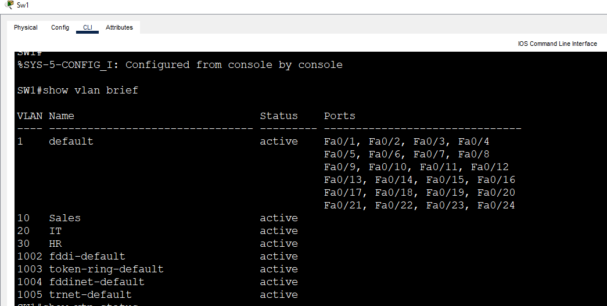
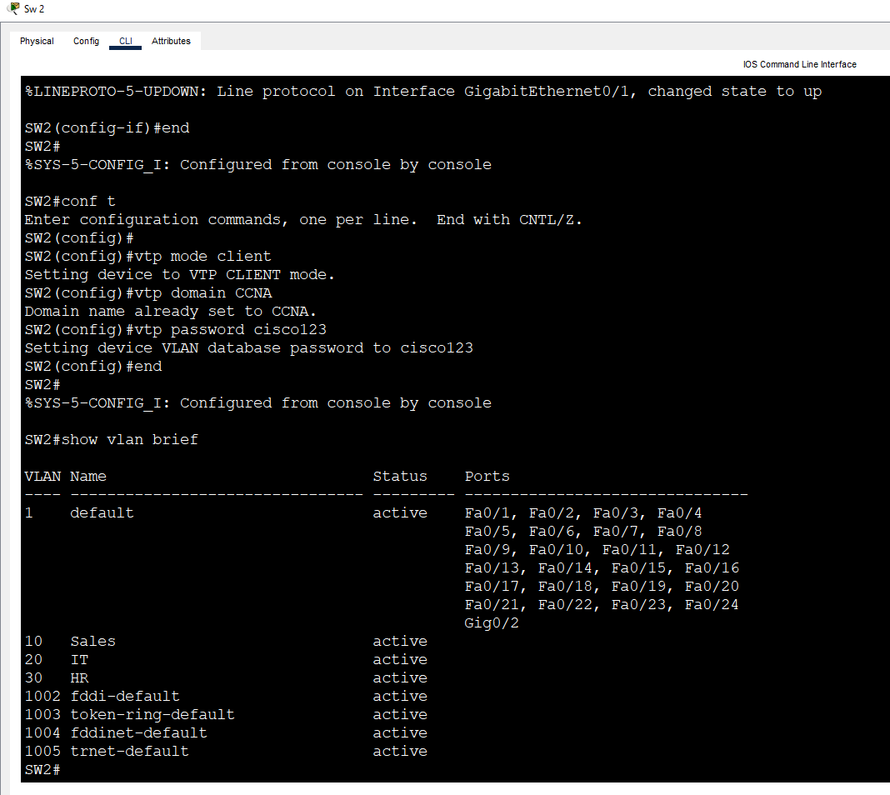
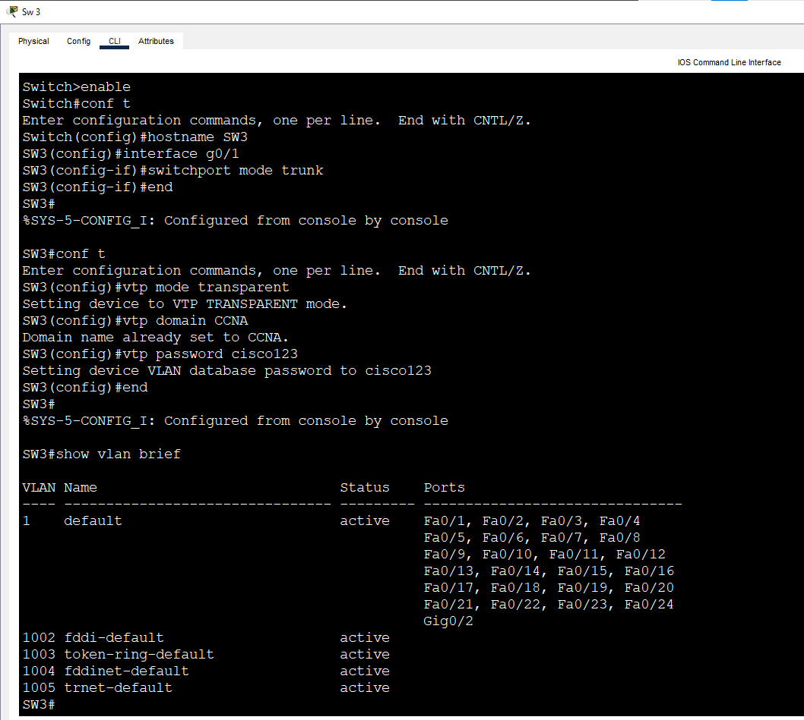

# Lab 9: VTP (VLAN Trunking Protocol)

**Week 2 - Lab 9** | Topic: Switching & VLANs

## Objective
Create VLANs once on a VTP server and let the other switches learn them automatically over trunk links. Compare the behavior of the three VTP modes: server, client and transparent.

## Theory

| Mode | Description |
|------|-------------|
| Server | Can create, change and delete VLANs, and advertises them to the other switches. It is the default mode |
| Client | Cannot change VLANs. It learns them from the server and forwards the advertisements |
| Transparent | Ignores received VLAN information and keeps its own local VLANs, but still forwards the advertisements to its neighbors |

| Concept | Description |
|---------|-------------|
| VTP domain | The group of switches that share VLAN information. The name must match on all of them |
| VTP password | Prevents an unknown switch from sending VLAN changes into the domain |
| Configuration revision | A counter that increases with every VLAN change. The advertisement with the higher number wins |
| Trunk requirement | VTP messages travel only over trunk links |

## Topology


Three Switch 2960 devices. `SW1` is the VTP server, `SW2` is a client and `SW3` is transparent. All switch-to-switch links use **Cross-Over** cables.

| Link | Port A | Port B | Mode |
|------|--------|--------|------|
| SW1 to SW2 | SW1 Gi0/1 | SW2 Gi0/1 | Trunk |
| SW1 to SW3 | SW1 Gi0/2 | SW3 Gi0/1 | Trunk |

| Switch | VTP Mode |
|--------|----------|
| SW1 | Server |
| SW2 | Client |
| SW3 | Transparent |

VTP settings: domain `CCNA`, password `cisco123`, version 2.

## Steps

### 1. Configure the trunks
VTP messages travel only over trunks, so the links come first.

SW1:
```
enable
configure terminal
hostname SW1
interface gi0/1
 switchport mode trunk
interface gi0/2
 switchport mode trunk
 end
```
SW2:
```
enable
configure terminal
hostname SW2
interface gi0/1
 switchport mode trunk
 end
```
SW3:
```
enable
configure terminal
hostname SW3
interface gi0/1
 switchport mode trunk
 end
```

### 2. Configure SW1 as the VTP server
```
configure terminal
vtp mode server
vtp domain CCNA
vtp password cisco123
vtp version 2
 end
```

| Command | Purpose |
|---------|---------|
| `vtp mode server` | Makes the switch a VTP server |
| `vtp domain CCNA` | Sets the domain name, which must match on all switches |
| `vtp password cisco123` | Sets the shared password |
| `vtp version 2` | Selects VTP version 2. It is set on the server and learned by the clients |

### 3. Configure SW2 as a client
```
configure terminal
vtp mode client
vtp domain CCNA
vtp password cisco123
 end
```

### 4. Configure SW3 as transparent
```
configure terminal
vtp mode transparent
vtp domain CCNA
vtp password cisco123
 end
```

### 5. Create the VLANs on SW1 only
```
configure terminal
vlan 10
 name Sales
vlan 20
 name IT
vlan 30
 name HR
 end
```

### 6. Verify
On SW1:
```
show vtp status
show vlan brief
```





On SW2:
```
show vlan brief
```
VLANs 10, 20 and 30 appear on SW2 without being configured there.



On SW3:
```
show vlan brief
```
VLANs 10, 20 and 30 do **not** appear on SW3, because a transparent switch does not learn VLANs.



| `show vtp status` field | Meaning |
|-------------------------|---------|
| VTP Version | The VTP version in use |
| Configuration Revision | The counter that decides which database wins |
| Number of existing VLANs | The count of VLANs in the database |
| VTP Operating Mode | Server, client or transparent |
| VTP Domain Name | The domain the switch belongs to |

### 7. Test the client restriction
On SW2:
```
configure terminal
vlan 40
```
The switch refuses the change, because a VTP client cannot create or modify VLANs.

### 8. Test the transparent mode
On SW3:
```
configure terminal
vlan 40
 name LOCAL
 end
show vlan brief
```
VLAN 40 exists on SW3 only. It is local and is not advertised to the other switches.

## Questions and Answers

**1. What is the function of VTP?**
VTP shares VLAN information between switches in the same domain over trunk links. VLANs are created once on a VTP server and learned automatically by the other switches, so they do not have to be configured on each switch by hand.

**2. What is the difference between server, client and transparent mode?**
A server can create, change and delete VLANs, and it advertises them to the other switches. A client cannot change VLANs. It only learns them from the server and forwards the advertisements. A transparent switch ignores the received VLAN information and keeps its own local VLANs, but it still forwards the advertisements to its neighbors.

**3. Why must the domain name and password match?**
A switch accepts VTP advertisements only from switches in the same domain, and with the same password if one is set. A mismatch makes the switch ignore the updates. The password also stops an unknown switch from sending VLAN changes into the network.

**4. What is the configuration revision number and why is it dangerous?**
It is a counter that increases with every VLAN change on a server. A switch always accepts the advertisement with the higher revision number. If a switch with a higher number, for example an old lab switch, is connected to the network, its VLAN database overwrites the real one and can delete VLANs on every switch. To reset the number on a switch, change its mode to transparent and back to server before connecting it.

**5. Why does VTP need a trunk?**
VTP messages are sent only over trunk links. An access port belongs to one VLAN and does not carry VTP advertisements, so a switch connected through an access port never learns the VLANs.

**6. Why do many companies disable VTP?**
The revision number problem can erase the VLANs of the whole network from a single mistake. Many networks have few VLANs, so the saving is small compared with the risk. They set switches to transparent mode, or manage VLANs with automation tools instead.

## Verification
| Command / test | Run on | Expected result |
|----------------|--------|-----------------|
| `show vtp status` | SW1 | Server mode, domain CCNA, version 2 |
| `show vlan brief` | SW2 | VLANs 10, 20 and 30 learned automatically |
| `show vlan brief` | SW3 | VLANs 10, 20 and 30 absent |
| `vlan 40` on SW2 | SW2 | Refused, the switch is a client |
| `vlan 40` on SW3 | SW3 | Accepted, local to SW3 only |

## Common Issues & Fixes
| Problem | Likely cause | Fix |
|---------|--------------|-----|
| The client does not learn the VLANs | The link is not a trunk | Set `switchport mode trunk` on both ends |
| The client does not learn the VLANs | Different domain name or password | Make them identical |
| VLANs disappear from the network | A switch with a higher revision number was connected | Reset its revision number before connecting it |
| The transparent switch does not learn VLANs | This is the normal behavior | Create the VLANs locally |
| A VLAN change is refused on a switch | The switch is a client | Make the change on the server |

## Files
- [Download Packet Tracer Lab](./lab%209.pkt)

## Lessons Learned
- VTP creates VLANs once on a server and spreads them to the other switches.
- The domain name and password must match on every switch in the domain.
- A client cannot change VLANs, and a transparent switch keeps only its own local VLANs.
- A higher configuration revision number overwrites the database, so a wrongly connected switch can erase the VLANs of the whole network.
