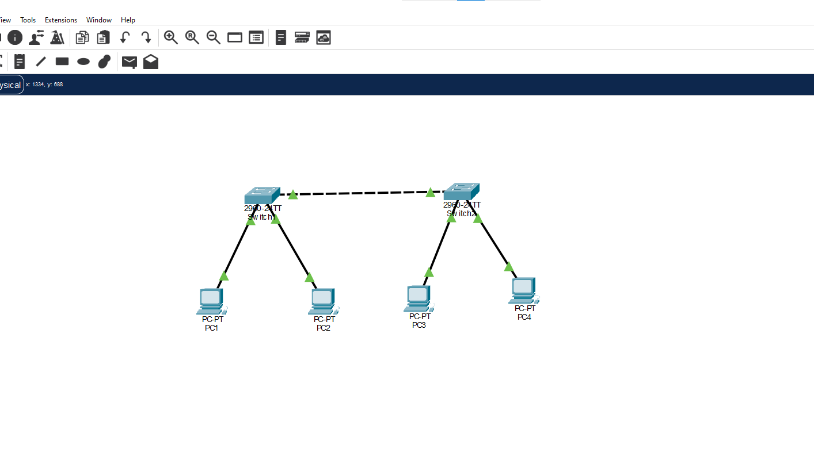
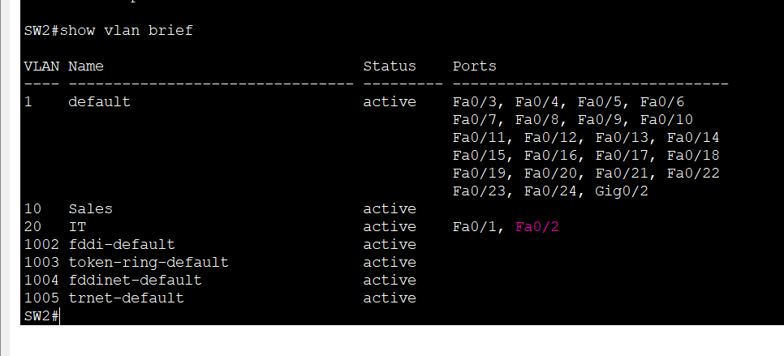
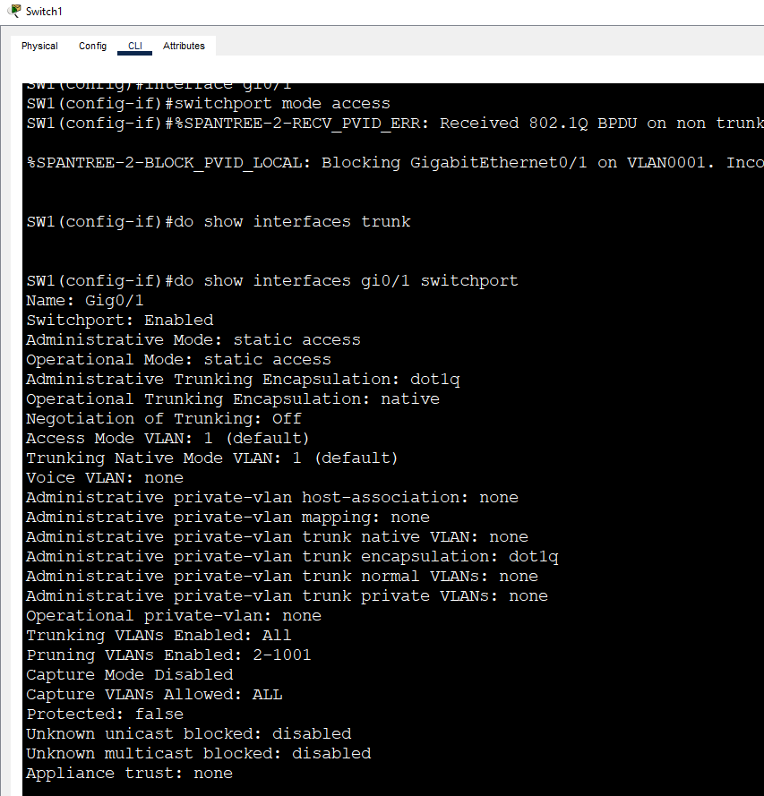
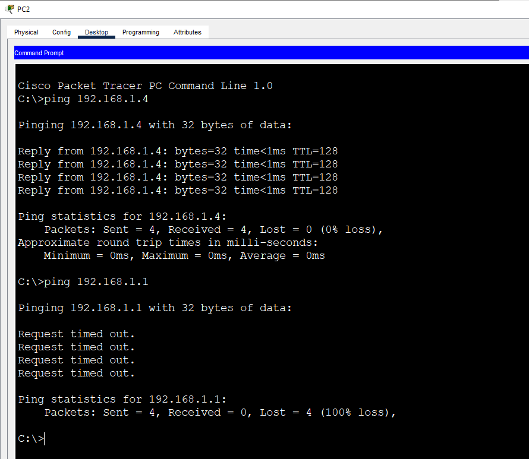

# Lab 10: VLAN Troubleshooting

**Week 2 - Lab 10** | Topic: Switching & VLANs

## Objective
Build a working VLAN network, break it with five common faults one at a time, and practice finding and fixing each fault with a structured troubleshooting method.

## Theory

| Layer / area | What to check | Command |
|--------------|---------------|---------|
| Layer 1 | The port is up and not shut down | `show interfaces status` |
| Layer 2, access ports | The port is in the correct VLAN and the VLAN exists | `show vlan brief` |
| Layer 2, trunk | The link is a trunk and carries the needed VLANs | `show interfaces trunk` |
| Layer 3 | The IP address and mask on the hosts are correct | PC settings, `ping` |

Troubleshoot from the bottom up. A fault on a lower layer makes every check above it fail, so the physical port comes first.

## Topology


Two Switch 2960 devices (`SW1`, `SW2`) and four PCs. The switch-to-switch link (Gi0/1 to Gi0/1) uses a **Cross-Over** cable, and the PCs use Straight-Through cables.

| Device | Switch | Port | VLAN |
|--------|--------|------|------|
| PC1 | SW1 | Fa0/1 | 10 (Sales) |
| PC2 | SW1 | Fa0/2 | 20 (IT) |
| PC3 | SW2 | Fa0/1 | 10 (Sales) |
| PC4 | SW2 | Fa0/2 | 20 (IT) |

## Addressing Table
All PCs are in one subnet, so VLANs are the only separation. There is no router and no default gateway.

| Device | IP Address | Subnet Mask |
|--------|------------|-------------|
| PC1 | 192.168.1.1 | 255.255.255.0 |
| PC2 | 192.168.1.2 | 255.255.255.0 |
| PC3 | 192.168.1.3 | 255.255.255.0 |
| PC4 | 192.168.1.4 | 255.255.255.0 |

## Steps

### Step 0. Build the working baseline (both switches)
```
enable
configure terminal
vlan 10
 name Sales
vlan 20
 name IT
 exit
interface fa0/1
 switchport mode access
 switchport access vlan 10
interface fa0/2
 switchport mode access
 switchport access vlan 20
interface gi0/1
 switchport mode trunk
 end
copy running-config startup-config
```
Test that PC1 reaches PC3 and PC2 reaches PC4. This is the reference state that every fault is compared against, and the network is restored to it after each fault.


### Fault 1. Port in the wrong VLAN
**Break (SW2):**
```
interface fa0/1
 switchport access vlan 20
```
**Symptom:** PC1 cannot reach PC3.

**Diagnose:**
```
show vlan brief
show interfaces fa0/1 switchport
```
Fa0/1 is listed under VLAN 20 instead of VLAN 10.



**Fix:**
```
interface fa0/1
 switchport access vlan 10
```

### Fault 2. The VLAN does not exist on the switch
**Break (SW2):**
```
no vlan 10
```
**Symptom:** PC1 cannot reach PC3.

**Diagnose:**
```
show vlan brief
show interfaces status
```
VLAN 10 is missing from the VLAN list, and Fa0/1 no longer works as an active port in VLAN 10.

**Fix:**
```
vlan 10
 name Sales
interface fa0/1
 switchport access vlan 10
```
Create the VLAN again and make sure the port is assigned to it.

### Fault 3. The trunk is not a trunk
**Break (SW1):**
```
interface gi0/1
 switchport mode access
```
**Symptom:** PC1 cannot reach PC3 and PC2 cannot reach PC4. Every VLAN between the switches fails.

**Diagnose:**
```
show interfaces trunk
show interfaces gi0/1 switchport
```
Gi0/1 is missing from the `show interfaces trunk` output.

**Fix:**
```
interface gi0/1
 switchport mode trunk
```

### Fault 4. A VLAN is not allowed on the trunk
**Break (SW1 and SW2):**
```
interface gi0/1
 switchport trunk allowed vlan remove 10
```
**Symptom:** PC1 cannot reach PC3, but PC2 still reaches PC4. Only one VLAN fails.

**Diagnose:**
```
show interfaces trunk
```
The "Vlans allowed on trunk" line does not include VLAN 10.



**Fix (both switches):**
```
interface gi0/1
 switchport trunk allowed vlan add 10
```

### Fault 5. The port is shut down
**Break (SW1):**
```
interface fa0/1
 shutdown
```
**Symptom:** PC1 has no connectivity at all, and its link light is off.

**Diagnose:**
```
show interfaces status
```
Fa0/1 is shown as disabled. On the 2960, `show ip interface brief` lists only the VLAN interfaces, so `show interfaces status` is the command to use here.

**Fix:**
```
interface fa0/1
 no shutdown
```

### Final check
After every fault is fixed, test that PC1 reaches PC3 and PC2 reaches PC4 again. PC1 still cannot reach PC2 or PC4, because they are in a different VLAN.



## Fault Summary

| Fault | Symptom | Diagnostic command | Fix |
|-------|---------|--------------------|-----|
| Port in the wrong VLAN | One host loses connectivity | `show vlan brief` | `switchport access vlan` |
| VLAN does not exist | One VLAN loses connectivity | `show vlan brief` | `vlan <id>` |
| Trunk not working | Every VLAN between the switches fails | `show interfaces trunk` | `switchport mode trunk` |
| VLAN not allowed on the trunk | One VLAN fails across the switches | `show interfaces trunk` | `allowed vlan add` |
| Port shut down | One host is completely disconnected | `show interfaces status` | `no shutdown` |

## Questions and Answers

**1. What are the steps to troubleshoot a VLAN problem?**
Work from the bottom up. First check the physical port with `show interfaces status`. Then check the VLAN membership and that the VLAN exists with `show vlan brief`. Then check that the link is a trunk and carries the VLAN with `show interfaces trunk`. Finally check the IP address and mask on the hosts.

**2. How do the symptoms of a VLAN fault differ from those of a trunk fault?**
A VLAN or access port fault usually affects one host or one VLAN. A trunk fault affects every VLAN that has to cross the link between the switches, so devices in different VLANs fail at the same time.

**3. What happens to an access port if its VLAN is deleted?**
The port stays configured with the deleted VLAN number but becomes inactive, so it does not forward traffic. The host connected to it loses connectivity until the VLAN is created again.

**4. Which command shows whether a VLAN is allowed on the trunk?**
`show interfaces trunk`. The "Vlans allowed on trunk" line lists the permitted VLANs, and the next line shows which of them are active and forwarding.

**5. Why start troubleshooting at the physical layer?**
A shut down port or a bad cable breaks everything above it. Checking the physical state first is quick and avoids searching through VLAN and IP settings for a problem that is actually a port that is down.

## Verification
| Command / test | Run on | Expected result |
|----------------|--------|-----------------|
| Ping PC1 to PC3 in the baseline | PC1 | Success |
| Ping PC2 to PC4 in the baseline | PC2 | Success |
| `show vlan brief` during Fault 1 | SW2 | Fa0/1 under VLAN 20 |
| `show interfaces trunk` during Fault 3 | SW1 | Gi0/1 not listed |
| `show interfaces trunk` during Fault 4 | SW1, SW2 | VLAN 10 missing from the allowed list |
| `show interfaces status` during Fault 5 | SW1 | Fa0/1 disabled |
| Ping PC1 to PC3 and PC2 to PC4 after all fixes | PC1, PC2 | Success |

## Common Issues & Fixes
| Problem | Likely cause | Fix |
|---------|--------------|-----|
| A host cannot reach a host in the same VLAN | Wrong access VLAN, or the VLAN is missing | Check `show vlan brief` |
| No host can cross between the switches | The trunk is down or set to access | Check `show interfaces trunk` |
| Only one VLAN fails across the switches | The VLAN is not in the trunk allowed list | Run `allowed vlan add` |
| One host has no link at all | The port is shut down or the cable is wrong | Run `no shutdown`, check the cable |
| The first ping times out | ARP resolution | Ping again |

## Files
- [Download Packet Tracer Lab](./lab%2010.pkt)

## Lessons Learned
- Troubleshoot from the bottom up: port, VLAN, trunk, then IP.
- The scope of the symptom points to the fault. One host suggests an access port, one VLAN suggests the VLAN or the trunk allowed list, and every VLAN suggests the trunk itself.
- `show vlan brief`, `show interfaces trunk` and `show interfaces status` find most VLAN faults.
- Restore the baseline after each fault, so each one is diagnosed on its own.
