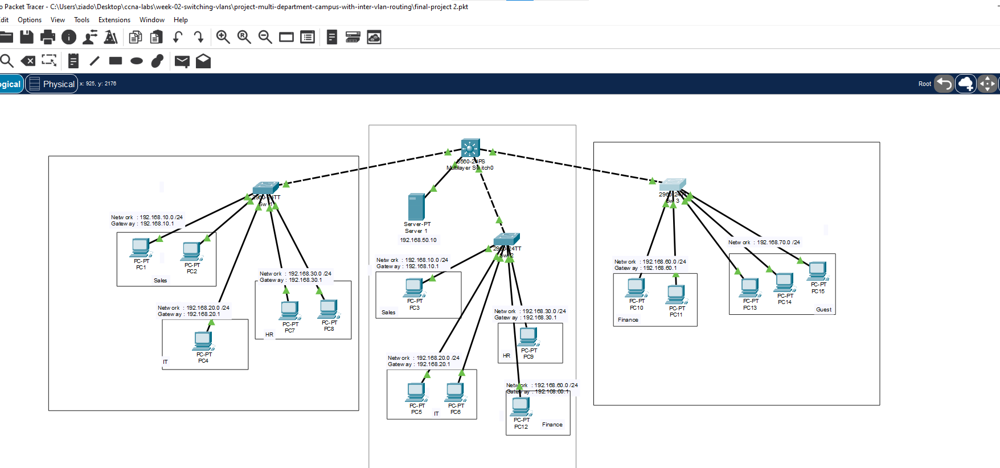
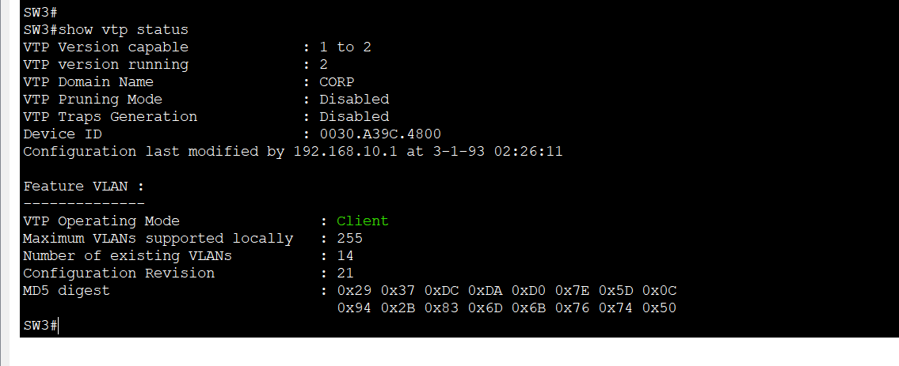
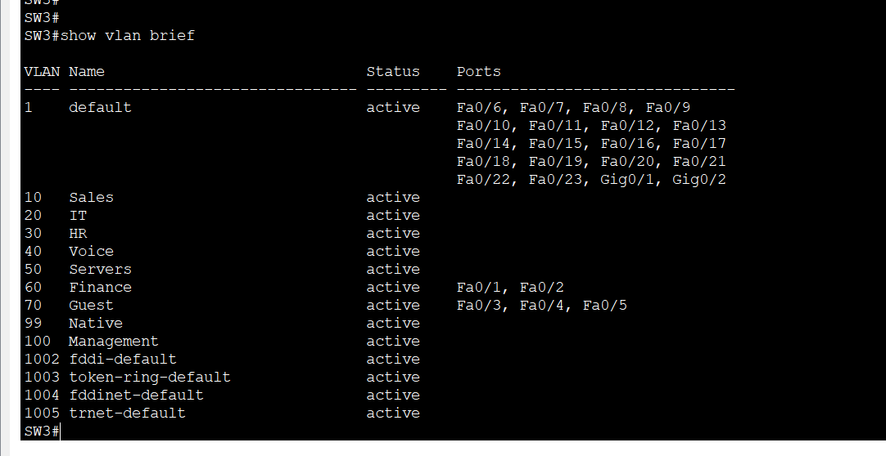
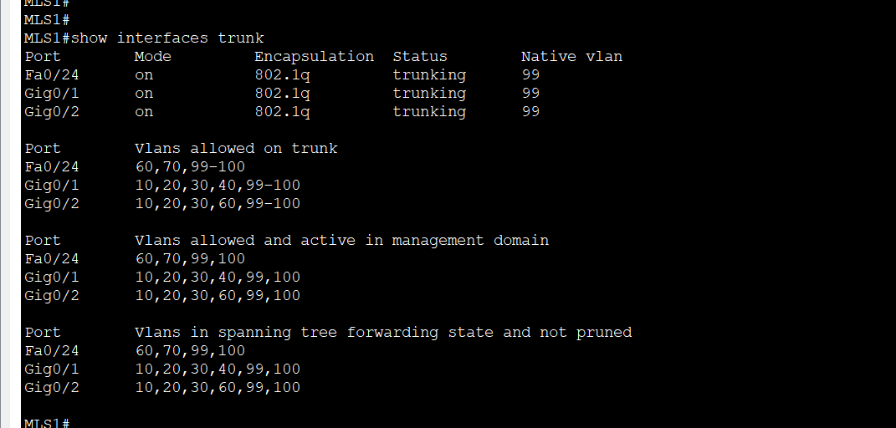
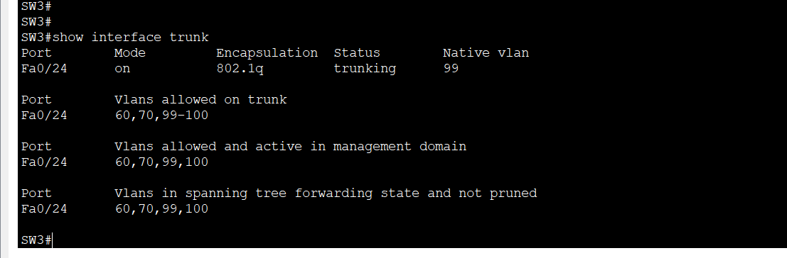
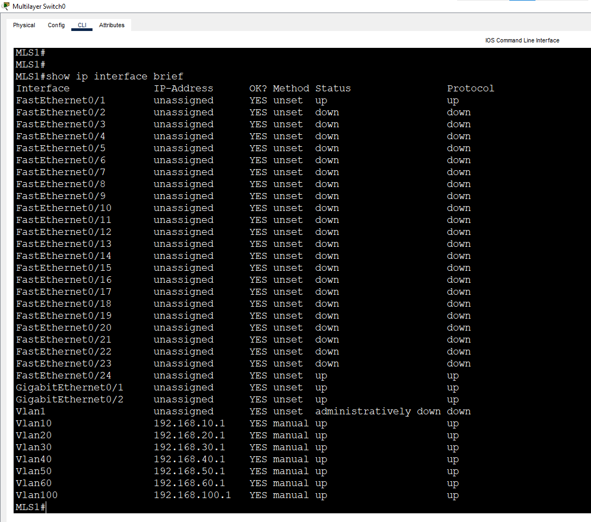
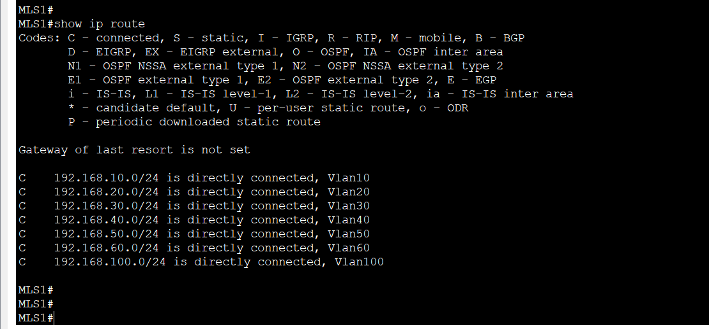
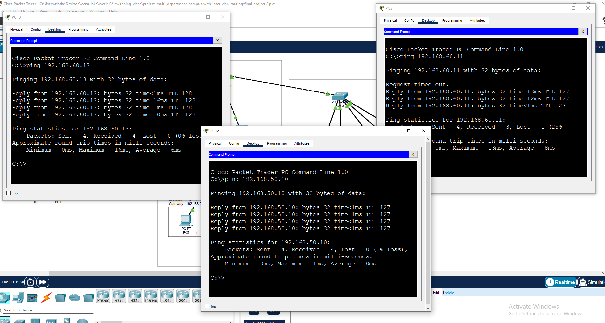
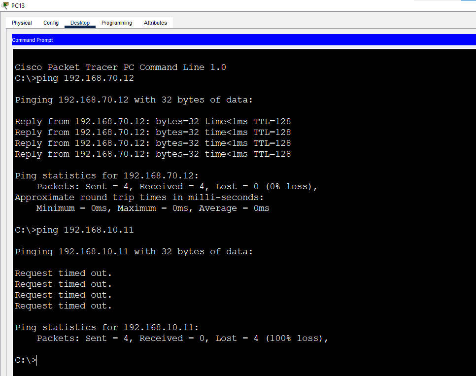
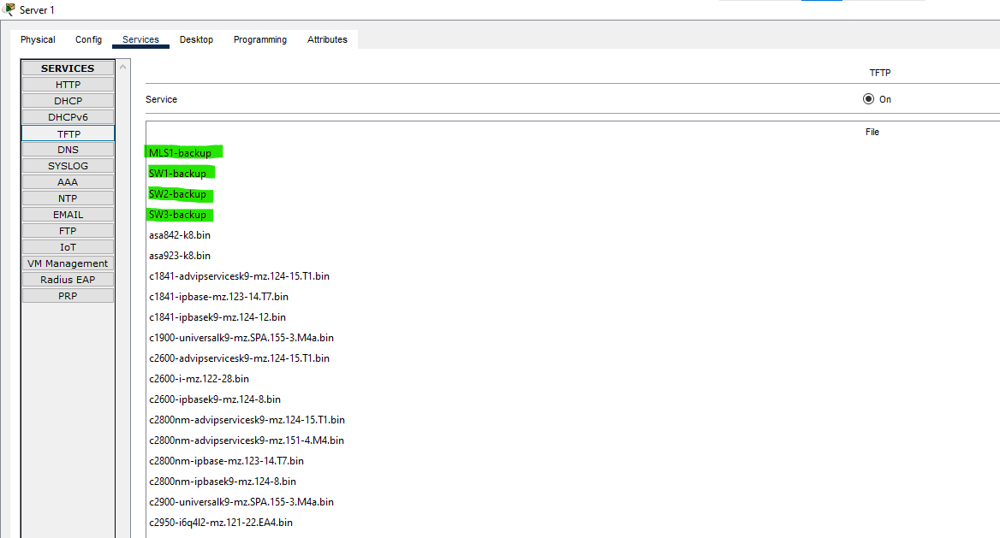

# Project: Multi-Department Campus with Inter-VLAN Routing

**Week 2 Project** | Topic: Switching & VLANs

## Objective
Design and build a multi-department campus network that combines everything from Week 2: VLANs, 802.1Q trunking, VTP, a Layer 3 switch for inter-VLAN routing, a voice VLAN, trunk hardening, an isolated guest network, and configuration backups to a TFTP server.

## Design Summary

| Area | Design |
|------|--------|
| Core | One Layer 3 switch (`MLS1`, Catalyst 3560-24PS) that routes between the VLANs using SVIs |
| Access | Three Catalyst 2960 switches (`SW1`, `SW2`, `SW3`) |
| VLAN management | `MLS1` is the VTP server, and the three access switches are VTP clients (domain `CORP`) |
| Departments | Sales, IT, HR, Finance, and an isolated Guest network |
| Services | Servers VLAN with a TFTP server, a Voice VLAN, and a Management VLAN |
| Security | Native VLAN 99, DTP disabled, per-trunk allowed VLAN lists, unused ports shut down |

## Topology


| Link | Cable |
|------|-------|
| SW1 Gi0/1 to MLS1 Gi0/1 | Cross-Over |
| SW2 Gi0/1 to MLS1 Gi0/2 | Cross-Over |
| SW3 Fa0/24 to MLS1 Fa0/24 | Cross-Over |
| PCs, server and IP phone | Straight-Through |

| Switch | Port | Device | VLAN |
|--------|------|--------|------|
| SW1 | Fa0/1 | PC1 | 10 (Sales) |
| SW1 | Fa0/2 | PC2 | 10 (Sales) |
| SW1 | Fa0/3 | PC4 | 20 (IT) |
| SW1 | Fa0/4 | PC7 | 30 (HR) |
| SW1 | Fa0/5 | PC8 | 30 (HR) |
| SW1 | Fa0/6 | IP Phone (optional) | 10 data, 40 voice |
| SW2 | Fa0/1 | PC3 | 10 (Sales) |
| SW2 | Fa0/2 | PC5 | 20 (IT) |
| SW2 | Fa0/3 | PC6 | 20 (IT) |
| SW2 | Fa0/4 | PC9 | 30 (HR) |
| SW2 | Fa0/5 | PC12 | 60 (Finance) |
| SW3 | Fa0/1 | PC10 | 60 (Finance) |
| SW3 | Fa0/2 | PC11 | 60 (Finance) |
| SW3 | Fa0/3 | PC13 | 70 (Guest) |
| SW3 | Fa0/4 | PC14 | 70 (Guest) |
| SW3 | Fa0/5 | PC15 | 70 (Guest) |
| MLS1 | Fa0/1 | Server1 | 50 (Servers) |

## VLAN Plan

| VLAN | Name | Network | Gateway (SVI on MLS1) |
|------|------|---------|-----------------------|
| 10 | Sales | 192.168.10.0/24 | 192.168.10.1 |
| 20 | IT | 192.168.20.0/24 | 192.168.20.1 |
| 30 | HR | 192.168.30.0/24 | 192.168.30.1 |
| 40 | Voice | 192.168.40.0/24 | 192.168.40.1 |
| 50 | Servers | 192.168.50.0/24 | 192.168.50.1 |
| 60 | Finance | 192.168.60.0/24 | 192.168.60.1 |
| 70 | Guest | 192.168.70.0/24 | None (isolated) |
| 99 | Native | - | - |
| 100 | Management | 192.168.100.0/24 | 192.168.100.1 |

## Addressing Table
All devices use the mask `255.255.255.0`.

| Device | VLAN | IP Address | Default Gateway |
|--------|------|------------|-----------------|
| PC1 | 10 | 192.168.10.11 | 192.168.10.1 |
| PC2 | 10 | 192.168.10.12 | 192.168.10.1 |
| PC3 | 10 | 192.168.10.13 | 192.168.10.1 |
| PC4 | 20 | 192.168.20.11 | 192.168.20.1 |
| PC5 | 20 | 192.168.20.12 | 192.168.20.1 |
| PC6 | 20 | 192.168.20.13 | 192.168.20.1 |
| PC7 | 30 | 192.168.30.11 | 192.168.30.1 |
| PC8 | 30 | 192.168.30.12 | 192.168.30.1 |
| PC9 | 30 | 192.168.30.13 | 192.168.30.1 |
| PC10 | 60 | 192.168.60.11 | 192.168.60.1 |
| PC11 | 60 | 192.168.60.12 | 192.168.60.1 |
| PC12 | 60 | 192.168.60.13 | 192.168.60.1 |
| PC13 | 70 | 192.168.70.11 | None |
| PC14 | 70 | 192.168.70.12 | None |
| PC15 | 70 | 192.168.70.13 | None |
| Server1 | 50 | 192.168.50.10 | 192.168.50.1 |
| SW1 | 100 | 192.168.100.2 | 192.168.100.1 |
| SW2 | 100 | 192.168.100.3 | 192.168.100.1 |
| SW3 | 100 | 192.168.100.4 | 192.168.100.1 |
| MLS1 | 100 | 192.168.100.1 | - |

## Trunk Allowed VLAN Lists
Each trunk carries only the VLANs its access switch needs, plus the native VLAN 99 and the management VLAN 100.

| Trunk | Allowed VLANs |
|-------|---------------|
| MLS1 Gi0/1 to SW1 | 10, 20, 30, 40, 99, 100 |
| MLS1 Gi0/2 to SW2 | 10, 20, 30, 60, 99, 100 |
| MLS1 Fa0/24 to SW3 | 60, 70, 99, 100 |

VLAN 50 is not on any trunk, because Server1 connects directly to MLS1.

## Steps

### Phase 1. Configure the trunks
VTP messages travel only over trunks, so the links come first. The 3560 supports more than one trunk encapsulation, so it needs the `encapsulation` command, which the 2960 does not have.

MLS1:
```
enable
configure terminal
hostname MLS1
interface range gi0/1 - 2 , fa0/24
 switchport trunk encapsulation dot1q
 switchport mode trunk
 end
```
SW1:
```
enable
configure terminal
hostname SW1
interface gi0/1
 switchport mode trunk
 end
```
SW2:
```
enable
configure terminal
hostname SW2
interface gi0/1
 switchport mode trunk
 end
```
SW3:
```
enable
configure terminal
hostname SW3
interface fa0/24
 switchport mode trunk
 end
```

### Phase 2. Configure VTP
MLS1 (server):
```
configure terminal
vtp mode server
vtp domain CORP
vtp password cisco123
vtp version 2
 end
```
SW1, SW2 and SW3 (clients):
```
configure terminal
vtp mode client
vtp domain CORP
vtp password cisco123
 end
```

### Phase 3. Create the VLANs (MLS1 only)
```
configure terminal
vlan 10
 name Sales
vlan 20
 name IT
vlan 30
 name HR
vlan 40
 name Voice
vlan 50
 name Servers
vlan 60
 name Finance
vlan 70
 name Guest
vlan 99
 name Native
vlan 100
 name Management
 end
```
Check on the access switches before continuing:
```
show vtp status
show vlan brief
```
All nine VLANs appear on SW1, SW2 and SW3 without being configured there.

### Phase 4. Configure the access ports
SW1:
```
configure terminal
interface range fa0/1 - 2
 switchport mode access
 switchport access vlan 10
 spanning-tree portfast
interface fa0/3
 switchport mode access
 switchport access vlan 20
 spanning-tree portfast
interface range fa0/4 - 5
 switchport mode access
 switchport access vlan 30
 spanning-tree portfast
interface fa0/6
 switchport mode access
 switchport access vlan 10
 switchport voice vlan 40
 spanning-tree portfast
 end
```
SW2:
```
configure terminal
interface fa0/1
 switchport mode access
 switchport access vlan 10
 spanning-tree portfast
interface range fa0/2 - 3
 switchport mode access
 switchport access vlan 20
 spanning-tree portfast
interface fa0/4
 switchport mode access
 switchport access vlan 30
 spanning-tree portfast
interface fa0/5
 switchport mode access
 switchport access vlan 60
 spanning-tree portfast
 end
```
SW3:
```
configure terminal
interface range fa0/1 - 2
 switchport mode access
 switchport access vlan 60
 spanning-tree portfast
interface range fa0/3 - 5
 switchport mode access
 switchport access vlan 70
 spanning-tree portfast
 end
```
MLS1 (server port). The 3560 defaults to dynamic mode, so access mode is set explicitly:
```
configure terminal
interface fa0/1
 switchport mode access
 switchport access vlan 50
 spanning-tree portfast
 end
```

### Phase 5. Enable routing on MLS1
There is no SVI for VLAN 70, so the Guest network has no gateway and cannot be routed.
```
configure terminal
ip routing
interface vlan 10
 ip address 192.168.10.1 255.255.255.0
 no shutdown
interface vlan 20
 ip address 192.168.20.1 255.255.255.0
 no shutdown
interface vlan 30
 ip address 192.168.30.1 255.255.255.0
 no shutdown
interface vlan 40
 ip address 192.168.40.1 255.255.255.0
 no shutdown
interface vlan 50
 ip address 192.168.50.1 255.255.255.0
 no shutdown
interface vlan 60
 ip address 192.168.60.1 255.255.255.0
 no shutdown
interface vlan 100
 ip address 192.168.100.1 255.255.255.0
 no shutdown
 end
```

### Phase 6. Management addresses on the access switches
SW1:
```
configure terminal
interface vlan 100
 ip address 192.168.100.2 255.255.255.0
 no shutdown
 exit
ip default-gateway 192.168.100.1
 end
```
SW2 uses the same commands with `192.168.100.3`, and SW3 with `192.168.100.4`.

### Phase 7. Harden the trunks and unused ports
MLS1:
```
configure terminal
interface range gi0/1 - 2 , fa0/24
 switchport trunk native vlan 99
 switchport nonegotiate
interface gi0/1
 switchport trunk allowed vlan 10,20,30,40,99,100
interface gi0/2
 switchport trunk allowed vlan 10,20,30,60,99,100
interface fa0/24
 switchport trunk allowed vlan 60,70,99,100
 end
```
SW1:
```
configure terminal
interface gi0/1
 switchport trunk native vlan 99
 switchport trunk allowed vlan 10,20,30,40,99,100
 switchport nonegotiate
 end
```
SW2:
```
configure terminal
interface gi0/1
 switchport trunk native vlan 99
 switchport trunk allowed vlan 10,20,30,60,99,100
 switchport nonegotiate
 end
```
SW3:
```
configure terminal
interface fa0/24
 switchport trunk native vlan 99
 switchport trunk allowed vlan 60,70,99,100
 switchport nonegotiate
 end
```
Shut down the unused ports.

SW1:
```
configure terminal
interface range fa0/7 - 24
 shutdown
interface gi0/2
 shutdown
 end
```
SW2:
```
configure terminal
interface range fa0/6 - 24
 shutdown
interface gi0/2
 shutdown
 end
```
SW3:
```
configure terminal
interface range fa0/6 - 23
 shutdown
interface range gi0/1 - 2
 shutdown
 end
```
Save the configuration on all four switches:
```
copy running-config startup-config
```

### Phase 8. Back up the switch configurations to TFTP
On Server1, open Services, select TFTP, and turn the service on. First confirm that each switch can reach the server:
```
ping 192.168.50.10
```
Then run on each of the four switches:
```
enable
copy running-config tftp
```
Answer the prompts with the server address `192.168.50.10` and a different file name per switch: `MLS1-backup`, `SW1-backup`, `SW2-backup` and `SW3-backup`. The access switches reach the server through their management SVIs, and MLS1 routes the traffic between VLAN 100 and VLAN 50.

Take the backups only after every test passes, so the saved files contain the final working configuration.

## Verification

### VTP and VLANs
`show vtp status` on SW3 shows the switch as a VTP client in domain `CORP`, with 14 VLANs in the database (the 9 created VLANs plus VLAN 1 and the four default VLANs 1002 to 1005).



`show vlan brief` on SW3 shows all VLANs learned from MLS1, with Finance on Fa0/1 and Fa0/2 and Guest on Fa0/3 to Fa0/5.



### Trunks
On MLS1, all three trunks use native VLAN 99, and each one carries its own allowed list.



On SW3, the single uplink carries only VLANs 60, 70, 99 and 100.



### Routing
All SVIs on MLS1 are up/up, and there is no SVI for VLAN 70.



The routing table has seven connected networks, and 192.168.70.0/24 is not routed.



### Connectivity
PC10 reaches PC12 inside VLAN 60 across two access switches. PC3 reaches PC10 in another VLAN through MLS1 (the first packet times out while ARP resolves), and PC12 reaches Server1.



### Guest isolation
PC13 reaches PC14 in the Guest VLAN, but cannot reach PC1 in the Sales VLAN.



### Backups
Server1 holds the four configuration backups, one for each switch.



### Summary of tests

| Test | From | To | Result |
|------|------|----|--------|
| Same VLAN across switches | PC10 | PC12 | Success |
| Inter-VLAN routing | PC3 | PC10 | Success |
| Access to the server | PC12 | 192.168.50.10 | Success |
| Guest inside its VLAN | PC13 | PC14 | Success |
| Guest to another department | PC13 | PC1 | Fails |
| TFTP backup of all switches | Each switch | Server1 | Four files saved |

## Design Notes
- **Central VLAN management:** VLANs are created once on MLS1. The access switches are VTP clients, so they cannot create or change VLANs.
- **Layer 3 core:** SVIs on MLS1 act as the default gateways, so no external router is needed.
- **Guest isolation:** VLAN 70 has no SVI, so its hosts can talk only to each other. This is isolation at the VLAN level and is not a replacement for access lists.
- **Trunk hardening:** the native VLAN is 99, DTP is off, and each trunk carries only the VLANs it needs.
- **Smaller attack surface:** unused switch ports are shut down.
- **Management VLAN:** switches are managed through VLAN 100, separate from user traffic.
- **Backups:** each switch configuration is stored on the TFTP server inside the Packet Tracer project.

## Common Issues & Fixes

| Problem | Likely cause | Fix |
|---------|--------------|-----|
| The clients do not learn the VLANs | The link is not a trunk, or the domain or password differs | Check `show interfaces trunk` and `show vtp status` |
| A VLAN does not reach a switch | The VLAN is missing from the trunk allowed list | Run `switchport trunk allowed vlan add <id>` on both ends |
| Hosts cannot reach other VLANs | `ip routing` is missing or the host gateway is wrong | Enable routing and check the gateway |
| An SVI is down | No active port in that VLAN, or `no shutdown` is missing | Connect a device or enable the SVI |
| The server port does not work | The 3560 port was left in dynamic mode | Set `switchport mode access` |
| TFTP backup fails | The server is unreachable or the TFTP service is off | Ping the server and turn the service on |
| The first ping times out | ARP resolution | Ping again |

## Files
- [Download Packet Tracer Project](./final-project%202.pkt)

## Lessons Learned
- VTP removes repeated VLAN configuration, and a restricted trunk still carries the VTP messages.
- A Layer 3 switch routes between VLANs with SVIs, and leaving out an SVI isolates a VLAN from routing.
- Each trunk should carry only the VLANs it needs, with a dedicated native VLAN and DTP turned off.
- Test connectivity first, then back up the working configuration.
