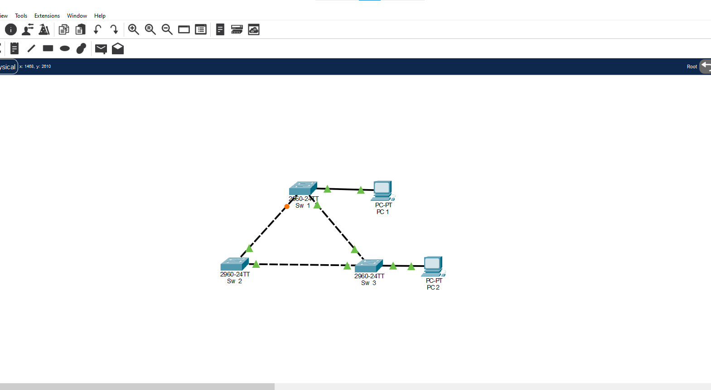
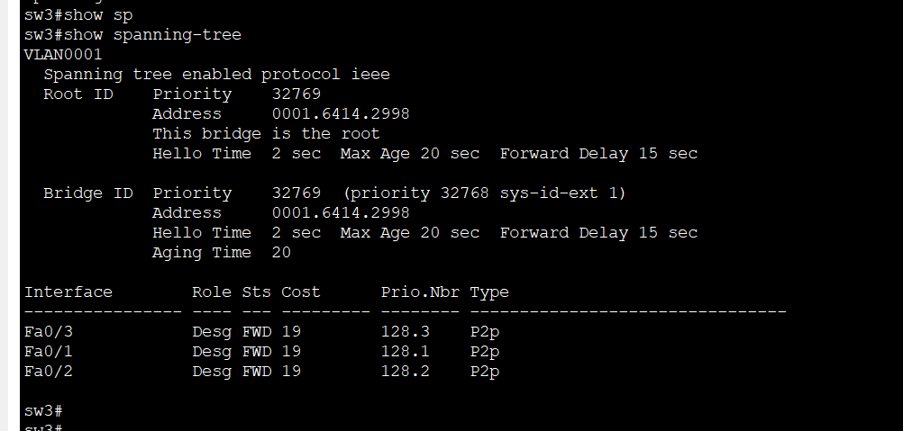
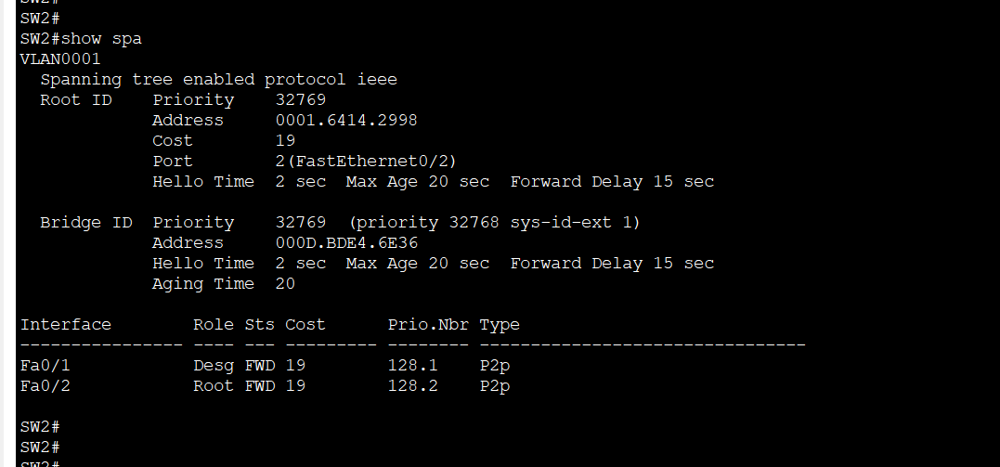
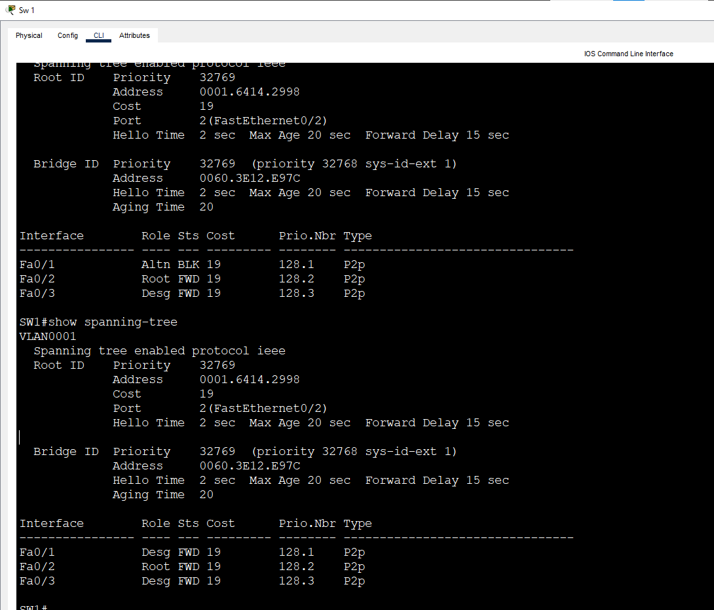
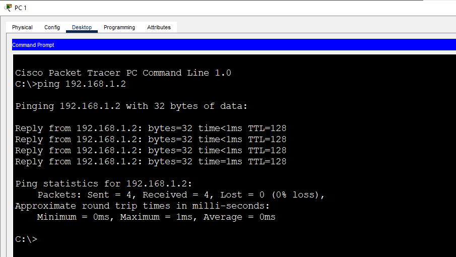

# Lab 1: STP Basics & Root Bridge

**Week 3 - Lab 1** | Topic: Layer 2 Redundancy & Security

## Objective
Connect three switches in a triangle, observe how Spanning Tree Protocol (STP) prevents a Layer 2 loop, identify the root bridge and the role of every port, and watch STP reconverge when a link fails.

## Theory

| Concept | Description |
|---------|-------------|
| Loop | Redundant links between switches make broadcast frames circle forever, which causes a broadcast storm |
| STP (802.1D) | Blocks selected ports so the Layer 2 topology has no loops, and unblocks them when a link fails |
| BPDU | The frames switches exchange (a hello every 2 seconds) to elect the root and calculate paths |
| Bridge ID | The priority (default 32768 plus the VLAN ID) followed by the switch MAC address |
| Root bridge | The switch with the lowest bridge ID. Every other switch calculates its path to it |
| Root port | The port on a non-root switch with the lowest-cost path to the root |
| Designated port | The forwarding port chosen on each segment to carry traffic toward the root |
| Alternate port | A port that blocks to prevent a loop. It takes over if the active path fails |
| Path cost | The cost of a link. Fast Ethernet (100 Mbps) is 19 |

The root bridge is the switch with the lowest priority, and the lowest MAC address breaks a tie. Between two ports on the same segment, STP chooses by lowest root path cost, then lowest sender bridge ID, then lowest port ID. After a failure, a blocked port goes through listening and learning (15 seconds each) before it forwards, so convergence takes about 30 to 50 seconds.

## Topology


Three Switch 2960 devices (`SW1`, `SW2`, `SW3`) connected in a triangle, and two PCs. The links between the switches use **Cross-Over** cables, and the PCs use Straight-Through cables.

| Link | Port A | Port B |
|------|--------|--------|
| SW1 to SW2 | SW1 Fa0/1 | SW2 Fa0/1 |
| SW2 to SW3 | SW2 Fa0/2 | SW3 Fa0/1 |
| SW3 to SW1 | SW3 Fa0/2 | SW1 Fa0/2 |
| PC1 to SW1 | PC1 | SW1 Fa0/3 |
| PC2 to SW3 | PC2 | SW3 Fa0/3 |

In the topology one link end is orange. That is the port STP has blocked to break the loop.

## Addressing Table
All devices are in the default VLAN 1 and in one subnet. The switches have no IP address, and there is no default gateway.

| Device | IP Address | Subnet Mask |
|--------|------------|-------------|
| PC1 | 192.168.1.1 | 255.255.255.0 |
| PC2 | 192.168.1.2 | 255.255.255.0 |

## Steps

### 1. Name the switches and connect them
On each switch, with its own name:
```
enable
configure terminal
hostname SW1
end
```
Use `SW2` and `SW3` on the other two. STP is enabled by default, so nothing else needs to be configured. Wait about 30 seconds until the link lights settle.

### 2. Check the spanning tree on every switch
```
show spanning-tree
```

| Output field | Meaning |
|--------------|---------|
| `Spanning tree enabled protocol ieee` | The default mode, PVST+ |
| `Root ID` | The current root bridge: its priority and MAC address |
| `This bridge is the root` | Appears only on the root bridge |
| `Bridge ID` | The priority and MAC address of this switch |
| `Priority 32769 (priority 32768 sys-id-ext 1)` | The default priority 32768 plus the VLAN ID 1 |
| `Role` | Root, Desg (designated) or Altn (alternate) |
| `Sts` | FWD (forwarding) or BLK (blocking) |
| `Cost` | The path cost of the port. Fast Ethernet is 19 |

Results:

| Switch | Bridge priority | MAC address | Root bridge | Fa0/1 | Fa0/2 | Fa0/3 |
|--------|-----------------|-------------|-------------|-------|-------|-------|
| SW1 | 32769 | 0060.3E12.E97C | No | Altn BLK | Root FWD | Desg FWD |
| SW2 | 32769 | 000D.BDE4.6E36 | No | Desg FWD | Root FWD | - |
| SW3 | 32769 | 0001.6414.2998 | **Yes** | Desg FWD | Desg FWD | Desg FWD |

SW3 is the root bridge, and all of its ports are designated and forwarding.



SW2 reaches the root through its Fa0/2 port, which is its root port, and its Fa0/1 port is designated.



On SW1 the root port is Fa0/2, and Fa0/1 is the alternate port in blocking state. The upper output shows this normal state, and the lower output was taken after the failure test in Step 5.



### 3. Understand the result
- **Root election:** all three switches have the same priority, 32769, so the lowest MAC address wins. `0001.6414.2998` (SW3) is lower than `000D.BDE4.6E36` (SW2), which is lower than `0060.3E12.E97C` (SW1).
- **Root ports:** SW1 and SW2 are both directly connected to SW3, so each reaches the root with a cost of 19 through its own port toward SW3.
- **The blocked port:** the link between SW1 and SW2 is the redundant link. Both switches have the same root path cost, so the tie is broken by the lower bridge ID. SW2 (`000D...`) is lower than SW1 (`0060...`), so SW2 Fa0/1 is designated, and SW1 Fa0/1 becomes the alternate port and blocks.

### 4. Test connectivity
From PC1:
```
ping 192.168.1.2
```
The ping to PC2 succeeds. Traffic goes through the direct link between SW1 and SW3, and the blocked port prevents the loop through SW2.



### 5. Test the convergence
On SW2, shut down the link toward SW3:
```
configure terminal
interface fa0/2
 shutdown
 end
```
Then run this on SW1 every 10 seconds:
```
show spanning-tree
```
SW2 can now reach the root only through SW1, so SW1 Fa0/1 changes from `Altn BLK` to `Desg FWD`, after passing through the listening and learning states. The network keeps working over the remaining links, so the redundant link does its job.

### 6. Restore the link
```
configure terminal
interface fa0/2
 no shutdown
 end
copy running-config startup-config
```
STP reconverges and SW1 Fa0/1 returns to the blocking state.

## Questions and Answers

**1. Why do we need STP?**
Redundant links give protection against a link failure, but they create loops in a Layer 2 network. A broadcast frame would circle forever and cause a broadcast storm, and MAC address tables would become unstable. STP blocks the redundant links and unblocks them only when they are needed.

**2. How is the root bridge elected?**
Every switch announces its bridge ID in BPDUs. The switch with the lowest priority wins, and if the priorities are equal, the lowest MAC address wins. In this lab SW3 has the lowest MAC address.

**3. Why is the priority 32769 and not 32768?**
The bridge priority is 32768 plus the VLAN ID through the system ID extension. VLAN 1 gives 32768 + 1 = 32769.

**4. What do the root, designated and alternate roles mean?**
The root port is the best path toward the root bridge on a non-root switch. A designated port is the forwarding port chosen on each segment. An alternate port is blocked and waits as a backup path.

**5. Why was SW1 Fa0/1 blocked and not a port on SW2?**
SW1 and SW2 both have a root path cost of 19, so the bridge ID decides. SW2 has the lower bridge ID, so its port on that segment is designated and forwards, and the port on SW1 blocks.

**6. What happens to the ping when the SW2 to SW3 link is shut down?**
PC1 and PC2 communicate over the direct link between SW1 and SW3, which this failure does not touch, so the ping keeps working. If the SW1 to SW3 link failed instead, traffic would pause until the blocked port moved to forwarding, which takes about 30 to 50 seconds.

## Verification
| Command / test | Run on | Expected result |
|----------------|--------|-----------------|
| `show spanning-tree` | SW3 | `This bridge is the root`, all ports Desg FWD |
| `show spanning-tree` | SW1 | Root port Fa0/2, Fa0/1 Altn BLK |
| `show spanning-tree` | SW2 | Root port Fa0/2, Fa0/1 Desg FWD |
| Ping PC1 to PC2 | PC1 | Success |
| SW2 Fa0/2 shut down, then `show spanning-tree` | SW1 | Fa0/1 changes from Altn BLK to Desg FWD |
| SW2 Fa0/2 enabled again | SW1 | Fa0/1 returns to Altn BLK |

## Common Issues & Fixes
| Problem | Likely cause | Fix |
|---------|--------------|-----|
| All link lights are orange | STP is still converging | Wait about 30 seconds |
| The root is a different switch than expected | The priorities are equal, so the lowest MAC address wins | Compare the MAC addresses in the output |
| A switch link stays down (red) | Wrong cable type between the switches | Use a Cross-Over cable |
| The first ping fails after connecting | The ports are still listening or learning | Wait and ping again |
| No blocked port is visible | The links are not all connected | Check that all three switch links are up |

## Files
- [Download Packet Tracer Lab](./lab%201.pkt)

## Lessons Learned
- STP prevents Layer 2 loops by blocking redundant links, and it keeps those links as a backup.
- The root bridge is the switch with the lowest bridge ID, so with default priorities the lowest MAC address wins.
- Every non-root switch has one root port, and every segment has one designated port.
- Ties are broken by root path cost, then bridge ID, then port ID.
- After a failure, the blocked port needs about 30 to 50 seconds to move to forwarding.
