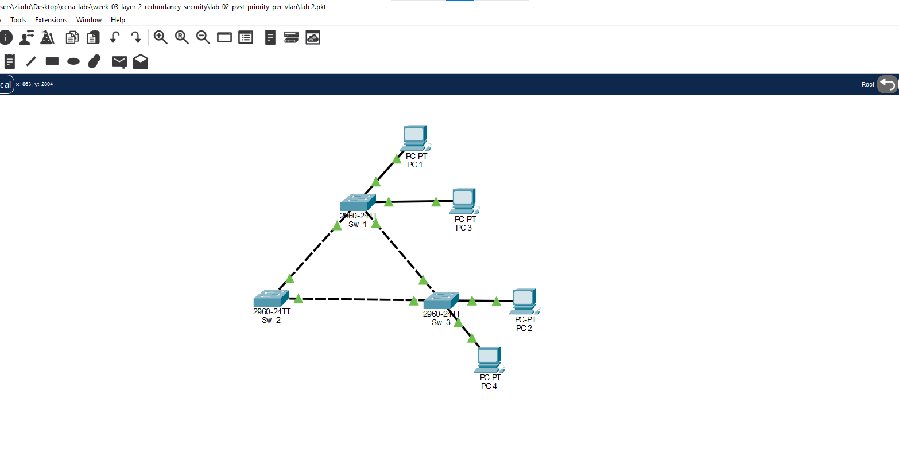
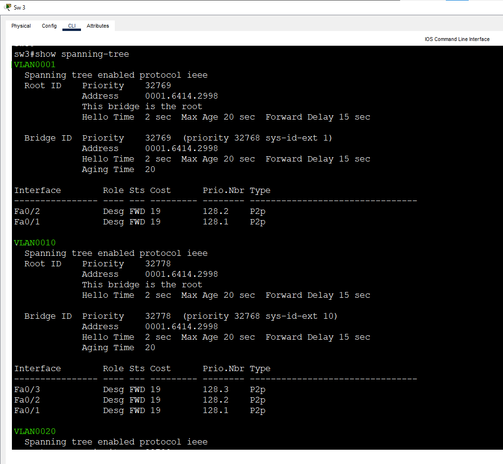
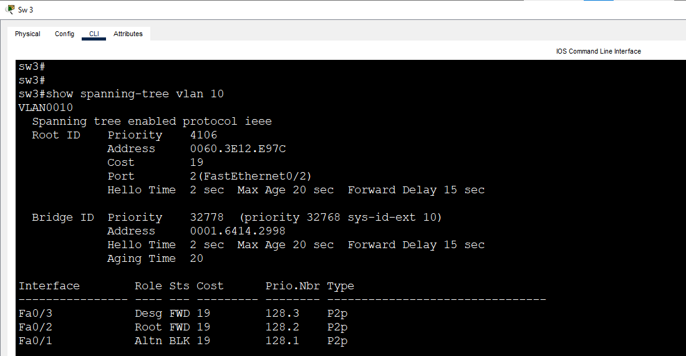
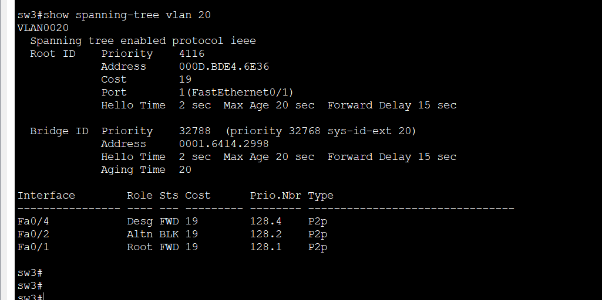
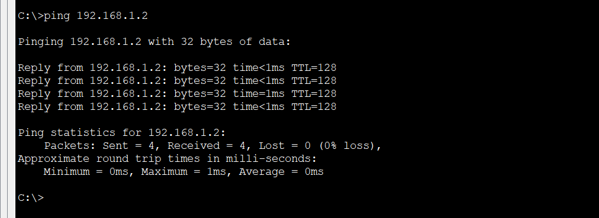

# Lab 2: PVST+ Priority per VLAN

**Week 3 - Lab 2** | Topic: Layer 2 Redundancy & Security

## Objective
Use the per-VLAN spanning tree of PVST+ to elect a different root bridge for each VLAN, so that the redundant links of a triangle are used by different VLANs instead of one link staying blocked for all of them.

## Theory

| Concept | Description |
|---------|-------------|
| PVST+ | The Cisco version of STP that runs a separate spanning tree instance for every VLAN |
| Bridge priority | The first part of the bridge ID. The default is 32768, and it can be changed only in multiples of 4096 |
| System ID extension | The VLAN ID is added to the priority, so VLAN 10 with priority 4096 is shown as 4106 |
| `spanning-tree vlan <id> priority <value>` | Sets the priority of the switch for one VLAN |
| Load balancing | Different VLANs use different links, because a different port is blocked in each VLAN |

With the default priorities, the same switch becomes the root of every VLAN, so the same port is blocked in every VLAN, and the redundant link carries no traffic at all. Setting a different root for each VLAN moves the blocked port, so each link is blocked for one VLAN and forwarding for the other.

## Topology


The same triangle as Lab 1: three Switch 2960 devices (`SW1`, `SW2`, `SW3`) and four PCs. The links between the switches use **Cross-Over** cables and are configured as trunks, and the PCs use Straight-Through cables.

| Link | Port A | Port B | Mode |
|------|--------|--------|------|
| SW1 to SW2 | SW1 Fa0/1 | SW2 Fa0/1 | Trunk |
| SW2 to SW3 | SW2 Fa0/2 | SW3 Fa0/1 | Trunk |
| SW3 to SW1 | SW3 Fa0/2 | SW1 Fa0/2 | Trunk |

| Device | Switch | Port | VLAN |
|--------|--------|------|------|
| PC1 | SW1 | Fa0/3 | 10 (Sales) |
| PC2 | SW3 | Fa0/3 | 10 (Sales) |
| PC3 | SW1 | Fa0/4 | 20 (IT) |
| PC4 | SW3 | Fa0/4 | 20 (IT) |

## Addressing Table
All PCs are in one subnet, so VLANs are the only separation. There is no router and no default gateway.

| Device | IP Address | Subnet Mask |
|--------|------------|-------------|
| PC1 | 192.168.1.1 | 255.255.255.0 |
| PC2 | 192.168.1.2 | 255.255.255.0 |
| PC3 | 192.168.1.3 | 255.255.255.0 |
| PC4 | 192.168.1.4 | 255.255.255.0 |

## Steps

### 1. Create the VLANs (all three switches)
```
enable
configure terminal
vlan 10
 name Sales
vlan 20
 name IT
 exit
```
The VLANs must exist on every switch, because a spanning tree instance is created for a VLAN only where the VLAN exists.

### 2. Configure the trunks (all three switches)
```
interface range fa0/1 - 2
 switchport mode trunk
 end
```
The 2960 supports only 802.1Q, so no `encapsulation` command is needed.

### 3. Configure the PC ports (SW1 and SW3)
```
configure terminal
interface fa0/3
 switchport mode access
 switchport access vlan 10
interface fa0/4
 switchport mode access
 switchport access vlan 20
 end
```
Set the IP addresses on the PCs according to the addressing table.

### 4. Check the default behavior
Before changing any priority, run this on SW3:
```
show spanning-tree
```
There is one spanning tree instance for each VLAN (`VLAN0001`, `VLAN0010` and `VLAN0020`). With the default priorities, the same switch is the root in all of them and the same port is blocked (`Altn BLK`) in all of them. The blocked link is wasted for every VLAN.



### 5. Set the priority per VLAN
The plan gives each VLAN its own root, and each switch is the backup root of the other VLAN:

| Switch | VLAN 10 priority | VLAN 20 priority |
|--------|------------------|------------------|
| SW1 | 4096 (root) | 8192 (backup) |
| SW2 | 8192 (backup) | 4096 (root) |
| SW3 | 32768 (default) | 32768 (default) |

SW1:
```
configure terminal
spanning-tree vlan 10 priority 4096
spanning-tree vlan 20 priority 8192
 end
```
SW2:
```
configure terminal
spanning-tree vlan 10 priority 8192
spanning-tree vlan 20 priority 4096
 end
```

| Command | Purpose |
|---------|---------|
| `spanning-tree vlan 10 priority 4096` | Sets the priority of the switch in VLAN 10 only. The value must be a multiple of 4096, otherwise the switch rejects it |

The displayed priority is the configured value plus the VLAN ID, so the root of VLAN 10 shows 4106 and the root of VLAN 20 shows 4116.

The commands `spanning-tree vlan 10 root primary` and `spanning-tree vlan 10 root secondary` are shortcuts that choose the priority automatically. This lab uses explicit values so that the result is predictable.

### 6. Verify
On SW3:
```
show spanning-tree vlan 10
show spanning-tree vlan 20
```
Expected roles of the trunk ports:

| Switch | VLAN 10 (root SW1) | VLAN 20 (root SW2) |
|--------|--------------------|--------------------|
| SW1 | Fa0/1 Desg, Fa0/2 Desg | Fa0/1 Root, Fa0/2 Desg |
| SW2 | Fa0/1 Root, Fa0/2 Desg | Fa0/1 Desg, Fa0/2 Desg |
| SW3 | Fa0/1 **Altn BLK**, Fa0/2 Root | Fa0/1 Root, Fa0/2 **Altn BLK** |

SW3 has the default priority in both VLANs, so its result does not depend on the MAC addresses. For VLAN 10, the root is SW1 with priority 4106, and SW3 blocks Fa0/1, the link toward SW2. 



For VLAN 20, the root is SW2 with priority 4116, and SW3 blocks Fa0/2, the link toward SW1.



Now both uplinks of SW3 are used, one for each VLAN. To confirm the roots, run `show spanning-tree vlan 10` on SW1 and `show spanning-tree vlan 20` on SW2. Both show `This bridge is the root`.

### 7. Test connectivity
From PC1:
```
ping 192.168.1.2
```
From PC3:
```
ping 192.168.1.4
```
Both pings succeed, because the PCs are in the same VLAN. A ping from PC1 to PC3 fails, because they are in different VLANs and there is no router.



### 8. Save
```
copy running-config startup-config
```

## Questions and Answers

**1. What is PVST+ and how is it different from a single STP instance?**
PVST+ runs a separate spanning tree for every VLAN, so each VLAN can have its own root bridge and its own blocked ports. A single STP instance forces all VLANs to share the same topology.

**2. Why does the switch reject the priority 5000?**
The bridge priority must be a multiple of 4096, because the lower 12 bits are used by the VLAN ID (the system ID extension).

**3. Why is the displayed priority 4106 and not 4096?**
The VLAN ID is added to the configured priority. VLAN 10 with the priority 4096 is shown as 4096 + 10 = 4106.

**4. How does a priority per VLAN give load balancing?**
Each VLAN has a different root, so a different port is blocked in each VLAN. On SW3, the link toward SW2 carries VLAN 20 and is blocked for VLAN 10, and the link toward SW1 carries VLAN 10 and is blocked for VLAN 20. Both links are used.

**5. What is the difference between `priority 4096` and `root primary`?**
`priority 4096` sets the exact value. `root primary` calculates a priority lower than the current root, so the result can change when the other switches change. The explicit command gives a predictable result.

**6. What happens to VLAN 10 if SW1 fails?**
SW2 becomes the root of VLAN 10, because it has the next lowest priority (8202). VLAN 20 is not affected, because SW2 is already its root.

## Verification
| Command / test | Run on | Expected result |
|----------------|--------|-----------------|
| `show spanning-tree` before the change | SW3 | The same port is blocked in VLANs 1, 10 and 20 |
| `show spanning-tree vlan 10` | SW1 | `This bridge is the root`, priority 4106 |
| `show spanning-tree vlan 20` | SW2 | `This bridge is the root`, priority 4116 |
| `show spanning-tree vlan 10` | SW3 | Fa0/1 Altn BLK, Fa0/2 Root FWD |
| `show spanning-tree vlan 20` | SW3 | Fa0/1 Root FWD, Fa0/2 Altn BLK |
| Ping PC1 to PC2 (VLAN 10) | PC1 | Success |
| Ping PC3 to PC4 (VLAN 20) | PC3 | Success |
| Ping PC1 to PC3 (different VLANs) | PC1 | Fails |

## Common Issues & Fixes
| Problem | Likely cause | Fix |
|---------|--------------|-----|
| `Bridge Priority must be in increments of 4096` | The value is not a multiple of 4096 | Use 4096, 8192 and so on |
| A VLAN is missing in `show spanning-tree` | The VLAN does not exist on the switch | Create the VLAN |
| The same port is blocked in both VLANs | The priorities were not applied to the correct VLANs | Check the `spanning-tree vlan` lines in the running config |
| Pings inside a VLAN fail | A link is not a trunk, or a PC is in the wrong VLAN | Check `show interfaces trunk` and `show vlan brief` |
| VLAN 1 appears in the output | VLAN 1 always exists | Ignore it in this lab |

## Files
- [Download Packet Tracer Lab](./lab%202.pkt)

## Lessons Learned
- PVST+ builds one spanning tree per VLAN, so each VLAN can have its own root bridge.
- The bridge priority is changed in multiples of 4096, and the VLAN ID is added to it.
- A different root for each VLAN moves the blocked port, so both redundant links carry traffic.
- Setting a backup root with the next lowest priority gives a predictable result when the primary root fails.
