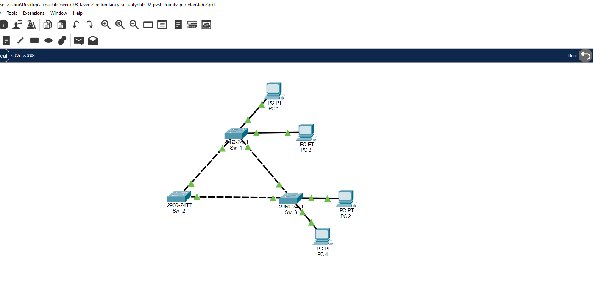
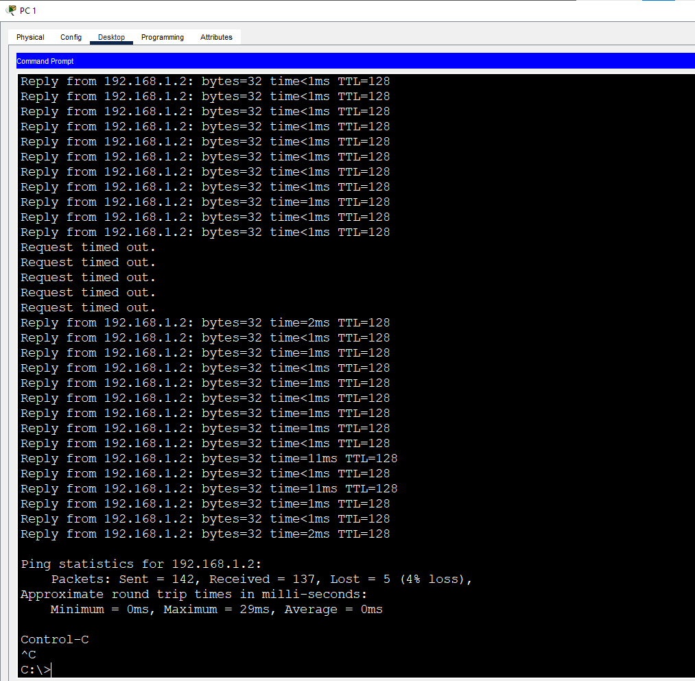
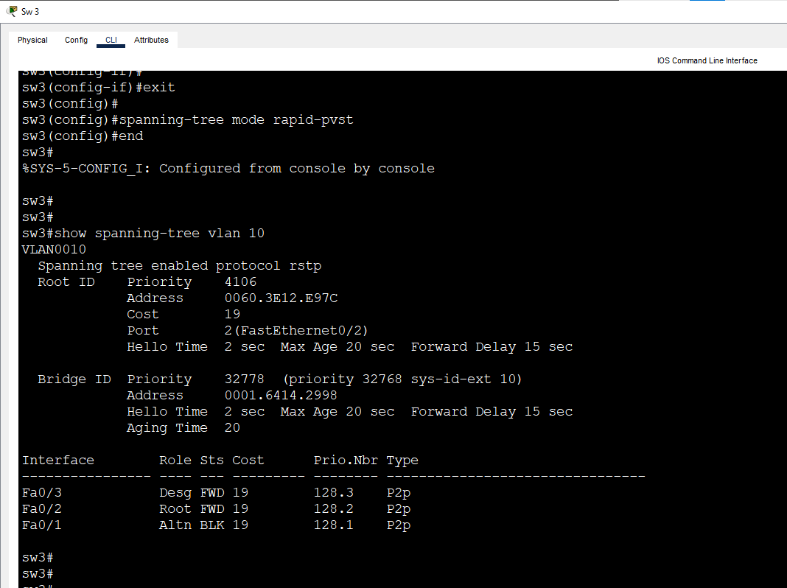
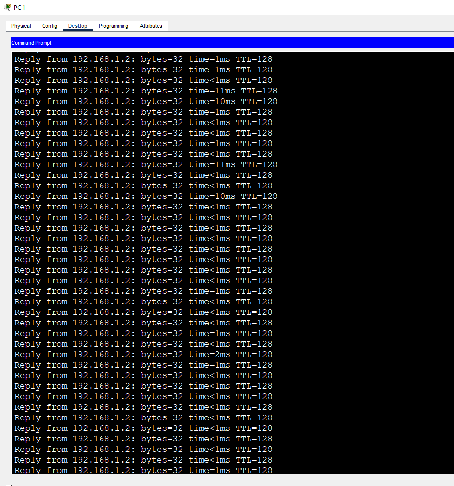
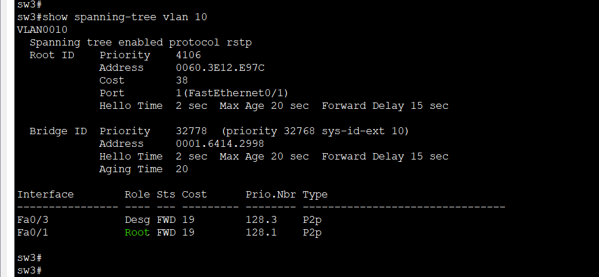

# Lab 3: Rapid PVST+

**Week 3 - Lab 3** | Topic: Layer 2 Redundancy & Security

## Objective
Measure how long the classic PVST+ (802.1D) takes to recover from a link failure, then enable Rapid PVST+ (802.1w) on the same network and compare the recovery time.

## Theory

| Concept | PVST+ (802.1D) | Rapid PVST+ (802.1w) |
|---------|----------------|----------------------|
| Convergence time | About 30 to 50 seconds | A few seconds |
| Port states | Blocking, Listening, Learning, Forwarding | Discarding, Learning, Forwarding |
| Port roles | Root, Designated, Alternate | Root, Designated, Alternate, Backup |
| How a port moves to forwarding | Timers (15 seconds listening + 15 seconds learning) | Proposal / Agreement negotiation between neighbor switches |
| BPDU | Generated by the root and relayed by the others | Every switch sends its own BPDU every hello time (2 seconds) |
| Cisco command | `spanning-tree mode pvst` (default) | `spanning-tree mode rapid-pvst` |

- The fast negotiation works on **point-to-point** links (full duplex). The output of `show spanning-tree` shows them as `P2p`.
- An alternate port is already prepared as a backup path, so when the root port fails the alternate port takes over without waiting for timers.
- A PVST+ switch connected to Rapid PVST+ switches still works, but that link falls back to the slow 802.1D behavior.

## Topology


The same triangle as Lab 2: three Switch 2960 devices (`SW1`, `SW2`, `SW3`) and four PCs. The links between the switches use **Cross-Over** cables and are configured as trunks, and the PCs use Straight-Through cables. The VLANs and the per-VLAN priorities of Lab 2 stay unchanged.

| Link | Port A | Port B | Mode |
|------|--------|--------|------|
| SW1 to SW2 | SW1 Fa0/1 | SW2 Fa0/1 | Trunk |
| SW2 to SW3 | SW2 Fa0/2 | SW3 Fa0/1 | Trunk |
| SW3 to SW1 | SW3 Fa0/2 | SW1 Fa0/2 | Trunk |

| Device | Switch | Port | VLAN |
|--------|--------|------|------|
| PC1 | SW1 | Fa0/3 | 10 (Sales) |
| PC2 | SW3 | Fa0/3 | 10 (Sales) |
| PC3 | SW1 | Fa0/4 | 20 (IT) |
| PC4 | SW3 | Fa0/4 | 20 (IT) |

## Addressing Table
All PCs are in one subnet, so VLANs are the only separation. There is no router and no default gateway.

| Device | IP Address | Subnet Mask |
|--------|------------|-------------|
| PC1 | 192.168.1.1 | 255.255.255.0 |
| PC2 | 192.168.1.2 | 255.255.255.0 |
| PC3 | 192.168.1.3 | 255.255.255.0 |
| PC4 | 192.168.1.4 | 255.255.255.0 |

## Steps

### 1. Start from the Lab 2 network
Open the Lab 2 file and save it as `lab 3.pkt`. Check the starting point on SW3:
```
show spanning-tree vlan 10
```
The first line shows `Spanning tree enabled protocol ieee`, which is PVST+. In VLAN 10 the port Fa0/2 is `Root FWD` and Fa0/1 is `Altn BLK`. The ping from PC1 to PC2 uses the direct link between SW1 Fa0/2 and SW3 Fa0/2, and this is the link that is failed in the tests.

### 2. Measure the convergence in PVST+
On PC1, start a continuous ping:
```
ping -t 192.168.1.2
```
When all replies succeed, fail the link on SW3:
```
configure terminal
interface fa0/2
 shutdown
 end
```
The ping shows a series of `Request timed out` lines until the blocked port Fa0/1 moves to forwarding. The timers of 802.1D make this gap long. Stop the ping with `Ctrl+C`.



Restore the link and wait about a minute until the ports return to their roles:
```
configure terminal
interface fa0/2
 no shutdown
 end
```

### 3. Enable Rapid PVST+ (all three switches)
```
configure terminal
spanning-tree mode rapid-pvst
 end
```

| Command | Purpose |
|---------|---------|
| `spanning-tree mode rapid-pvst` | Changes the switch from PVST+ (802.1D) to Rapid PVST+ (802.1w) for all VLANs |

All three switches must use the same mode. A switch left in PVST+ keeps the slow behavior on its links.

### 4. Verify the mode
On SW3:
```
show spanning-tree vlan 10
```
- The first line now shows `Spanning tree enabled protocol rstp`.
- The roles are unchanged, because the priorities did not change: Fa0/2 is the root port and Fa0/1 is the alternate port.
- The Type column shows `P2p`, which is the condition for the fast negotiation.



### 5. Measure the convergence in Rapid PVST+
On PC1, start the continuous ping again:
```
ping -t 192.168.1.2
```
Then fail the same link on SW3:
```
configure terminal
interface fa0/2
 shutdown
 end
```
The gap in the ping is much shorter than in PVST+. Stop the ping with `Ctrl+C` and compare the number of `Request timed out` lines with step 2.



While the link is down, check SW3:
```
show spanning-tree vlan 10
```
Fa0/1 is now the root port in forwarding state, and it was the alternate port before the failure.



### 6. Restore the link and save
```
configure terminal
interface fa0/2
 no shutdown
 end
copy running-config startup-config
```
Save on all three switches. After the network settles, Fa0/2 is the root port and Fa0/1 is the alternate port again.

## Comparison

| | PVST+ | Rapid PVST+ |
|---|-------|-------------|
| Command | `spanning-tree mode pvst` | `spanning-tree mode rapid-pvst` |
| Output of `show spanning-tree` | `protocol ieee` | `protocol rstp` |
| Ping gap after the link failure | Long series of timeouts | Short gap |
| Backup path | Waits for the timers | Takes over by negotiation |

The exact number of timeouts depends on the speed of Packet Tracer, but the difference between the two tests is clear.

## Questions and Answers

**1. What is the difference between PVST+ and Rapid PVST+?**
PVST+ is based on 802.1D and relies on timers, so it needs about 30 to 50 seconds to react to a failure. Rapid PVST+ is based on 802.1w, keeps one spanning tree per VLAN like PVST+, and reacts in a few seconds.

**2. Why is Rapid PVST+ faster?**
A port does not wait for the listening and learning timers. Neighbor switches negotiate with a proposal and an agreement, and the alternate port is already prepared to replace the root port, so it moves to forwarding immediately.

**3. What are the port states in RSTP?**
Discarding, learning and forwarding. The blocking and listening states of 802.1D are merged into discarding.

**4. What is a P2p link and why does it matter?**
It is a full-duplex link between two switches. Rapid PVST+ uses the fast proposal and agreement negotiation only on point-to-point links, so a half-duplex link falls back to the slower behavior.

**5. What happens if a PVST+ switch is connected to Rapid PVST+ switches?**
They interoperate, but the link to the PVST+ switch behaves as 802.1D, so it loses the fast convergence.

**6. Which command enables Rapid PVST+?**
`spanning-tree mode rapid-pvst`, entered in global configuration mode.

## Verification
| Command / test | Run on | Expected result |
|----------------|--------|-----------------|
| `show spanning-tree vlan 10` before the change | SW3 | `protocol ieee`, Fa0/2 Root FWD, Fa0/1 Altn BLK |
| Continuous ping with Fa0/2 shut down, in PVST+ | PC1 | Long series of timeouts |
| `spanning-tree mode rapid-pvst` | SW1, SW2, SW3 | Accepted |
| `show spanning-tree vlan 10` after the change | SW3 | `protocol rstp`, links shown as P2p |
| Continuous ping with Fa0/2 shut down, in Rapid PVST+ | PC1 | Short gap |
| `show spanning-tree vlan 10` during the failure | SW3 | Fa0/1 Root FWD |
| `no shutdown` on Fa0/2 | SW3 | Fa0/2 Root, Fa0/1 Altn |

## Common Issues & Fixes
| Problem | Likely cause | Fix |
|---------|--------------|-----|
| The output still shows `ieee` | The command was not applied on that switch | Run `spanning-tree mode rapid-pvst` on all three switches |
| The gap is long even in Rapid PVST+ | One switch is still in PVST+ | Check `show spanning-tree` on every switch |
| The ping does not break at all | The failed link is not on the ping path | Fail SW3 Fa0/2, the direct link toward SW1 |
| The ports do not return to their roles after `no shutdown` | The network is still converging | Wait a minute and check again |
| `ping -t` does not work | Wrong syntax | Type `ping -t 192.168.1.2` |

## Files
- [Download Packet Tracer Lab](./lab%203.pkt)

## Lessons Learned
- PVST+ recovers from a failure with timers, so the gap is long.
- Rapid PVST+ uses negotiation and prepared alternate ports, so the gap is short.
- All switches in the topology should run the same spanning tree mode.
- Rapid PVST+ needs point-to-point (full duplex) links for the fastest recovery.
