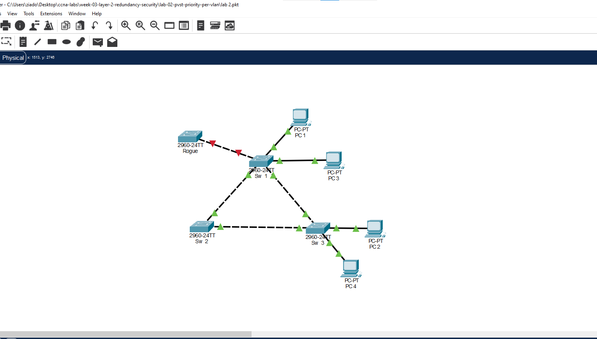
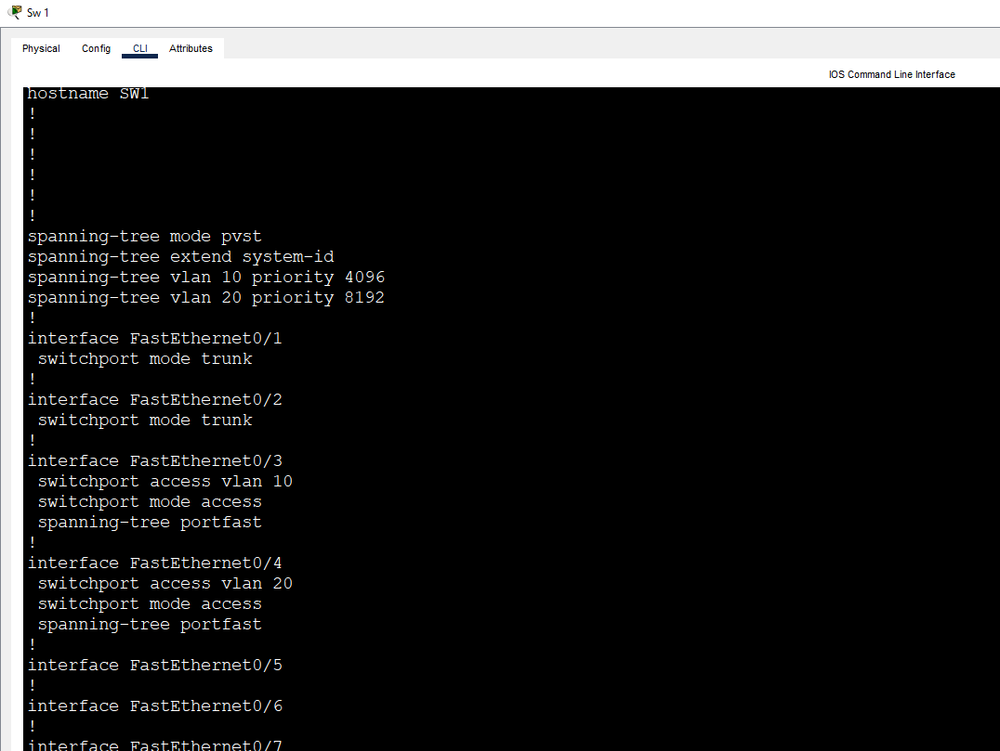
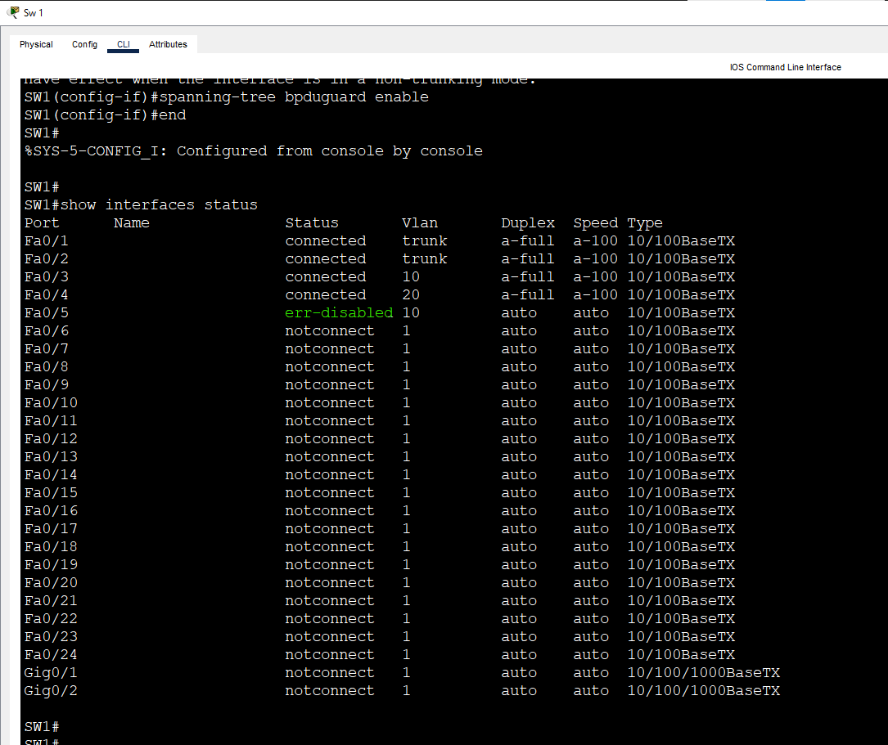
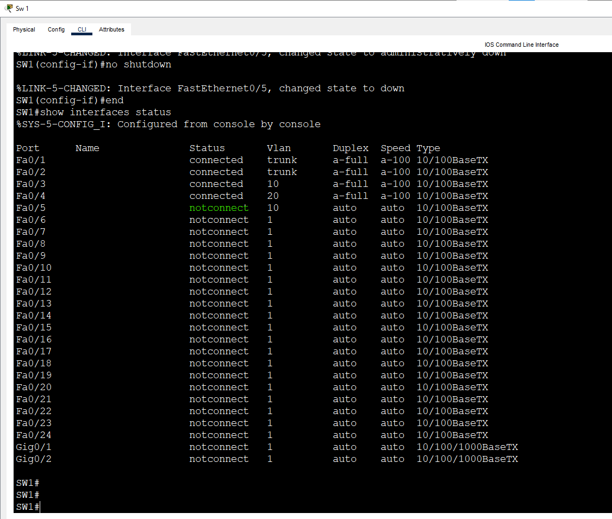

# Lab 4: PortFast & BPDU Guard

**Week 3 - Lab 4** | Topic: Layer 2 Redundancy & Security

## Objective
Make access ports start forwarding immediately with PortFast, and protect them with BPDU Guard so that a switch connected to an access port by mistake (or on purpose) shuts the port down instead of creating a loop.

## Theory

| Concept | Description |
|---------|-------------|
| Port start-up in STP | A port normally passes through listening and learning (15 seconds each) before it forwards, so a new device waits about 30 seconds |
| PortFast | Makes an access port go to forwarding immediately, because a PC cannot create a loop |
| BPDU Guard | Shuts the port down (`err-disabled`) when a BPDU arrives on it |
| `err-disabled` | A protection state. The port stays down until it is reset manually or by error-disable recovery |
| Where to use them | Only on access ports that connect end devices (PCs, printers) |

PortFast removes the waiting time, but it also removes the loop protection on that port. If a switch is connected to a PortFast port, a loop becomes possible. BPDU Guard closes this gap: a PC never sends BPDUs, so a BPDU on the port means a switch was connected, and the port is shut down.

## Topology


The Lab 2 triangle: three Switch 2960 devices (`SW1`, `SW2`, `SW3`) and four PCs, plus a fourth switch `ROGUE` that represents an unauthorized switch. The links between switches use **Cross-Over** cables and the PCs use Straight-Through cables. The network runs the default PVST+, so the delay of the normal port start-up is visible.

| Link | Port A | Port B | Mode |
|------|--------|--------|------|
| SW1 to SW2 | SW1 Fa0/1 | SW2 Fa0/1 | Trunk |
| SW2 to SW3 | SW2 Fa0/2 | SW3 Fa0/1 | Trunk |
| SW3 to SW1 | SW3 Fa0/2 | SW1 Fa0/2 | Trunk |
| ROGUE to SW1 | ROGUE Fa0/1 | SW1 Fa0/5 | Access (connected in step 4) |

| Device | Switch | Port | VLAN |
|--------|--------|------|------|
| PC1 | SW1 | Fa0/3 | 10 (Sales) |
| PC2 | SW3 | Fa0/3 | 10 (Sales) |
| PC3 | SW1 | Fa0/4 | 20 (IT) |
| PC4 | SW3 | Fa0/4 | 20 (IT) |

## Addressing Table
All PCs are in one subnet, so VLANs are the only separation. There is no router and no default gateway.

| Device | IP Address | Subnet Mask |
|--------|------------|-------------|
| PC1 | 192.168.1.1 | 255.255.255.0 |
| PC2 | 192.168.1.2 | 255.255.255.0 |
| PC3 | 192.168.1.3 | 255.255.255.0 |
| PC4 | 192.168.1.4 | 255.255.255.0 |

## Steps

### 1. See the problem without PortFast
Start from the Lab 2 network and save it as `lab 4.pkt`. On SW1:
```
enable
configure terminal
interface fa0/3
 shutdown
 no shutdown
 end
show spanning-tree interface fa0/3
```
The link light of Fa0/3 stays orange for about 30 seconds while the port passes through the listening and learning states, and only then turns green.

### 2. Enable PortFast on the PC ports
```
configure terminal
interface range fa0/3 - 4
 spanning-tree portfast
 end
```

| Command | Purpose |
|---------|---------|
| `spanning-tree portfast` | The port goes to forwarding immediately. The switch prints a warning that PortFast must be used only on ports connected to end devices |

Repeat the test:
```
configure terminal
interface fa0/3
 shutdown
 no shutdown
 end
```
The link light turns green almost at once. Check the port:
```
show spanning-tree vlan 10
```



### 3. Prepare the port for the rogue switch
On SW1:
```
configure terminal
interface fa0/5
 switchport mode access
 switchport access vlan 10
 spanning-tree portfast
 spanning-tree bpduguard enable
 end
```

| Command | Purpose |
|---------|---------|
| `spanning-tree bpduguard enable` | Shuts the port down if it receives a BPDU |

### 4. Connect the rogue switch
Connect `ROGUE` Fa0/1 to SW1 Fa0/5 with a Cross-Over cable. The switch sends BPDUs, and SW1 shuts the port down. The console of SW1 shows a message like this:
```
%SPANTREE-2-BLOCK_BPDUGUARD: Received BPDU on port Fa0/5 with BPDU Guard enabled. Disabling port.
```


Verify:
```
show interfaces status
```
Fa0/5 is shown as `err-disabled`.



### 5. Apply the protection globally (optional)
Instead of configuring every port:
```
configure terminal
spanning-tree portfast default
spanning-tree portfast bpduguard default
 end
```

| Command | Purpose |
|---------|---------|
| `spanning-tree portfast default` | Enables PortFast on all access ports. Trunk ports are not affected |
| `spanning-tree portfast bpduguard default` | Enables BPDU Guard on every port that uses PortFast |

### 6. Recover the port
First remove the cause by disconnecting the rogue switch. Then reset the port:
```
configure terminal
interface fa0/5
 shutdown
 no shutdown
 end
show interfaces status
```
The port leaves the `err-disabled` state. If the rogue switch is still connected, the port is shut down again.



Save the configuration:
```
copy running-config startup-config
```

## Questions and Answers

**1. What is PortFast and why is it used?**
PortFast makes an access port skip the listening and learning states and forward immediately. It is used on ports with end devices, so a PC gets network access at once instead of waiting about 30 seconds.

**2. Why must PortFast not be used on a trunk or on a port connected to a switch?**
A switch can create a loop. The port would forward right away, before STP has the chance to detect and block the loop.

**3. What is BPDU Guard and what happens when a BPDU arrives?**
BPDU Guard protects PortFast ports. When a BPDU is received on such a port, the switch puts the port in the `err-disabled` state and stops forwarding traffic through it.

**4. What does `err-disabled` mean and how is the port restored?**
It is a protection state where the switch shuts down the port. After the cause is removed, the port is restored with `shutdown` followed by `no shutdown`, or automatically with error-disable recovery.

**5. What is the difference between configuring on the port and with `default`?**
The port command applies to one port. The `default` command applies globally: PortFast on every access port and BPDU Guard on every PortFast port, so new ports are protected without extra configuration.

**6. Why are PortFast and BPDU Guard used together?**
PortFast gives fast start-up but removes the loop detection on the port. BPDU Guard restores the protection: if a switch is connected, the port is shut down before it can cause a loop.

## Verification
| Command / test | Run on | Expected result |
|----------------|--------|-----------------|
| Fa0/3 `shutdown` and `no shutdown` without PortFast | SW1 | Orange light for about 30 seconds |
| Fa0/3 `shutdown` and `no shutdown` with PortFast | SW1 | Green light almost at once |
| Connect `ROGUE` to Fa0/5 | SW1 | BPDU Guard message in the console |
| `show interfaces status` | SW1 | Fa0/5 `err-disabled` |
| `shutdown`, `no shutdown` after removing the cause | SW1 | Fa0/5 leaves `err-disabled` |

## Common Issues & Fixes
| Problem | Likely cause | Fix |
|---------|--------------|-----|
| The port is not shut down when the switch is connected | BPDU Guard is not enabled on that port | Check the port configuration with `show running-config` |
| The port stays `err-disabled` after the cable is removed | The state does not clear by itself | Run `shutdown` and `no shutdown` |
| The port is shut down again right after recovery | The rogue switch is still connected | Disconnect it first |
| The light is still orange with PortFast | The port is a trunk, or the command was not applied | Make the port access and apply the command |
| The warning about PortFast appears | Normal message | Use PortFast only on end-device ports |

## Files
- [Download Packet Tracer Lab](./lab%204.pkt)

## Lessons Learned
- PortFast removes the 30-second wait on ports with end devices.
- PortFast must never be used on ports that connect to switches.
- BPDU Guard shuts down a PortFast port that receives a BPDU, so a rogue switch cannot create a loop.
- A port in the `err-disabled` state must be reset after the cause is removed.
