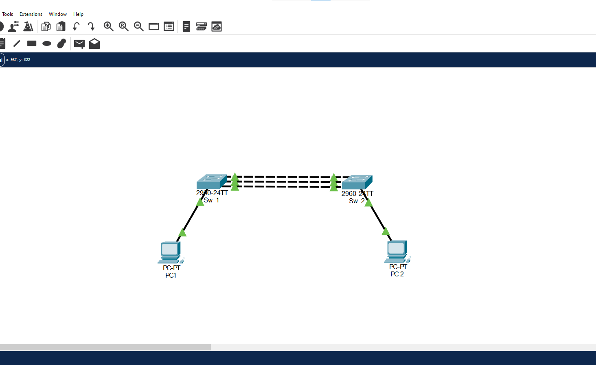
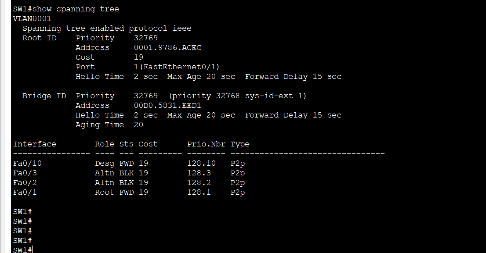
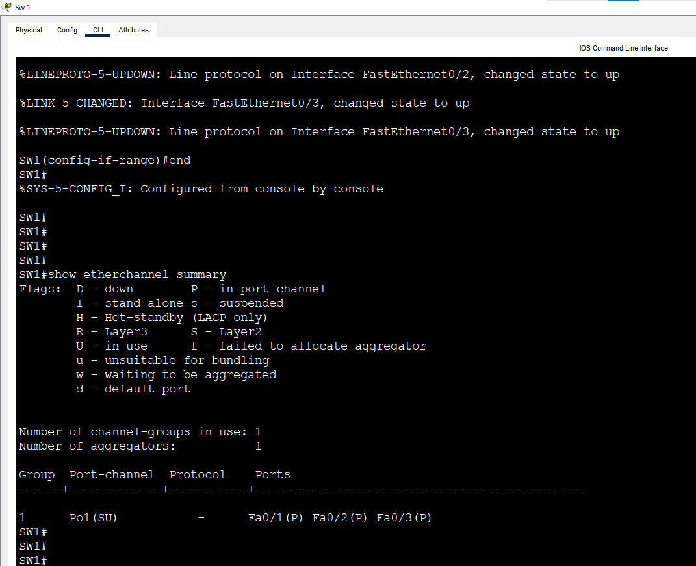
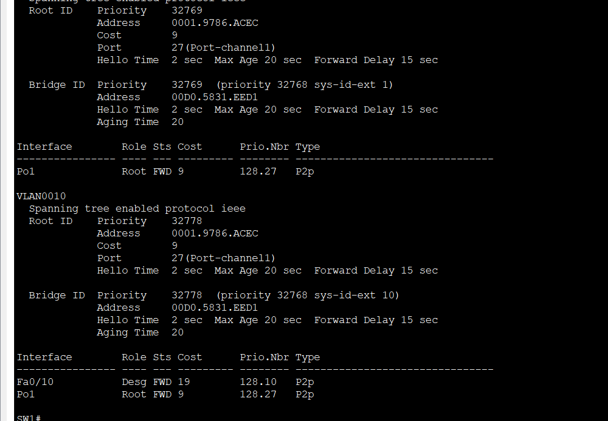
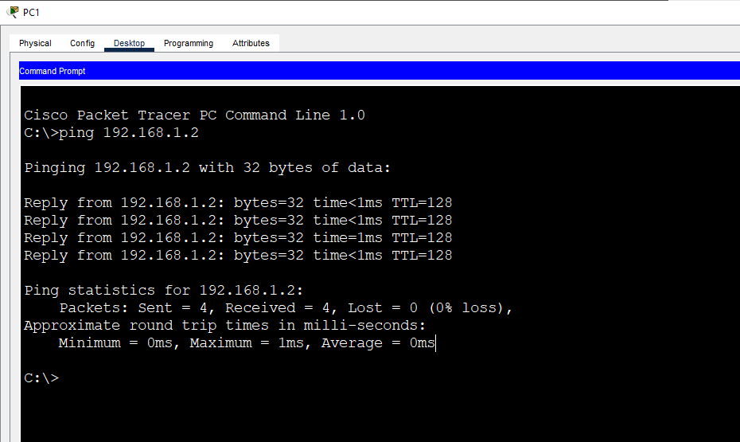

# Lab 5: EtherChannel (Static)

**Week 3 - Lab 5** | Topic: Layer 2 Redundancy & Security

## Objective
Bundle three parallel links between two switches into one logical Port-Channel using static EtherChannel (`mode on`), so that STP no longer blocks the extra links and the traffic can use all of them.

## Theory

| Concept | Description |
|---------|-------------|
| EtherChannel | Combines several physical links into one logical link |
| Port-Channel | The logical interface created for the bundle (`interface port-channel 1`) |
| Static (`mode on`) | The bundle is formed without any negotiation protocol, so both sides must be configured correctly by hand |
| Load balancing | Frames are spread over the member links by a hash of addresses, so the distribution is not always equal |
| STP | Treats the Port-Channel as one link, so no member port is blocked |
| Member requirements | Same speed, same duplex, same trunk or access mode and the same allowed VLANs on all member ports |

Without EtherChannel, STP blocks all but one of the parallel links, so the extra cables carry nothing. With EtherChannel the bandwidth is added together, and if one cable fails the others keep working without waiting for STP to reconverge.

With `mode on` there is no protocol to check the other side. A wrong or one-sided configuration is not detected and can cause a loop or shut ports down. LACP and PAgP, in the next labs, add this check.

## Topology


Two Switch 2960 devices (`SW1`, `SW2`) connected by three **Cross-Over** cables, and two PCs connected with Straight-Through cables.

| Link | Port A | Port B |
|------|--------|--------|
| SW1 to SW2 | SW1 Fa0/1 | SW2 Fa0/1 |
| SW1 to SW2 | SW1 Fa0/2 | SW2 Fa0/2 |
| SW1 to SW2 | SW1 Fa0/3 | SW2 Fa0/3 |

| Device | Switch | Port | VLAN |
|--------|--------|------|------|
| PC1 | SW1 | Fa0/10 | 10 (Sales) |
| PC2 | SW2 | Fa0/10 | 10 (Sales) |

## Addressing Table
Both PCs are in one subnet. The switches have no IP address and there is no default gateway.

| Device | IP Address | Subnet Mask |
|--------|------------|-------------|
| PC1 | 192.168.1.1 | 255.255.255.0 |
| PC2 | 192.168.1.2 | 255.255.255.0 |

## Steps

### 1. See the problem without EtherChannel
Name the switches and connect the three cables. Wait about 30 seconds.
```
enable
configure terminal
hostname SW1
end
show spanning-tree
```
Use `SW2` on the other switch. STP allows only one path between the switches. On the non-root switch one port is the root port, and the other two are alternate ports in blocking state, so two of the three cables carry nothing.



### 2. Create the VLAN and the PC ports (both switches)
```
configure terminal
vlan 10
 name Sales
 exit
interface fa0/10
 switchport mode access
 switchport access vlan 10
 end
```

### 3. Create the EtherChannel (both switches)
```
configure terminal
interface range fa0/1 - 3
 shutdown
 channel-group 1 mode on
 switchport mode trunk
 no shutdown
 end
```

| Command | Purpose |
|---------|---------|
| `interface range fa0/1 - 3` | Configures the three ports together |
| `shutdown` | Keeps the ports down during the configuration, so no temporary loop appears |
| `channel-group 1 mode on` | Adds the ports to group 1 and forms the bundle statically, without a protocol |
| `switchport mode trunk` | Makes the bundle a trunk |
| `no shutdown` | Brings the ports up after the configuration is complete |

The `channel-group` command creates the `Port-channel1` interface automatically. The group number is only local, but this lab uses 1 on both switches for simplicity.

### 4. Verify
On SW1:
```
show etherchannel summary
```

| Output | Meaning |
|--------|---------|
| `Po1(SU)` | `S` means Layer 2 and `U` means in use |
| `Fa0/1(P) Fa0/2(P) Fa0/3(P)` | `P` means the port is bundled in the Port-Channel |
| Protocol column `-` | No negotiation protocol, because the mode is static |



Also check:
```
show interfaces trunk
show spanning-tree
```
`Po1` is shown as one trunk, and the spanning tree shows only `Po1`. No port is in the alternate blocking state.



| Status flag | Meaning |
|-------------|---------|
| `P` | Bundled in the Port-Channel |
| `s` | Suspended, because the configuration does not match |
| `D` | Down |
| `I` | Stand-alone, not part of the bundle |

### 5. Test connectivity
From PC1:
```
ping 192.168.1.2
```
The ping succeeds.



### 6. Test the link failure
Start `ping -t 192.168.1.2` on PC1, then shut one member port on SW1:
```
configure terminal
interface fa0/1
 shutdown
 end
show etherchannel summary
```
The failed port is marked down, `Po1` stays `SU`, and the ping continues with no outage or with at most one lost reply. Without EtherChannel, STP would need about 30 seconds to recover. Restore the port:
```
configure terminal
interface fa0/1
 no shutdown
 end
```

### 7. Save
On both switches:
```
copy running-config startup-config
```

## Questions and Answers

**1. What is EtherChannel and why is it used?**
It bundles several physical links into one logical link. It adds the bandwidth of the links together and keeps working when one link fails, and STP does not block the extra links.

**2. What is the difference between the Port-Channel and the physical ports?**
The Port-Channel is the logical interface that represents the bundle, and STP and the trunk settings work on it. The physical ports are its members.

**3. What does `mode on` mean and what is its risk?**
It forms the bundle without a negotiation protocol. If the other side is not configured the same way, the switch cannot detect it, and the result can be a loop or ports that are shut down.

**4. Why does STP not block the ports inside an EtherChannel?**
STP sees the whole bundle as one link, so there is no redundant path between the two switches to block.

**5. Which settings must match on the member ports?**
Speed, duplex, trunk or access mode, and the allowed VLANs. A port with a different setting is suspended (`s`) or stays stand-alone (`I`).

**6. What happens if one cable fails?**
The traffic continues on the remaining links, and the bundle stays up. The bandwidth is reduced, but the outage is very short or does not appear.

## Verification
| Command / test | Run on | Expected result |
|----------------|--------|-----------------|
| `show spanning-tree` before the bundle | Both switches | Extra links blocked |
| `show etherchannel summary` | SW1 | `Po1(SU)`, Fa0/1, Fa0/2 and Fa0/3 with `P` |
| `show interfaces trunk` | SW1 | `Po1` is a trunk |
| `show spanning-tree` after the bundle | SW1 | Only `Po1`, no blocked port |
| Ping PC1 to PC2 | PC1 | Success |
| Fa0/1 shut down during `ping -t` | SW1 | Ping continues, `Po1` stays `SU` |

## Common Issues & Fixes
| Problem | Likely cause | Fix |
|---------|--------------|-----|
| Ports show `s` (suspended) | The settings do not match between the members or the two sides | Make speed, duplex and trunk settings identical |
| Ports show `I` | The ports did not join the group | Check `channel-group` on both switches |
| A loop or ports shut down | One side is configured with `mode on` and the other is not | Configure `mode on` on both sides |
| The ping fails | The VLAN does not match, or the trunk is not working | Check `show vlan brief` and `show interfaces trunk` |
| The configuration behaves strangely | The ports were configured in the wrong order | Run `no channel-group` on the ports and repeat the steps in order |

## Files
- [Download Packet Tracer Lab](./lab%205.pkt)

## Lessons Learned
- STP blocks parallel links, so extra cables are wasted without EtherChannel.
- EtherChannel combines the links into one Port-Channel that STP treats as a single link.
- In static mode, both sides must be configured by hand, and mistakes are not detected.
- If one member link fails, the bundle keeps working without waiting for STP.
