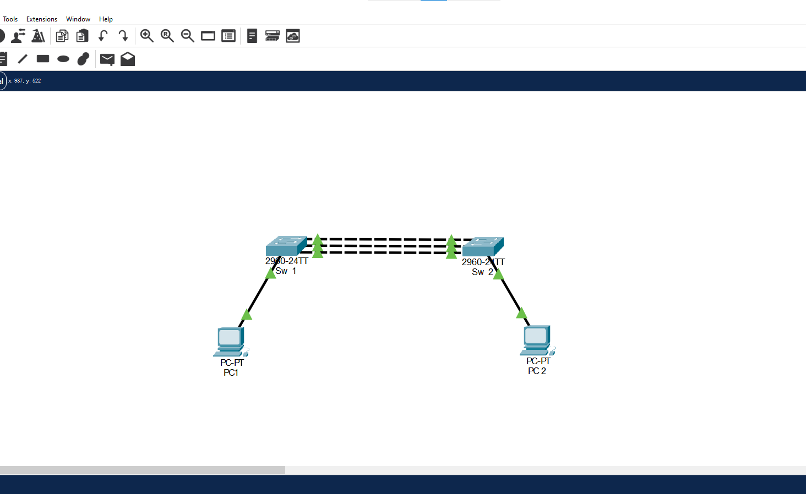
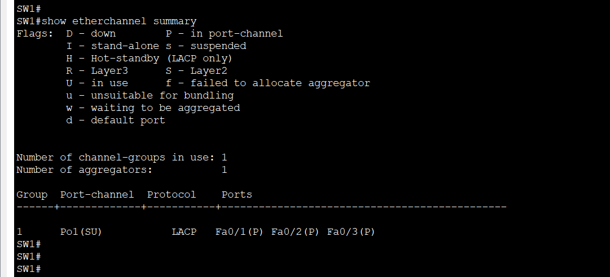
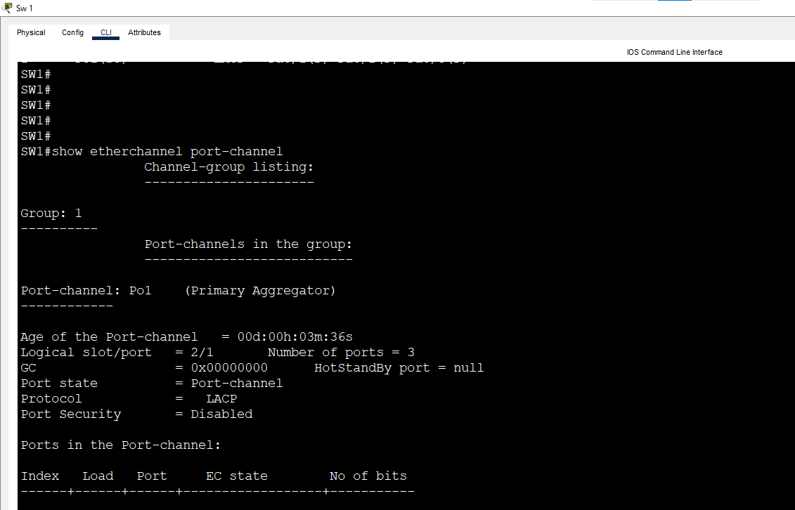
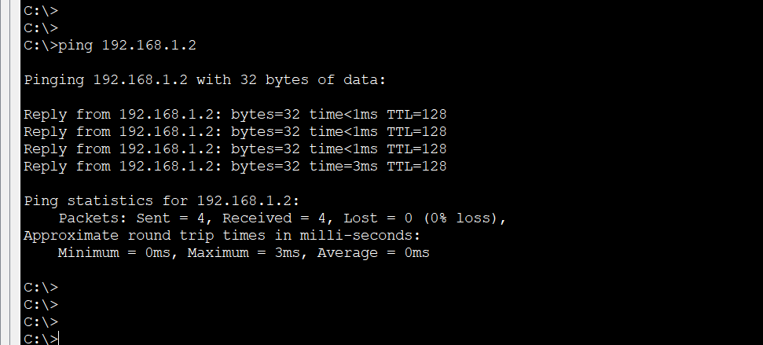
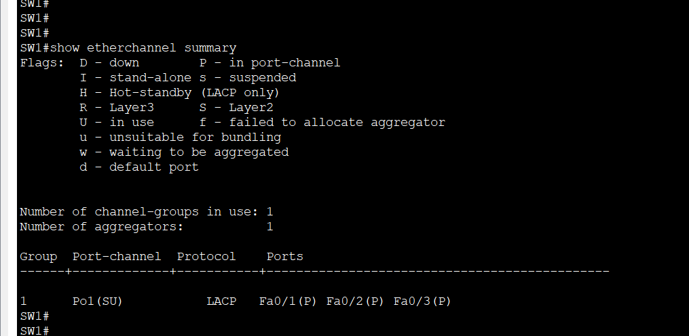

# Lab 6: EtherChannel (LACP)

**Week 3 - Lab 6** | Topic: Layer 2 Redundancy & Security

## Objective
Form an EtherChannel with LACP (IEEE 802.3ad), which negotiates the bundle between the switches, and compare it with the static `mode on` of Lab 5 by testing which mode combinations form a bundle and which do not.

## Theory

| Concept | Description |
|---------|-------------|
| LACP | An open standard protocol (802.3ad) that forms an EtherChannel by negotiation, so it works between switches of different vendors |
| `active` | The switch starts the negotiation and sends LACP packets |
| `passive` | The switch waits for LACP packets and only replies |
| `on` | Static bundle with no protocol |
| LACP priority | Decides which switch controls the choice of the active ports. The lower value is better |
| Maximum ports | Up to 16 member ports, and 8 of them active at the same time |

| Side A | Side B | Bundle |
|--------|--------|--------|
| active | active | Forms |
| active | passive | Forms |
| passive | passive | Does not form, because both sides wait |
| on | on | Forms, but without any check |
| active or passive | on | Does not form |

LACP cannot be mixed with PAgP. LACP checks the settings of both sides before it forms the bundle, so a mismatch keeps the ports out of the bundle instead of causing a loop, which is the risk of `mode on`.

## Topology


The same topology as Lab 5: two Switch 2960 devices (`SW1`, `SW2`) connected by three **Cross-Over** cables, and two PCs connected with Straight-Through cables.

| Link | Port A | Port B |
|------|--------|--------|
| SW1 to SW2 | SW1 Fa0/1 | SW2 Fa0/1 |
| SW1 to SW2 | SW1 Fa0/2 | SW2 Fa0/2 |
| SW1 to SW2 | SW1 Fa0/3 | SW2 Fa0/3 |

| Device | Switch | Port | VLAN |
|--------|--------|------|------|
| PC1 | SW1 | Fa0/10 | 10 (Sales) |
| PC2 | SW2 | Fa0/10 | 10 (Sales) |

## Addressing Table
Both PCs are in one subnet. The switches have no IP address and there is no default gateway.

| Device | IP Address | Subnet Mask |
|--------|------------|-------------|
| PC1 | 192.168.1.1 | 255.255.255.0 |
| PC2 | 192.168.1.2 | 255.255.255.0 |

## Steps

### 1. Remove the old EtherChannel (both switches)
Open the Lab 5 file and save it as `lab 6.pkt`. Then remove the static bundle:
```
enable
configure terminal
no interface port-channel 1
interface range fa0/1 - 3
 no channel-group
 end
```

| Command | Purpose |
|---------|---------|
| `no interface port-channel 1` | Deletes the old logical interface |
| `no channel-group` | Removes the ports from the group |

### 2. Configure LACP
SW1 (active):
```
configure terminal
interface range fa0/1 - 3
 shutdown
 channel-protocol lacp
 channel-group 1 mode active
 switchport mode trunk
 no shutdown
 end
```
SW2 (passive):
```
configure terminal
interface range fa0/1 - 3
 shutdown
 channel-protocol lacp
 channel-group 1 mode passive
 switchport mode trunk
 no shutdown
 end
```

| Command | Purpose |
|---------|---------|
| `channel-protocol lacp` | Selects LACP as the protocol of these ports |
| `channel-group 1 mode active` | Joins group 1 and starts the LACP negotiation |
| `channel-group 1 mode passive` | Joins group 1 and only answers LACP packets |

At least one side must be `active`.

### 3. Verify
On SW1:
```
show etherchannel summary
```
`Po1` is `SU`, the three ports are marked `P`, and the Protocol column shows `LACP`.



Check the neighbor:
```
show etherchannel port-channel
show lacp neighbor
```
The output shows the details of the other switch and the state of each member port. If `show lacp neighbor` is not supported in Packet Tracer, use `show etherchannel detail`.



### 4. Test connectivity
From PC1:
```
ping 192.168.1.2
```
The ping succeeds.



### 5. Test a wrong combination (passive and passive)
On SW1, change the mode:
```
configure terminal
interface range fa0/1 - 3
 channel-group 1 mode passive
 end
show etherchannel summary
```
The bundle is not formed, because both sides wait for the other one to start. With `mode on` the bundle would have formed without any check.



### 6. Restore the correct mode and save
On SW1:
```
configure terminal
interface range fa0/1 - 3
 channel-group 1 mode active
 end
show etherchannel summary
```
The bundle returns to `SU`. Save on both switches:
```
copy running-config startup-config
```

## Questions and Answers

**1. What is LACP and how is it different from `mode on`?**
LACP is a standard protocol that negotiates the EtherChannel and checks the settings of both sides. `mode on` forms the bundle without any protocol and without checking the other side.

**2. What is the difference between `active` and `passive`?**
An active port starts the negotiation by sending LACP packets. A passive port only replies when it receives LACP packets.

**3. Which mode combinations form a bundle?**
Active with active, and active with passive. Passive with passive does not form, and `on` forms only with `on`.

**4. Why is LACP better than the static mode?**
It detects mismatched settings before the bundle is formed, so a mistake does not cause a loop. It also works between different vendors.

**5. Can LACP be used with PAgP?**
No. PAgP is Cisco only, and the two protocols cannot negotiate with each other, so both sides must use the same protocol.

**6. What do the flags `P`, `I` and `s` mean in `show etherchannel summary`?**
`P` means the port is bundled, `I` means it is stand-alone and not in the bundle, and `s` means it is suspended because the configuration does not match.

## Verification
| Command / test | Run on | Expected result |
|----------------|--------|-----------------|
| `show etherchannel summary` | SW1 | `Po1(SU)`, Fa0/1, Fa0/2 and Fa0/3 with `P`, protocol LACP |
| `show lacp neighbor` | SW1 | Details of SW2 |
| Ping PC1 to PC2 | PC1 | Success |
| SW1 and SW2 both `passive` | SW1 | The bundle is not formed |
| SW1 returned to `active` | SW1 | `Po1(SU)` again |

## Common Issues & Fixes
| Problem | Likely cause | Fix |
|---------|--------------|-----|
| The bundle does not form | Both sides are `passive`, or the protocols are different | Set at least one side to `active` and use LACP on both |
| Ports show `s` | The settings do not match between the members | Make speed, duplex and trunk settings identical |
| `channel-protocol` is rejected | The port is already in a group with another protocol | Run `no channel-group` first and repeat |
| `active` with `on` does not form | Static mode cannot negotiate | Use the same protocol on both sides |
| `show lacp neighbor` is not recognized | A limit of Packet Tracer | Use `show etherchannel detail` |

## Files
- [Download Packet Tracer Lab](./lab%206.pkt)

## Lessons Learned
- LACP forms the EtherChannel by negotiation, and it works between different vendors.
- At least one side must be `active`, and passive with passive never forms a bundle.
- LACP checks the settings of both sides, so a mistake does not create a loop like it can with `mode on`.
- Both sides must use the same protocol, so LACP and PAgP cannot be mixed.
