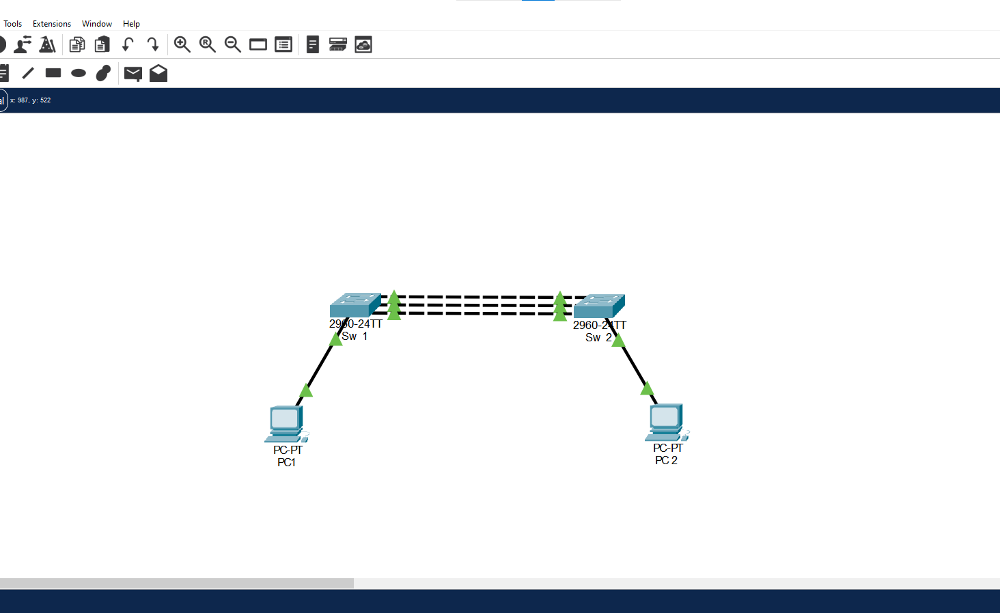
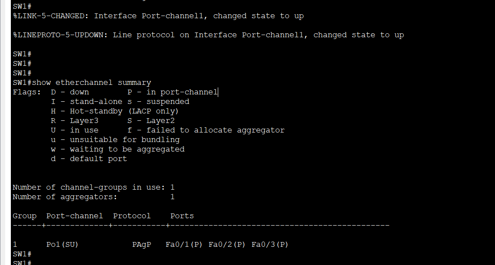
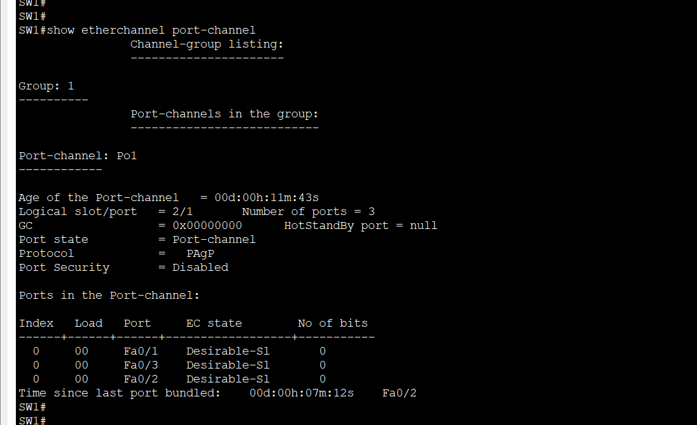
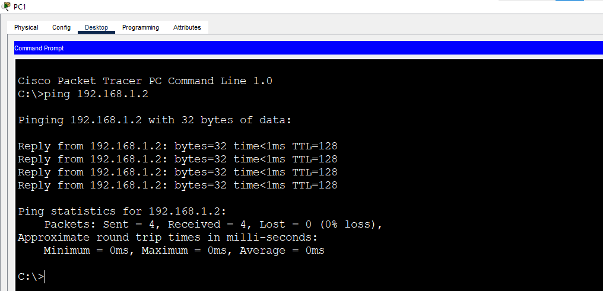
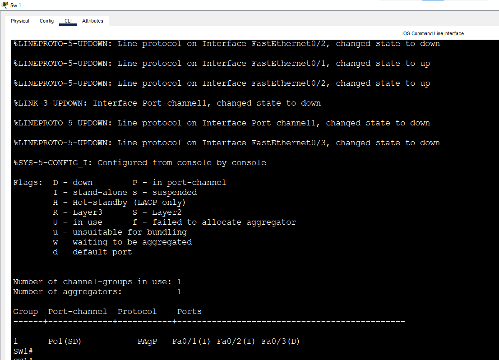

# Lab 7: EtherChannel (PAgP)

**Week 3 - Lab 7** | Topic: Layer 2 Redundancy & Security

## Objective
Form an EtherChannel with PAgP, the Cisco proprietary negotiation protocol, and compare its modes (`desirable` and `auto`) with LACP and with the static `mode on` of the previous labs.

## Theory

| Concept | Description |
|---------|-------------|
| PAgP | Port Aggregation Protocol. A Cisco proprietary protocol that forms an EtherChannel by negotiation |
| `desirable` | The switch starts the negotiation (the equivalent of `active` in LACP) |
| `auto` | The switch waits and only replies (the equivalent of `passive` in LACP) |
| `on` | Static bundle with no protocol |
| Maximum ports | Up to 8 ports in a group |

| Side A | Side B | Bundle |
|--------|--------|--------|
| desirable | desirable | Forms |
| desirable | auto | Forms |
| auto | auto | Does not form, because both sides wait |
| on | on | Forms, but without any check |
| desirable or auto | on | Does not form |

| | LACP | PAgP | Static |
|---|------|------|--------|
| Standard | IEEE 802.3ad (open) | Cisco only | No protocol |
| Modes | active / passive | desirable / auto | on |
| Negotiation and checking | Yes | Yes | No |

PAgP and LACP cannot be mixed in the same bundle. A port that still has the configuration of one protocol must be cleaned before the other protocol is applied.

## Topology


The same topology as Lab 6: two Switch 2960 devices (`SW1`, `SW2`) connected by three **Cross-Over** cables, and two PCs connected with Straight-Through cables.

| Link | Port A | Port B |
|------|--------|--------|
| SW1 to SW2 | SW1 Fa0/1 | SW2 Fa0/1 |
| SW1 to SW2 | SW1 Fa0/2 | SW2 Fa0/2 |
| SW1 to SW2 | SW1 Fa0/3 | SW2 Fa0/3 |

| Device | Switch | Port | VLAN |
|--------|--------|------|------|
| PC1 | SW1 | Fa0/10 | 10 (Sales) |
| PC2 | SW2 | Fa0/10 | 10 (Sales) |

## Addressing Table
Both PCs are in one subnet. The switches have no IP address and there is no default gateway.

| Device | IP Address | Subnet Mask |
|--------|------------|-------------|
| PC1 | 192.168.1.1 | 255.255.255.0 |
| PC2 | 192.168.1.2 | 255.255.255.0 |

## Steps

### 1. Remove the old LACP configuration (both switches)
Open the Lab 6 file and save it as `lab 7.pkt`. The ports still carry the LACP settings, and they block the PAgP commands, so remove them first:
```
enable
configure terminal
no interface port-channel 1
interface range fa0/1 - 3
 no channel-group
 no channel-protocol
 end
show running-config interface fa0/1
```

| Command | Purpose |
|---------|---------|
| `no interface port-channel 1` | Deletes the old logical interface |
| `no channel-group` | Removes the ports from the old group |
| `no channel-protocol` | Removes the old protocol (LACP) from the ports |

The interface must show only `switchport mode trunk`, with no line that starts with `channel-`. If a `channel-` line remains, the PAgP commands are not applied: in this lab the old line `channel-protocol lacp` left the summary empty (`Number of channel-groups in use: 0`) until it was removed.

### 2. Configure PAgP
SW1 (desirable):
```
configure terminal
interface range fa0/1 - 3
 channel-protocol pagp
 channel-group 1 mode desirable
 switchport mode trunk
 end
```
SW2 (auto):
```
configure terminal
interface range fa0/1 - 3
 channel-protocol pagp
 channel-group 1 mode auto
 switchport mode trunk
 end
```

| Command | Purpose |
|---------|---------|
| `channel-protocol pagp` | Selects PAgP as the protocol of these ports |
| `channel-group 1 mode desirable` | Joins group 1 and starts the PAgP negotiation |
| `channel-group 1 mode auto` | Joins group 1 and only answers PAgP packets |

The group number must be 1 or higher, because 0 is not a valid group. At least one side must be `desirable`. Until the second switch is configured, SW1 shows `Po1(SD)` with the ports as `I`, because it has no neighbor yet.

### 3. Verify
On SW1, after about 30 seconds:
```
show etherchannel summary
```
```
Group  Port-channel  Protocol    Ports
1      Po1(SU)       PAgP        Fa0/1(P) Fa0/2(P) Fa0/3(P)
```
`Po1` is `SU` (Layer 2, in use), the three ports are `P` (bundled), and the protocol is `PAgP`.



Check the neighbor:
```
show etherchannel port-channel
show pagp neighbor
```
If `show pagp neighbor` is not supported in Packet Tracer, use `show etherchannel detail`.



### 4. Test connectivity
From PC1:
```
ping 192.168.1.2
```
The ping succeeds. If the first request times out, repeat it.



### 5. Test a wrong combination (auto and auto)
On SW1:
```
configure terminal
interface range fa0/1 - 3
 channel-group 1 mode auto
 end
show etherchannel summary
```
The bundle is not formed, because both sides wait for the other one to start.



### 6. Restore the correct mode and save
On SW1:
```
configure terminal
interface range fa0/1 - 3
 channel-group 1 mode desirable
 end
show etherchannel summary
```
`Po1` returns to `SU`. Save on both switches:
```
copy running-config startup-config
```

## Questions and Answers

**1. What is PAgP and how is it different from LACP?**
PAgP is a Cisco proprietary protocol that forms an EtherChannel by negotiation. LACP does the same job but is an open IEEE standard (802.3ad), so it also works between different vendors.

**2. What is the difference between `desirable` and `auto`?**
A `desirable` port starts the negotiation by sending PAgP packets. An `auto` port only replies when it receives PAgP packets.

**3. Which mode combinations form a bundle?**
Desirable with desirable, and desirable with auto. Auto with auto does not form, and `on` forms only with `on`.

**4. Why can PAgP and LACP not be mixed?**
They are different protocols with different packets, so the two sides cannot negotiate with each other. Both sides must use the same protocol.

**5. When is PAgP used and when LACP?**
PAgP only works between Cisco devices. LACP is preferred in mixed networks and is the common choice today, because it is an open standard.

**6. Why did the PAgP commands not work in the lab at first?**
The ports still had the LACP configuration of the previous lab. The old `channel-protocol lacp` blocked the new commands, and the summary showed no channel group. After `no channel-group` and `no channel-protocol`, the PAgP bundle formed.

## Verification
| Command / test | Run on | Expected result |
|----------------|--------|-----------------|
| `show running-config interface fa0/1` after cleaning | SW1, SW2 | No line that starts with `channel-` |
| `show etherchannel summary` before SW2 is configured | SW1 | `Po1(SD)`, ports `I` |
| `show etherchannel summary` after both sides | SW1 | `Po1(SU)`, Fa0/1, Fa0/2 and Fa0/3 with `P`, protocol PAgP |
| Ping PC1 to PC2 | PC1 | Success |
| SW1 and SW2 both `auto` | SW1 | The bundle is not formed |
| SW1 returned to `desirable` | SW1 | `Po1(SU)` again |

## Common Issues & Fixes
| Problem | Likely cause | Fix |
|---------|--------------|-----|
| `Number of channel-groups in use: 0` | Old LACP settings are still on the ports, or the group number is 0 | Run `no channel-group` and `no channel-protocol`, then use group 1 |
| `Po1(SD)` with ports `I` | The other switch is not configured yet | Configure the second switch |
| The bundle does not form | Both sides are `auto`, or the protocols are different | Set at least one side to `desirable` and use PAgP on both |
| Ports show `s` | The settings do not match between the members | Make speed, duplex and trunk settings identical |
| `show pagp neighbor` is not recognized | A limit of Packet Tracer | Use `show etherchannel detail` |

## Files
- [Download Packet Tracer Lab](./lab%207.pkt)

## Lessons Learned
- PAgP is the Cisco proprietary negotiation protocol, with the modes `desirable` and `auto`.
- At least one side must be `desirable`, and auto with auto never forms a bundle.
- PAgP and LACP cannot be mixed, and the old protocol configuration must be removed before changing the protocol.
- `show etherchannel summary` shows the protocol, the state of the Port-Channel and the state of every member port.
