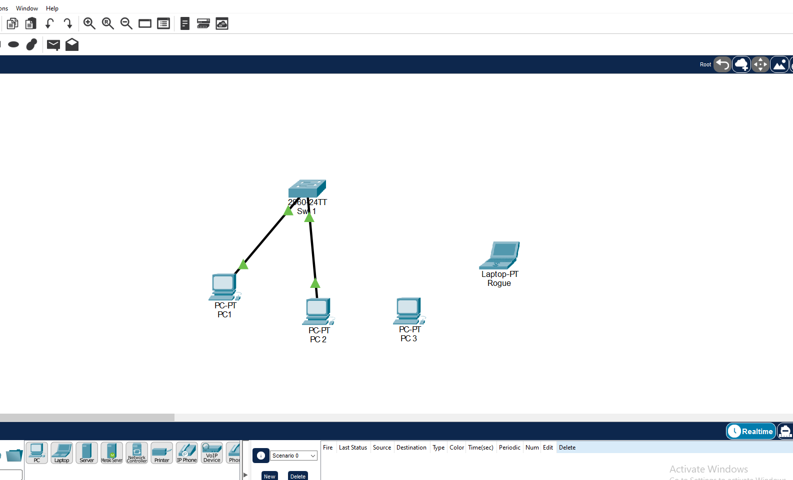
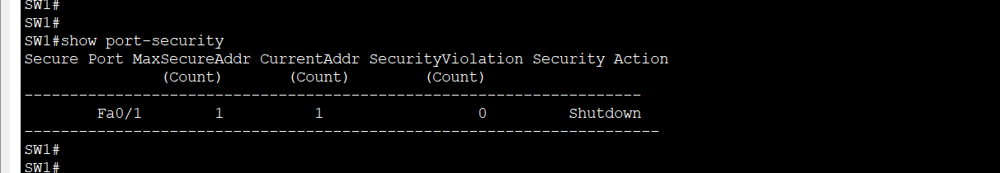
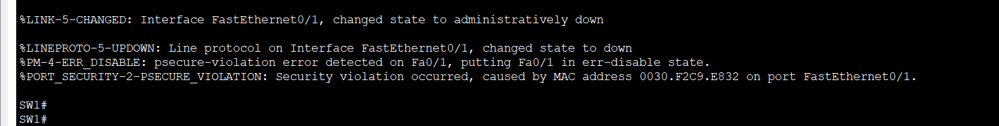
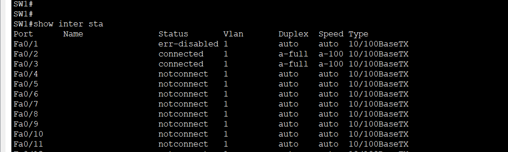
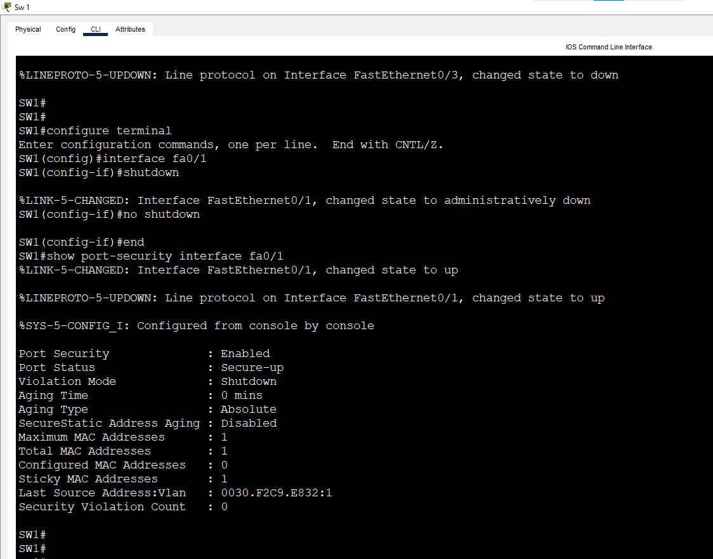

# Lab 8: Port Security

**Week 3 - Lab 8** | Topic: Layer 2 Redundancy & Security

## Objective
Limit which devices can use a switch port by their MAC address, learn the allowed address with sticky learning, and test what each violation mode does when an unknown device is connected.

## Theory

| Concept | Description |
|---------|-------------|
| Port Security | Restricts the MAC addresses that are allowed on an access port |
| Maximum | The number of MAC addresses allowed on the port. The default is 1 |
| Static | The MAC address is typed by hand with `switchport port-security mac-address <MAC>` |
| Dynamic | The switch learns the address, but it is not kept after a restart |
| Sticky | The switch learns the address and writes it to the running configuration |
| Violation | Happens when an unknown MAC arrives, or when the maximum is exceeded |

| Violation mode | Behavior | Log message | Violation counter |
|----------------|----------|-------------|-------------------|
| `shutdown` (default) | Puts the port in the `err-disabled` state | Yes | Yes |
| `restrict` | Drops the unknown traffic and the port stays up | Yes | Yes |
| `protect` | Drops the unknown traffic silently | No | No |

Port Security works only on a static access port or a static trunk port, so `switchport mode access` must be configured first. After a `shutdown` violation the port must be reset manually, like with BPDU Guard.

## Topology


One Switch 2960 (`SW1`) and PCs connected with Straight-Through cables. `PC3` is the unauthorized device, and `ROGUE` is a second unauthorized device used in the optional test.

| Device | Switch | Port | VLAN |
|--------|--------|------|------|
| PC1 | SW1 | Fa0/1 | 1 |
| PC2 | SW1 | Fa0/2 | 1 |
| PC3 (unauthorized) | Connected to Fa0/1 in step 4 | Fa0/1 | 1 |
| ROGUE (unauthorized) | Connected to Fa0/2 in step 6 | Fa0/2 | 1 |

## Addressing Table
All devices are in the default VLAN 1 and in one subnet. The switch has no IP address and there is no default gateway.

| Device | IP Address | Subnet Mask |
|--------|------------|-------------|
| PC1 | 192.168.1.1 | 255.255.255.0 |
| PC2 | 192.168.1.2 | 255.255.255.0 |
| PC3 | 192.168.1.3 | 255.255.255.0 |
| ROGUE | 192.168.1.99 | 255.255.255.0 |

## Steps

### 1. Prepare the network
```
enable
configure terminal
hostname SW1
end
```
Connect PC1 to Fa0/1 and PC2 to Fa0/2, and set the IP addresses. Test that PC1 can ping PC2 before any security is enabled.

### 2. Enable Port Security on Fa0/1 (sticky)
```
configure terminal
interface fa0/1
 switchport mode access
 switchport port-security
 switchport port-security maximum 1
 switchport port-security mac-address sticky
 switchport port-security violation shutdown
 end
```

| Command | Purpose |
|---------|---------|
| `switchport mode access` | Required before Port Security can be enabled |
| `switchport port-security` | Enables the feature on the port |
| `switchport port-security maximum 1` | Allows only one device |
| `switchport port-security mac-address sticky` | Learns the MAC of the connected device and saves it in the running configuration |
| `switchport port-security violation shutdown` | Shuts the port down on a violation. It is the default and is typed here to make it clear |

Send traffic from PC1, for example `ping 192.168.1.2`, so that the switch learns its MAC address.

### 3. Verify
```
show port-security
show port-security interface fa0/1
show running-config interface fa0/1
```
- `show port-security` lists the maximum, the current number of addresses, the violation count and the action.
- `show port-security interface fa0/1` shows `Port Status: Secure-up` and `Violation Mode: Shutdown`.
- The running configuration contains a line `switchport port-security mac-address sticky <MAC of PC1>`.



### 4. Test a violation
Disconnect PC1 from Fa0/1 and connect PC3 to the same port, then send traffic from PC3, for example `ping 192.168.1.2`. The unknown MAC address causes a violation, the link light turns red, and SW1 prints a message like this:
```
%PM-4-ERR_DISABLE: psecure-violation error detected on Fa0/1, putting Fa0/1 in err-disable state
```



Verify:
```
show interfaces status
show port-security interface fa0/1
```
Fa0/1 is `err-disabled`, and the security violation count increased.



### 5. Restore the port
Connect the original PC1 back to Fa0/1, then reset the port:
```
configure terminal
interface fa0/1
 shutdown
 no shutdown
 end
show port-security interface fa0/1
```
The port returns to `Secure-up`, and PC1 can ping PC2 again.



To allow PC3 instead of PC1, clear the learned address and let the port learn again:
```
configure terminal
interface fa0/1
 no switchport port-security mac-address sticky
 switchport port-security mac-address sticky
 end
```
Then reset the port with `shutdown` and `no shutdown`.

### 6. Compare the restrict mode on Fa0/2 (optional)
```
configure terminal
interface fa0/2
 switchport mode access
 switchport port-security
 switchport port-security maximum 1
 switchport port-security mac-address sticky
 switchport port-security violation restrict
 end
```
Let PC2 send traffic so the address is learned, then replace PC2 with `ROGUE`. The port is **not** shut down and stays `Secure-up`, but the traffic of the unknown device is dropped. `show port-security interface fa0/2` shows the increasing violation count.

### 7. Save
```
copy running-config startup-config
```

## Questions and Answers

**1. What is Port Security and why is it used?**
It controls which devices may use a switch port by their MAC address. It stops an unknown device from being plugged into a free port in the office.

**2. What is the difference between static, dynamic and sticky?**
Static addresses are typed by hand. Dynamic addresses are learned by the switch but are lost after a restart. Sticky addresses are learned automatically and saved in the running configuration, so they are kept if the configuration is saved.

**3. What are the three violation modes?**
`shutdown` puts the port in `err-disabled`, with a log message and a counter. `restrict` drops the unknown traffic and keeps the port up, with a log message and a counter. `protect` drops the unknown traffic silently, without a message or a counter.

**4. What happens to the port in shutdown mode and how is it restored?**
The port goes to the `err-disabled` state and carries no traffic. After the cause is removed, it is restored with `shutdown` followed by `no shutdown`.

**5. Why must the port be an access port?**
Port Security does not work on a port that can negotiate its mode dynamically. The port must be set statically to access (or trunk) first.

**6. What happens if the number of MAC addresses exceeds the maximum?**
It is a violation, and the switch applies the configured violation mode. With the default `shutdown` mode, the port is shut down.

## Verification
| Command / test | Run on | Expected result |
|----------------|--------|-----------------|
| `show port-security interface fa0/1` | SW1 | `Secure-up`, maximum 1, mode Shutdown |
| `show running-config interface fa0/1` | SW1 | The sticky MAC of PC1 is listed |
| PC3 connected to Fa0/1 | SW1 | `err-disable` message, port `err-disabled` |
| `shutdown`, `no shutdown` with PC1 connected | SW1 | Fa0/1 returns to `Secure-up` |
| ROGUE connected to Fa0/2 (restrict) | SW1 | Port stays up, violation count increases |

## Common Issues & Fixes
| Problem | Likely cause | Fix |
|---------|--------------|-----|
| The command is rejected because the port is dynamic | The port mode is not configured | Run `switchport mode access` first |
| The port does not come back after `no shutdown` | The unauthorized device is still connected | Connect the original device or clear the sticky address |
| The sticky MAC is not in the configuration | No traffic was sent yet | Send a ping from the device |
| The port is not shut down by an unknown device | The maximum is higher than 1, or the switch learned both devices | Check `show port-security interface` |
| `show port-security` shows nothing | The feature is not enabled on any port | Run `switchport port-security` on the port |

## Files
- [Download Packet Tracer Lab](./lab%208.pkt)

## Lessons Learned
- Port Security allows only the expected MAC addresses on an access port.
- Sticky learning saves the learned address in the running configuration.
- The `shutdown` mode puts the port in `err-disabled`, and the port must be reset manually after the cause is removed.
- The `restrict` and `protect` modes keep the port up and only drop the unknown traffic.
